# Agent ผ่าน MCP ใน LINE OA 18 ตุลาคม 2569

## ข้อตกลง

ใช้ Agent ในแอป รับงานจากแชท LINE โดยใช้ AI API และรุ่นที่ตั้งค่าในเว็บอยู่แล้ว
รองรับงานเดิมตามสิทธิ์ผู้แจ้ง เจ้าหน้าที่ Supervisor และแอดมิน เปลี่ยนข้อมูลหลังผู้ใช้ยืนยัน
เมื่อ AI หรือ MCP ขัดข้อง ผู้ใช้ทำต่อผ่านเมนูและคำสั่งเดิมได้ โค้ด MCP อยู่ใน production release `e9b124b31768` แล้ว ตรวจ runtime วันที่ 18 ตุลาคมพบว่า AI และ MCP เปิดใช้พร้อมรุ่น AI ที่ตั้งค่าในเว็บ

## เส้นทางทำงาน

```mermaid
flowchart LR
    L[LINE signed webhook] --> Q[Inbox / outbox / n8n lease]
    Q --> A[Agent ใช้ AI profile เดิม]
    A --> C[MCP Client]
    C --> S[MCP Server ผูกบัญชี LINE]
    S --> R[ค้นข้อมูลในสิทธิ์ / เตรียมคำสั่ง]
    R --> U[แสดงข้อมูลหรือสรุปพร้อมปุ่ม]
    U --> H[ผู้ใช้ยืนยัน]
    H --> E[MCP execute_confirmed_action]
    E --> D[LINE dispatcher / domain services เดิม]
    D --> V[ตรวจสิทธิ์และสถานะล่าสุด]
```

ใช้ official Python MCP SDK รุ่น 1.x ที่ล็อกใน `uv.lock` มี initialize, tools/list และ tools/call
ผ่าน memory transport ภายใน Django ไม่เปิด endpoint MCP สาธารณะ ไม่ต้องเพิ่มบัญชีบริการ
หรือส่ง LINE access token ให้โมเดล และไม่ต้องติดตั้ง LINE Bot MCP แยก
โมเดลเลือกเครื่องมือเป็น JSON จึงใช้กับ API เดิมที่รองรับ chat completions ได้
หนึ่งข้อความเลือกเครื่องมือได้หนึ่งครั้ง หรือตอบคำถามเกี่ยวกับบริการโดยใช้ข้อมูลระบบและคลังคำตอบที่รับรองแล้ว ส่วนข้อมูลสำหรับส่งเรื่องที่ขาดถามต่อผ่านขั้นตอนเดิม

## เครื่องมือ

| เครื่องมือ | ขอบเขต |
|---|---|
| get_context | เมนูที่แสดงอยู่และคำสั่งตามสิทธิ์ ไม่มี key หรือ LINE ID |
| list_cases / get_case | เรื่องของผู้แจ้งเท่านั้น หรือเรื่องในสิทธิ์เจ้าหน้าที่; หน้าแรกเป็นเรื่องที่ยังไม่จบ |
| list_orders | งานสั่งที่บัญชีเจ้าหน้าที่เห็นได้ |
| list_equipment | รายการอุปกรณ์ที่ใช้งานและหมวด LINE ที่ตั้งค่าในเว็บ |
| admin_directory | คำขอรับรองและผู้ใช้ LINE เฉพาะแอดมิน |
| prepare_action | เลือกปุ่มปัจจุบันหรือเตรียมคำสั่งงานเดิม เช่น approve, เพิ่ม/ถอนสิทธิ์ หรือสั่งงาน; เมนูบริการที่กำหนดไว้เปิดได้ทันที ส่วนคำสั่งเปลี่ยนข้อมูลต้องยืนยัน |
| execute_confirmed_action | เปิดให้ตัวจัดการการยืนยันของระบบเท่านั้น โมเดลไม่มีเครื่องมือนี้ |

ผลรายการมีปุ่มรายละเอียด/เปลี่ยนหน้า เมื่อเป็นการเปิดรายละเอียดใช้ขั้นตอนเดิม
การเบิก คืน แจ้งปัญหา และการกรอกข้อมูลใช้ตัวสกัดร่าง/ฟอร์มเดิม จึงคงกติกาและการยืนยันเดิม
คำสั่ง Supervisor ที่ยังเป็นร่างต้องยืนยันสรุปงานสุดท้ายก่อนสร้างงานจริง
การเชื่อมบัญชี/OTP/ยืนยันพนักงานยังทำตามหลักฐานเดิม ไม่เปิดให้ Agent ข้าม

## การตรวจสิทธิ์และคำสั่งซ้ำ

- ผู้กระทำมาจาก webhook ที่ตรวจลายเซ็นแล้ว MCP ไม่รับ actor/role/LINE ID จากโมเดล
- ตรวจสิทธิ์ทุกครั้งที่เรียกเครื่องมือ และใช้ domain services เดิมตอนดำเนินการ
- การยืนยันผูก AIRun, LINE identity, สถานะร่าง, prompt และสิทธิ์เจ้าหน้าที่
- ถ้าเปลี่ยนขั้นตอน เปิดเมนูใหม่ ถอนสิทธิ์ หรือใช้ปุ่มของผู้อื่น จะไม่ใช้คำสั่งเก่า
- บันทึกการยืนยัน/ยกเลิกและ inbox ที่ยืนยันใน AIRun.result; ปุ่มยืนยันซ้ำไม่ทำงานซ้ำ
- คำสั่งที่เลือกปุ่มเดิมแสดงสรุปจากข้อความระบบเดิมด้วย เพื่อให้ตรวจเป้าหมายก่อนยืนยัน
- ข้อมูลส่ง AI ผ่านตัว mask เดิม; ข้อความเกี่ยวกับลูกค้าในงานการใช้ไฟฟ้าและผู้แจ้งนิรนามคงข้อจำกัดเดิม

## เปิดใช้และตรวจสอบ

`AI_ENABLED=true` และ `AI_MCP_ENABLED=true` พร้อมรุ่น AI ที่เปิดใช้แล้ว
หน้า `/console/admin/ai/` แสดงสถานะ MCP และรุ่น AI เดิม ค่าปริยาย MCP เป็น true แต่ไม่ทำงานหากปิด AI
ตั้ง `AI_MCP_ENABLED=false` เพื่อใช้กระบวนการสกัดร่างเดิมโดยไม่ผ่านตัวเลือกเครื่องมือ
ไม่ต้องเพิ่ม migration หรือเปลี่ยน workflow n8n; ยังคง event `conversation.ai_requested`
และ endpoint `/internal/v1/ai/extract` พร้อม lease/watchdog เดิม

ทดสอบด้วย `operations.tests.test_m14_agent_mcp` ซึ่งใช้ session MCP จริง
และ API จำลองสำหรับตรวจการยืนยัน, สิทธิ์, การทำซ้ำ, rollback และ fallback
การทดสอบ API จริงใช้ข้อมูลจำลองใน transaction แล้ว rollback และปิดการเรียก LINE
ผลตรวจ local ไม่แทนผลทดสอบ webhook บน OCI หลัง deploy

## ผลตรวจส่งมอบ

- ชุดรวม workflow เดิมและ MCP: 61 tests ผ่าน
- หลังเพิ่มการกันผลเก่าและ fallback: 28 tests ผ่าน (ซ้ำบางส่วนกับชุดรวม)
- ชุด MCP ก่อนปรับเมนู: 17 tests ผ่าน รวมพนักงานที่มีร่างเบิกและการเปลี่ยนบัญชีผู้แจ้งระหว่างรอ
- Ruff check/format, Django check, migration drift และ git diff whitespace ผ่าน
- API จริงเลือกเครื่องมือถูกในสามข้อความจำลอง: ติดตามเรื่อง, เปิดเมนูส่งเรื่อง, ค้นอุปกรณ์
- หน้า admin AI HTTP 200 ภายใต้บัญชีทดสอบชั่วคราว; local health ok
- ไม่มีการส่งข้อความ LINE จริงระหว่างการทดสอบ เครื่องมือ MCP และ API จริงบน OCI ตรวจเพิ่มในรอบ deploy เมนูแบบกระชับ

## เมนูแบบกระชับ

คำสั่งที่ Agent เห็นสอดคล้องกับสิทธิ์ปัจจุบัน: บริการ แจ้งปัญหา ติดตามเรื่องของฉัน และเบิก/ส่งคืนอุปกรณ์สำหรับผู้มีสิทธิ์ เจ้าหน้าที่มีงานของกองและเมนูเพิ่มเติม ส่วน Supervisor และแอดมินมีคำสั่งตามบทบาทเดิม การถอนสิทธิ์หรือเปลี่ยนบัญชีก่อนยืนยันทำให้คำสั่งเดิมใช้ไม่ได้

## ผลตรวจหลัง deploy เมนูแบบกระชับ

Production release `669abf70b213` เปิด `AI_ENABLED` และ `AI_MCP_ENABLED` แล้ว ทดสอบ session MCP จริงและ AI API ที่ตั้งค่าในเว็บ ค้นเรื่องของตนเองผ่าน `list_cases`, ค้นอุปกรณ์ผ่าน `list_equipment` และเตรียมเมนูบริการผ่าน `prepare_action` สำเร็จ การตรวจนี้ใช้เครื่องมืออ่านข้อมูลและเตรียมคำสั่ง ส่วนการดำเนินงานหลังยืนยัน สิทธิ์ คำสั่งซ้ำ และผลเก่าอยู่ในชุด MCP 18 tests ซึ่งผ่านพร้อม CI รวม 902 tests ดู [รายงาน deploy](line-deployment-2026-10-18.md)

## แพตช์การสนทนา 18 ตุลาคม 2569

พบว่า planner เดิมรองรับเพียงเลือกเครื่องมือหรือคืนข้อความไปขั้นตอนรับเรื่อง จึงตีความ “สวัสดี ทำอะไรได้บ้าง” เป็นเปิดเมนูและขอยืนยัน แพตช์ให้ AI ตอบก่อนแม่แบบเมื่อเปิด Agent เพิ่มการตอบบริการตามสิทธิ์ การตอบคำถาม/ถามข้อมูลที่ขาดด้วย AI API เดิม และใช้บทสนทนา Agent ล่าสุดไม่เกินสองครั้งภายใน 20 นาที เฉพาะบัญชี สิทธิ์ และขั้นตอนเดิม ไม่ดึงข้อความนิรนามหรือเรื่องของผู้อื่นเข้าบริบท

ผลอ่านรายการเรื่อง งานสั่ง และอุปกรณ์จาก MCP ส่งให้โมเดลเรียบเรียงคำตอบได้ภายในงบเวลาเดิม โดยเห็นเฉพาะข้อมูลที่เครื่องมืออนุญาต หากเรียบเรียงไม่ได้แสดงข้อมูลและปุ่มจากระบบ การตอบข้อความตรวจรูปแบบ ตัวเลข เลขเรื่อง ลิงก์ และถ้อยคำรับปากด้วยตัวตรวจคำตอบเดิม การเปิดเมนูบริการที่กำหนดไว้ไม่ต้องยืนยัน แต่ส่งเรื่อง รับรอง และเปลี่ยนสิทธิ์ยังต้องยืนยันและตรวจสิทธิ์ล่าสุด

การค้นอุปกรณ์ตรวจหมวดจากข้อความผู้ใช้ด้วยตัวกรองเดียวกับเมนู มิเตอร์ / CT / VT / อุปกรณ์อื่น หากโมเดลส่งคำค้นว่างจึงไม่คืนอุปกรณ์ทั้งหมดแล้วสรุปปนหมวด CT/VT ที่ยังไม่มีรายการจะได้ผลว่างตามจริง การเปลี่ยนหน้ารักษาหมวดเดิม

CI ผ่าน 5 ขั้น รวม 908 tests จากนั้นตรวจโค้ดฉบับสุดท้ายและชุด MCP/การสนทนาที่เกี่ยวข้อง 59 tests ผ่าน (ซ้ำบางส่วนกับชุดรวม) การทดสอบ AI API จริงจาก Local สนทนาต่อเนื่องสามข้อความและค้นอุปกรณ์ผ่าน MCP สำเร็จ

Deploy รุ่น `1c81755c7ba8` บน OCI E5 เวลา 15:31 น. วันที่ 18 ตุลาคม 2569 สำรอง `20261014-145320F_20261018-083022I` ก่อนเปลี่ยนรุ่น ตรวจ hash โค้ดสี่ไฟล์ตรง Local, services healthy, maintenance off, readiness และ signed empty webhook HTTP 200 ทดสอบ “สวัสดี ทำอะไรได้บ้าง” → “แล้วควรเริ่มจากตรงไหนก่อน” → “ค้นหารายการมิเตอร์” ด้วย AI API จริงบน OCI ได้คำตอบสนทนาและพบมิเตอร์ 1 รายการ ไม่มีหม้อแปลงปน การทดสอบใช้บัญชีจำลองใน transaction แล้ว rollback และปิดการส่ง LINE ยังไม่ได้ทดสอบบนโทรศัพท์จริง

## Typhoon 2.5 แบบ JSON schema และ temperature 0.4 (21 ตุลาคม 2569)

ผู้ใช้สั่งให้ Agent สกัดร่างและตอบแชตด้วย `typhoon-v2.5-30b-a3b-instruct` แบบ JSON schema ที่ temperature 0.4 และให้ทำเครื่องมือตามสมุดงาน Agentic AI (Super AI Level 2) งานนี้อยู่บน branch `dev` เท่านั้น ยังไม่ได้ push หรือ deploy

### ข้อเท็จจริงจาก API จริง

ตรวจด้วยข้อความจำลองวันที่ 21 ตุลาคม 2569

- OpenTyphoon ยังรับ `response_format` โดยไม่บังคับ ทั้งแบบ `json_schema` และ `json_object` คำตอบออกมาเป็นข้อความธรรมดา ผลเหมือนที่ตรวจไว้วันที่ 7 ตุลาคม
- `max_tokens` นับเฉพาะคำตอบ prompt 2,421 token กับ `max_tokens` 40 ตอบได้ปกติ หมายเหตุในสมุดงานที่ว่านับรวม prompt ไม่ตรงกับ API ตอนนี้
- คำตอบที่ถูกตัดที่ `max_tokens` มี `finish_reason` เป็น `length`
- เรียกเครื่องมือแบบ native (`tools`) ได้ ยังไม่ได้ใช้ เพราะโมเดลสำรองของ ThaiLLM อาจไม่รองรับ

### สิ่งที่เปลี่ยน

- `ai.chat_json` เป็นทางเรียกเดียวของงานสกัดร่าง ตอบแชต ถามต่อ และ Agent ส่ง `response_format` แบบ strict เมื่อโปรไฟล์เปิด JSON schema และใส่ schema เดียวกันใน prompt ด้วย เว้นแต่ host อยู่ใน `AI_SCHEMA_ENFORCED_HOSTS` (ค่าเริ่มต้น `thaillm.or.th`) ตัวตรวจของแต่ละงานยังตรวจคำตอบเข้มเท่าเดิม
- คำตอบที่ถูกตัด ระบบขอใหม่หนึ่งครั้งด้วย token สองเท่า ไม่เกิน 2,048 ถ้ายังถูกตัดหรือเวลาไม่พอ จะนับเป็นคำตอบผิดรูปแบบ (`ai.Truncated`) แล้วไปโมเดลสำรอง
- คำตอบที่มีประโยคนำหน้า JSON หรือพิมพ์ JSON ซ้ำสองชุด ระบบใช้ object แรก
- โมเดลสำเร็จรูป Typhoon 2.5 สร้างโปรไฟล์ JSON schema, temperature 0.40, max tokens 1,200, timeout 15 วินาที และเลือกได้ว่าจะสร้างรุ่นของงานสกัดร่างหรือตอบแชต
- Agent ทำงานเป็นรอบ: แต่ละขั้นโมเดลตอบ JSON หนึ่งชุด คือ `reply`, `tool` หรือ `intake` ใช้ temperature ของโปรไฟล์แทนค่า 0 ที่เขียนไว้ในโค้ด เครื่องมืออ่านข้อมูล (`list_cases`, `list_orders`, `list_equipment`) ส่งผลกลับให้โมเดลอ่านต่อได้ไม่เกิน 3 ครั้งต่อข้อความ ภายใน 12 วินาที เครื่องมือที่ถูกปฏิเสธจะส่งเหตุผลกลับให้โมเดลอธิบาย การเรียกเครื่องมือเดิมซ้ำทำให้จบรอบ ส่วน `get_case`, `admin_directory` และ `prepare_action` จบรอบทันที การเปลี่ยนข้อมูลยังต้องให้ผู้ใช้ยืนยันเหมือนเดิม
- เครื่องมือแสดงให้โมเดลในรูปแบบ function ของ OpenAI (`agent_mcp.function_tools`) แบบเดียวกับสมุดงาน `list_cases` กรองได้ตามประเภท (`kind`: เบิก คืน แจ้งปัญหา) และสถานะ (`state`: ยังไม่จบ จบแล้ว ทั้งหมด) ปุ่มเปลี่ยนหน้าใช้ตัวกรองเดิม
- ผลจากเครื่องมือที่โมเดลเห็นไม่มี ID ภายในและค่าว่าง คำตอบของ Agent ตัด ครับ/ค่ะ ออก และยังผ่านตัวตรวจคำตอบเดิม (ตัวเลข เลขเรื่อง ลิงก์ ถ้อยคำรับปาก)
- คำสั่ง `manage.py agent_walkthrough` ลองข้อความตัวอย่างกับ AI จริงแบบสมุดงาน พิมพ์ทุกขั้นและทุกการเรียกเครื่องมือ แล้วสกัดร่างหรือตอบแชตเมื่อ Agent ส่งต่อ ใช้บัญชีจำลองบนฐานข้อมูลสาธิตเท่านั้น ย้อนกลับทั้งหมด ไม่ส่ง LINE `--preset typhoon-v2.5-30b` ลองโปรไฟล์ใหม่โดยไม่ต้องสร้างรุ่นจริง

### ผลลองกับ API จริง

`agent_walkthrough --preset typhoon-v2.5-30b` 13 ข้อความใน 2 รอบ ใช้เวลาข้อละ 1.5 ถึง 3.3 วินาที

- ค้นมิเตอร์ ค้นเรื่องของตนเอง และค้นเรื่องแจ้งปัญหาที่ปิดแล้ว เรียกเครื่องมือถูกและสรุปจากผลจริง
- ขอเบิกฟิวส์ 2 ชิ้นได้ร่างเบิก `FUSE_SYN_A` 2 ชิ้นพร้อมวัตถุประสงค์ ส่งคืนมิเตอร์ 1 เครื่องได้ร่างคืนพร้อมสภาพ
- ข้อความสั่งให้อนุมัติทุกคนถูกปฏิเสธ ผู้แจ้งที่ขอดูงานของกองได้คำอธิบายว่าไม่มีสิทธิ์ คำถามนอกเรื่องได้คำอธิบายขอบเขตบริการ
- รอบแรก prompt ใหม่เลือกเปิดเมนูบริการแทนการค้นมิเตอร์ จึงเพิ่มกติกาและตัวอย่างการเลือกเครื่องมือ และพบ ครับ ในคำตอบกับคำอธิบายช่องกลุ่ม LINE ที่ว่าง จึงแก้ตามข้อข้างบน

### ก่อนเปิดใช้

ผลข้างบนเป็นการลองด้วยมือ ยังไม่ใช่การประเมินตามเกณฑ์ รุ่นใหม่ต้องผ่านขั้นเดิม: ทดสอบการเชื่อมต่อ ประเมิน แล้วผู้ใช้สั่งเปลี่ยนรุ่นพร้อมเหตุผล ทั้งงานสกัดร่าง (`make eval-ai VERSION=<รุ่น>`) และงานตอบแชต (`manage.py answer_ai --profile <โปรไฟล์> --test --evaluate`) การเปลี่ยนโค้ดทำให้ผลประเมินเดิมของ v11 และ v14 ใช้เปลี่ยนรุ่นซ้ำไม่ได้ แต่รุ่นที่เปิดอยู่ยังทำงานต่อ
