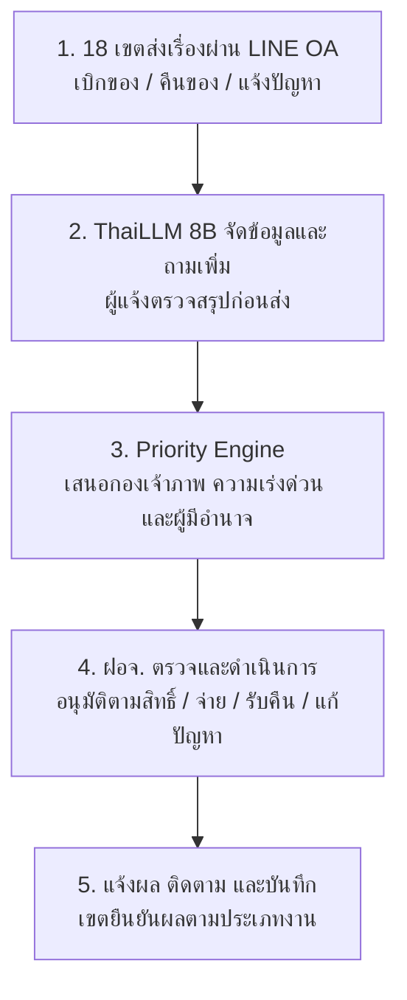
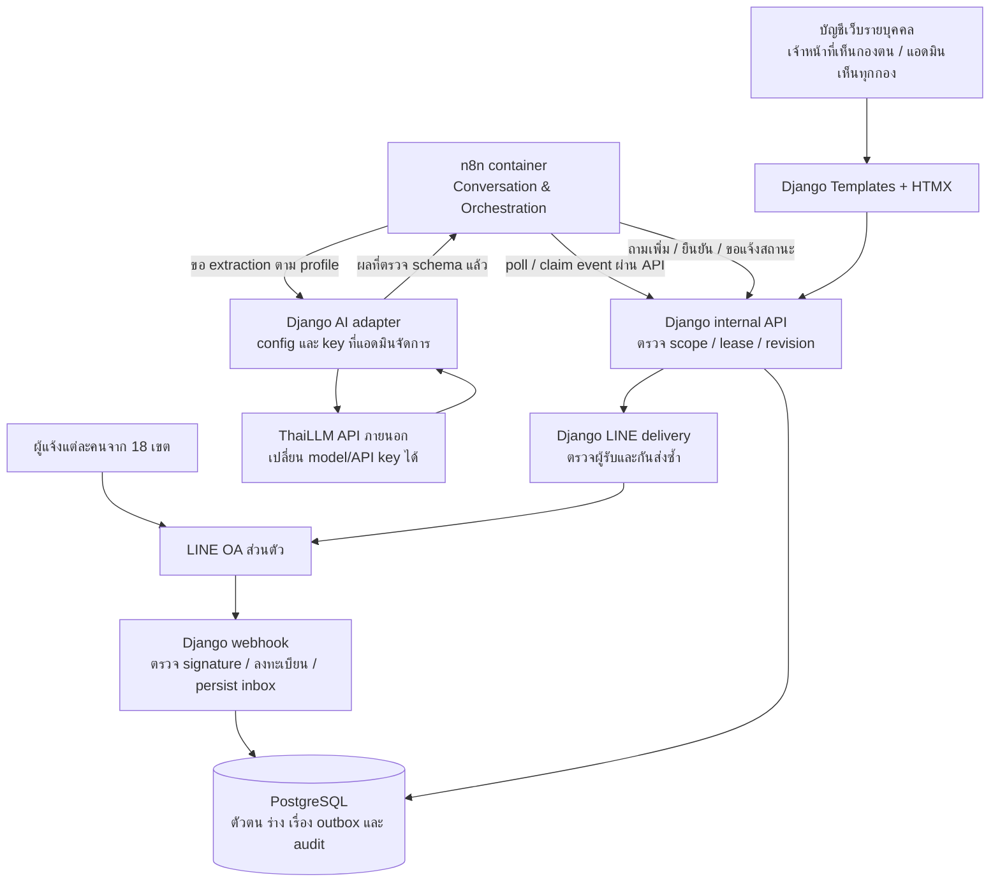
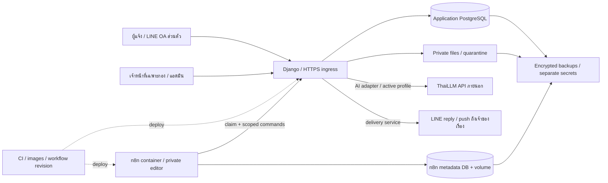

# ระบบรับเรื่อง เบิก–คืนอุปกรณ์ และแจ้งปัญหา การไฟฟ้านครหลวง 18 เขต → ฝอจ.

เอกสารหลัก: ขอบเขตโครงการ · Priority Engine · Production-ready · แผนพัฒนาตามโมดูล · Technology Stack · CI/CD · โมดูลสำหรับ AI implement · คำศัพท์กลาง

ปรับปรุง: 6 ตุลาคม 2569 | สถานะ: M00–M03 เสร็จในเครื่อง (done local); M04–M13 ยัง planned; ยังไม่ deploy staging/production บน OCI

ขอบเขตงานรอบนี้: ปรับแผนในเอกสารเท่านั้น ยกเลิกกรอบเวลาเดิม และกำหนดเป้าหมาย production-ready ตามโมดูล ยังไม่เริ่ม implementation เพิ่ม คำสั่งและลำดับพัฒนาด้านล่างเป็นแผนสำหรับเมื่อผู้ใช้สั่งเริ่มพัฒนา

ข้อกำหนดที่ยืนยันแล้ว: ผู้ใช้มาจาก 18 เขต งานหลักคือเบิกของ ส่งคืนของ และแจ้งปัญหา มีระบบทะเบียน/สต็อกเดิม ใช้ Synthetic data ของมิเตอร์ หม้อแปลง และอุปกรณ์ไฟฟ้าอื่นในต้นแบบ ไม่มี GIS และใช้กองจำลองจนกว่าผู้ใช้จะส่งหน้าที่กองจริง พัฒนาเพื่อ production-ready ตามโมดูลและเกณฑ์ตรวจรับ รับเรื่องผ่าน LINE OA ใช้ n8n ใน Docker container เป็น Conversation & Orchestration และเรียก ThaiLLM ผ่าน API ภายนอก โดยเปลี่ยน model/API key ได้และไม่ self-host โมเดล ใช้ PostgreSQL และเน้นซอฟต์แวร์โอเพนซอร์ส/บริการใช้ฟรีภายในโควตา ชื่อทั้ง 18 เขตใช้ชื่อจริงของการไฟฟ้านครหลวง; รหัสภายใน กอง และธุรกรรมยังเป็นข้อมูลจำลอง

ข้อกำหนดเพิ่มเติมที่ยืนยัน 5 ตุลาคม 2569: ผู้แจ้งแอด LINE OA สนทนาส่วนตัว ลงทะเบียนชื่อ/เขต และรอแอดมินรับรองก่อนส่งเรื่อง; เห็นเฉพาะเรื่องตนเองแม้อยู่เขตเดียวกัน บัญชีเว็บ ฝอจ. เป็นรายบุคคลผูกกอง/บทบาท รับเฉพาะงานที่มอบหมายให้กองตน แอดมินบริหารทุกกอง เพิ่ม/ปิดบัญชี และกำหนดบทบาทภายหลังได้ การเปลี่ยน AI API/model/key ทำได้ทั้งหน้าเว็บและ configuration แต่จำกัดเฉพาะแอดมินผู้พัฒนา รายละเอียดเหล่านี้เป็นข้อกำหนดที่จะ implement; โค้ดปัจจุบันยังมีเพียง M00

ข้อกำหนดเพิ่มเติมที่ยืนยัน 6 ตุลาคม 2569: staging และ production ใช้ **Oracle Cloud Infrastructure (OCI) Always Free โดยไม่เกินโควตา** ตาม [E.2.1](#oracle-free-tier) PostgreSQL 17 รันใน container บน OCI แทน Supabase Free ซึ่งไม่อยู่ใน baseline แล้ว; VM ขององค์กรเป็นทางเลือกภายหลังเมื่อโหลด ความพร้อมใช้งาน หรือนโยบายข้อมูลเกินที่ free tier รองรับ ช่องทางรับเรื่องคง LINE OA (ทบทวน Microsoft Teams แล้วไม่เลือก) ใช้บัญชี **@894attlg** โดยระบบคุมโควตาข้อความเองตาม [C.2.3](#line-quota)

เอกสารนี้รวมเนื้อหาจากเอกสารวิเคราะห์ คำศัพท์ และแบบ Priority Engine ไว้เป็นแหล่งอ้างอิงเดียว ส่วน C กำหนดสถาปัตยกรรมและลำดับโมดูล ส่วน E–F กำหนด production gates, CI/CD และคำสั่ง implement การเปิดใช้จริงต้องผ่าน gates และยืนยันสภาพแวดล้อมองค์กรก่อน

## สารบัญ

- [A. ขอบเขตและกระบวนการบริการ](#scope)
- [B. Priority Engine และอำนาจตัดสินใจ](#priority-engine)
- [C. แผน Implement และ Technology Stack](#implementation)
- [Technology Stack ที่แนะนำ](#technology-stack)
- [ฐานข้อมูลและแนวทางใช้ฟรี](#database-choice)
- [LINE OA และการคุมโควตาข้อความ](#line-quota)
- [ThaiLLM API และการเปลี่ยน model/API key](#model-choice)
- [ชื่อการไฟฟ้านครหลวง 18 เขต](#mea-districts)
- [แผนพัฒนาตามโมดูลและเกณฑ์ส่งมอบ](#implementation-phases)
- [D. คำศัพท์กลาง](#glossary)
- [E. แผน production และเกณฑ์เปิดใช้งาน](#production-plan)
- [Oracle Cloud Always Free และการคุมโควตา](#oracle-free-tier)
- [CI/CD, deployment และ rollback](#cicd)
- [F. โมดูลและคำสั่งให้ AI implement](#ai-implementation-modules)

ข้อมูลประกอบที่ใช้ต่อได้: [ทะเบียนและงานจำลอง](synthetic-data.json), [กองจำลองและสถานการณ์ Priority Engine](priority-engine-demo.json)

สำเนาเอกสารก่อนรวม: [ZIP สำรองเอกสารต้นทาง](archive/documents-before-merge.zip)

<a id="scope"></a>

## A. ขอบเขตและกระบวนการบริการ

### A.1 กรอบการวิเคราะห์

ปรับแนวคิดจากภาพ PEA Intellisense มาใช้กับงานบริการภายในระหว่าง 18 เขตการไฟฟ้าและ ฝอจ. ตามข้อกำหนดผู้ใช้ ตัดขั้นที่ 3 ของภาพซึ่งเป็นการเชื่อม GIS ออก เหลือกระบวนการหลัก 5 ขั้น และรวมการตรวจทะเบียนอุปกรณ์กับยอดของไว้ในขั้นตรวจสอบเรื่อง

ข้อมูลที่ผู้ใช้ยืนยัน: ผู้ส่งเรื่องคือ 18 เขตการไฟฟ้า หน่วยงานรับเรื่องคือ ฝอจ. มีงานเบิกของ ส่งคืนของ และแจ้งปัญหา ของตัวอย่างคือมิเตอร์ หม้อแปลง และอุปกรณ์ไฟฟ้าอื่น ๆ มีระบบทะเบียนหรือสต็อกเดิมแล้ว แต่ระยะนี้ใช้ Synthetic data และไม่มีส่วน GIS

สมมติฐานในการออกแบบ: “แจ้ง” หมายถึงการส่งเรื่องเข้าสู่ระบบ และงานหลักมี 3 ประเภทข้างต้น ช่องทางรับเรื่องคือ LINE OA แบบส่วนตัว ใช้ n8n ประสานบทสนทนาและ ThaiLLM API ภายนอก โดยเริ่มประเมินรุ่น 8B ที่บัญชี API เข้าถึงได้และเปลี่ยนรุ่นภายหลังได้; รายละเอียดระบบสต็อกเดิม อำนาจอนุมัติ และกรอบเวลาบริการยังต้องยืนยัน เนื้อหาด้านล่างเป็นข้อเสนอสำหรับโครงการ ชื่อเขตเป็นชื่อจริงของการไฟฟ้านครหลวง ส่วนตัวเลข รหัสเขตภายใน รุ่นอุปกรณ์ และเลขประจำเครื่องในข้อมูลตัวอย่างเป็นข้อมูลจำลอง

ชื่อโครงการเสนอ: **ระบบผู้ช่วยรับเรื่องและติดตามการเบิก–คืนของ 18 เขตการไฟฟ้า สำหรับ ฝอจ.**

เป้าหมาย: เปลี่ยนข้อความและเอกสารจากเขตให้เป็นงานที่ข้อมูลครบ มีผู้รับผิดชอบ มีสถานะ และตรวจสอบประวัติได้ โดยเชื่อมคำขอกับการปฏิบัติงานจริง

### A.2 Adapt เป็นกระบวนการ 5 ขั้น

| ขั้น | แนวคิดในภาพ | การปรับใช้กับ 18 เขตและ ฝอจ. | ผลลัพธ์ที่ต้องได้ |
| --- | --- | --- | --- |
| 1 | รับแจ้งจากลูกค้าผ่านออนไลน์ | รับเรื่องจากผู้ใช้งานที่ยืนยันตัวตนและผูกกับเขต ผ่าน LINE OA แบบสนทนารายบุคคล พร้อมข้อความ รูป และเอกสาร | ผู้แจ้ง เขต ข้อความต้นฉบับ เอกสาร และร่างเรื่องหรือเลขรับเรื่อง |
| 2 | AI เข้าใจเจตนาและจัดข้อมูล | แยกเบิก/คืน/ปัญหา ดึงรายการ จำนวน หน่วย เหตุผล วันที่ต้องการ และถามข้อมูลที่ขาด ให้ผู้แจ้งยืนยันสรุปก่อนส่ง | ข้อมูลคำขอที่ตรวจทานแล้ว; จุดที่ AI ไม่แน่ใจระบุชัด |
| 3 | Priority Engine: วิเคราะห์และจัดการงาน (ขั้น 4 ในภาพ) | จับคู่ประเภทงานกับกองเจ้าภาพและหน่วยร่วมตามทะเบียนหน้าที่ ตรวจข้อมูลและยอดจำลอง เสนอความเร่งด่วน พร้อมขอบเขตอำนาจและทางเปลี่ยนคำแนะนำ | ชุดข้อเสนอที่มีหลักฐาน เจ้าภาพ เหตุผล กติกาอ้างอิง และผู้ตัดสินใจขั้นต่อไป |
| 4 | เจ้าหน้าที่ตรวจและตัดสินใจ (ขั้น 5 ในภาพ) | ฝอจ. ตรวจเรื่อง; ผู้มีอำนาจอนุมัติตามระเบียบ; ผู้ปฏิบัติงานยืนยันการจ่าย รับคืน หรือแก้ปัญหาในสถานการณ์จำลอง | การตัดสินใจและหลักฐานการดำเนินงานตามสิทธิ์ |
| 5 | ตอบกลับและบันทึกผล (ขั้น 6 ในภาพ) | แจ้งเลขเรื่อง สถานะ ผลดำเนินการ และงานที่ยังค้าง ให้เขตยืนยันรับของหรือผลแก้ไขตามประเภทงาน พร้อมบันทึกประวัติ | ปิดเรื่องได้ตามเงื่อนไข และมีข้อมูลรายงานย้อนกลับ |

องค์ประกอบที่คงจากภาพคือการตรวจข้อมูลประกอบ การมีเจ้าหน้าที่ตัดสินใจ และการบันทึกหลักฐาน ระยะต้นแบบตรวจจาก Synthetic data โดยไม่เชื่อมระบบจริง เมื่อจะใช้งานจริงต้องตรวจจากระบบทะเบียนเดิมที่หน่วยงานรับรอง

รายละเอียดของขั้นนี้อยู่ใน [แบบออกแบบ Priority Engine](#priority-engine) และ [ชุดข้อมูลกอง/สถานการณ์จำลอง](priority-engine-demo.json) ผู้ใช้ให้สร้างกองจำลองก่อนและจะรวบรวมหน้าที่กองจริงภายหลัง เอกสารจึงใช้รหัสกองจำลอง 4 กอง พร้อมบทบาทรับเรื่องกลาง แยกคำแนะนำของ AI ออกจากกติกาบังคับและอำนาจเจ้าหน้าที่อย่างชัดเจน



### A.3 ผู้เกี่ยวข้องและสิทธิ์

| บทบาท | หน้าที่ | ขอบเขตสิทธิ์ |
| --- | --- | --- |
| ผู้แจ้งประจำเขต | แอด LINE OA ลงทะเบียนชื่อ/เขต รอแอดมินรับรอง ส่งเรื่อง ตอบเพิ่มและยืนยันผล | เห็นเฉพาะร่าง เรื่อง ข้อความและไฟล์ของตนเอง ผู้แจ้งคนอื่นแม้อยู่เขตเดียวกันไม่เห็น |
| เจ้าหน้าที่กอง | ใช้บัญชีเว็บรายบุคคลรับเรื่องและดำเนินการ | เห็นคิว/รายละเอียดของกองที่ผูกกับบัญชีและมีบทบาทที่อนุญาต; ไม่เห็นคิวกองอื่น |
| ผู้อนุมัติ ผู้จ่าย ผู้รับคืน ผู้ตรวจสภาพ และผู้แก้ปัญหา | ทำ action ตามหน้าที่ที่ได้รับมอบหมาย | อยู่ภายในกองของตนและ AuthorityGrant/กติกาที่มีผล; บทบาทไม่ยืนยันว่ามีของหรือทำรายการจริงแล้ว |
| ผู้กำกับงานในกอง | ติดตามงานค้างและรายงาน | ดูข้อมูล/สถิติในกองตนตามสิทธิ์ การดูรายงานไม่ให้สิทธิ์แก้ไขงานอัตโนมัติ |
| แอดมินระบบ | บริหารข้อมูลและงานทุกกอง รับรองผู้แจ้ง เพิ่ม/ระงับผู้ใช้ เปลี่ยนกองและกำหนดบทบาทภายหลัง | เห็นทุกกองและจัดการผู้ใช้/บทบาท/ทะเบียนได้ผ่านบริการที่ตรวจสอบและบันทึกประวัติ |
| แอดมินผู้พัฒนา | แอดมินที่ได้รับสิทธิ์ตั้งค่าทางเทคนิคเพิ่มเติม | เปลี่ยน ThaiLLM API/model/key ผ่านเว็บหรือ configuration และดูแล n8n; ผู้ใช้ทั่วไป/เจ้าหน้าที่กอง/แอดมินที่ไม่มีสิทธิ์นี้เข้าถึงไม่ได้ |

บัญชีเว็บเป็นบัญชีรายบุคคล ไม่ใช้รหัสผ่านร่วมกอง หนึ่งกองมีผู้ใช้หลายคนได้ ผู้ใช้ใหม่ที่ยังไม่ได้รับกองและบทบาทอยู่สถานะรอกำหนดสิทธิ์และอ่านเรื่องไม่ได้ แอดมินเพิ่มหรือแก้บทบาทภายหลังได้โดยมีผลกับ request ถัดไป รวม session ที่เปิดอยู่แล้ว ห้ามยกระดับสิทธิ์จากข้อมูลที่ browser หรือ LINE ส่งมาเอง

ความเป็นส่วนตัวของผู้แจ้งหมายถึงผู้แจ้งรายอื่นไม่เห็นเรื่องกัน ส่วนเจ้าหน้าที่กองที่รับผิดชอบและแอดมินเข้าถึงได้ตามหน้าที่ ใช้ทั้ง requester ownership และ division scope ฝั่ง server กับรายการ รายละเอียด การค้นหา ไฟล์ ประวัติ รายงาน และ export ไม่พึ่งเพียงการซ่อนเมนูหรือความเป็นแชทส่วนตัวของ LINE

กองปลายทางเห็นคำขอรับช่วง/ใบงานย่อยที่ส่งให้กองตนอย่างชัดเจนเฉพาะข้อมูลที่จำเป็น ไม่เปิดคิวทั้งหมดของกองต้นทาง เมื่อเปลี่ยนเจ้าภาพหรือย้ายผู้ใช้ให้ประเมินสิทธิ์ใหม่ทุกครั้ง แอดมินบริหารข้ามกองได้ แต่การอนุมัติตามระเบียบยังต้องมี AuthorityGrant และทุก action ต้องผ่านกติกาจำนวน/สถานะ ไม่แก้หรือลบ audit ย้อนหลังผ่านหน้าใช้งาน

### A.4 กระบวนการรายประเภท

#### A.4.1 เบิกของ

ข้อมูลขั้นต่ำ: เขต ผู้ติดต่อ รหัสหรือชนิดของ รายละเอียด/รุ่น จำนวน หน่วย วัตถุประสงค์ วันที่ต้องการ และจุดรับหรือส่ง ถ้ามีระเบียบกำหนดให้ใช้เอกสารอนุมัติให้แนบหรืออ้างอิงด้วย

ลำดับงานเสนอ:

1. ผู้แจ้งเลือกเบิกของและให้รายละเอียด ระบบถามข้อมูลที่ยังขาด
2. ระบบแสดงสรุปให้ผู้แจ้งยืนยัน ก่อนส่งให้ ฝอจ.
3. ฝอจ. ตรวจรายการและยอดจากแหล่งข้อมูลจริง หากไม่มีข้อมูลล่าสุดต้องระบุว่ารอตรวจสอบ
4. ผู้มีอำนาจตัดสินใจตามระเบียบ ระบุจำนวนที่อนุมัติ ไม่ถือว่าจำนวนที่ขอเท่ากับจำนวนที่อนุมัติ
5. ผู้ปฏิบัติงานเตรียมและจ่ายของตามจำนวนจริง บันทึกเอกสารส่งมอบและผู้รับ
6. เขตยืนยันรับของหรือแจ้งจำนวนไม่ตรง ปิดงานเมื่อครบเงื่อนไข

สถานะหลัก: ร่าง → ส่งแล้ว → รอตรวจสอบ → รออนุมัติ → รอจ่าย → จ่ายบางส่วน/จ่ายครบ → รอยืนยันรับ → ปิดเรื่อง โดยมีทางออกสำหรับรอข้อมูล ไม่อนุมัติ และยกเลิก

ต้องเก็บจำนวนที่ขอ อนุมัติ จ่าย และรับจริงแยกกัน หากจ่ายบางส่วนให้ระบุจำนวนที่ยังค้างต่อรายการ พร้อมกำหนดว่าจะรอจ่ายเพิ่มหรือยุติส่วนที่เหลือ การอนุมัติและการแจ้งว่าเตรียมของแล้วไม่ใช่เหตุให้ตัดยอดจ่ายจริง

#### A.4.2 ส่งคืนของ

ข้อมูลขั้นต่ำ: เขต ผู้ติดต่อ รายการ จำนวน หน่วย เหตุผล สภาพ รูปประกอบ วันที่จะส่ง และเลขจ่าย/เลขเบิกเดิมถ้ามี สำหรับของที่ควบคุมรายชิ้นให้ระบุหมายเลขประจำเครื่องด้วย

ลำดับงานเสนอ:

1. เขตแจ้งความประสงค์ส่งคืนพร้อมข้อมูลรายการ
2. ฝอจ. ตรวจสิทธิ์และเอกสารอ้างอิง กำหนดจุดรับและวิธีส่งคืนตามกระบวนการจริง
3. เมื่อของมาถึง ผู้รับตรวจชนิดและจำนวนจริง ยืนยันการรับไว้และระบุส่วนที่ไม่ตรง
4. ตรวจสภาพ แยกของพร้อมใช้ ของรอตรวจ ของต้องซ่อม หรือของที่ต้องดำเนินการอื่นตามระเบียบ
5. บันทึกการรับคืนและผลตรวจในแหล่งทะเบียนที่องค์กรใช้
6. แจ้งผลให้เขตและปิดเรื่องเมื่อรายการที่ค้างได้รับการจัดการ

สถานะหลัก: ส่งคำขอคืน → รอตรวจคำขอ → รอของมาถึง → รับไว้รอตรวจ → ตรวจสภาพ → รับคืนบางส่วน/ครบ → ปิดเรื่อง

“แจ้งว่าจะคืน” ยังไม่ใช่ “รับคืนแล้ว” และ “รับไว้รอตรวจ” ยังไม่ใช่ “พร้อมจ่าย” หากของเดิมไม่มีเลขเบิกในระบบ ให้มีทางตรวจสอบเอกสารหรือหลักฐานโดยเจ้าหน้าที่ ไม่สร้างเลขอ้างอิงขึ้นเอง

#### A.4.3 แจ้งปัญหา

ข้อมูลขั้นต่ำ: เขต ผู้ติดต่อ ประเภทและรายละเอียดปัญหา เวลาเกิด รายการหรือเลขเรื่องที่เกี่ยวข้องถ้ามี รูป/หลักฐาน และผลกระทบต่อการทำงาน

ลำดับงานเสนอ:

1. เขตแจ้งปัญหา เช่น ของชำรุด ส่งไม่ครบ ได้รับผิดรายการ หรืองานล่าช้า
2. ระบบจัดข้อมูลและเสนอเรื่องเดิมที่อาจเกี่ยวข้อง ให้เจ้าหน้าที่ตรวจความสัมพันธ์
3. ฝอจ. ประเมินความเร่งด่วนตามผลกระทบ กำหนดผู้รับผิดชอบและเวลาที่ควรอัปเดต
4. ผู้รับผิดชอบดำเนินการ พร้อมบันทึกความคืบหน้าและหลักฐาน
5. แจ้งผลให้เขตยืนยันหรือโต้แย้ง เมื่อครบเงื่อนไขจึงปิดเรื่อง

สถานะหลัก: รับเรื่อง → คัดกรอง → มอบหมาย → ดำเนินการ → รอเขตยืนยัน → ปิดเรื่อง พร้อมสถานะรอข้อมูลและการเปิดเรื่องกลับเมื่อมีข้อโต้แย้งตามกติกาที่กำหนด

ปัญหาหนึ่งอาจทำให้ต้องมีคำขอคืนและคำขอเบิกทดแทน ให้แยกงานเหล่านั้นและเชื่อมอ้างอิงกัน การปิดเรื่องปัญหาไม่ควรปิดคำขอที่ยังค้างโดยอัตโนมัติ

### A.5 สิ่งที่ AI ช่วยได้และจุดควบคุม

| งาน | บทบาท AI | จุดควบคุม |
| --- | --- | --- |
| จัดประเภท | เสนอเบิก/คืน/ปัญหา และแยกหลายเจตนาในข้อความ | ผู้แจ้งหรือเจ้าหน้าที่ตรวจยืนยัน |
| ดึงรายละเอียด | สกัดรายการ จำนวน หน่วย วัน และเหตุผล | ตรวจตรงกับทะเบียน; จำนวนและหน่วยต้องชัดเจน |
| ถามเพิ่มเติม | ถามเฉพาะข้อมูลที่ขาดในเรื่องนั้น | เก็บข้อมูลที่ผู้แจ้งตอบจริง; ไม่เติมข้อมูลที่ไม่ทราบ |
| อ่านรูปหรือเอกสาร | ช่วยถอดข้อความและเสนอรายการ | ตรวจจุดที่อ่านไม่ชัดและเอกสารต้นฉบับก่อนส่ง |
| สรุปให้เจ้าหน้าที่ | จัดข้อมูลและร่างคำตอบ | เก็บต้นฉบับและแหล่งข้อมูลให้อ้างอิง |
| เสนอเรื่องเกี่ยวข้อง | ชี้เรื่องซ้ำหรือเรื่องที่สัมพันธ์กัน | ไม่รวมคำขอคล้ายกันหรือยกเลิกเรื่องอัตโนมัติ |
| เสนอความเร่งด่วน | ประเมินจากรายละเอียดผลกระทบ | กติกากลางและเจ้าหน้าที่กำหนดลำดับคิวจริง |
| ส่งเรื่องเข้ากอง | เสนอกองเจ้าภาพและงานย่อยจากทะเบียนหน้าที่ที่รับรอง | ต้นแบบเป็นข้อเสนอ; ส่งอัตโนมัติได้เฉพาะเส้นทางที่หน่วยงานมอบหมายชัดและย้อนกลับได้ |
| เจ้าหน้าที่เห็นต่าง | บันทึกเหตุผล เสนอผลกระทบ และติดตามการตัดสินใจใหม่ | เปลี่ยนคำแนะนำตามสิทธิ์ได้; การข้ามกติกาบังคับต้องใช้ช่องทางข้อยกเว้นที่กำหนด |
| อนุมัติและปรับยอด | จัดข้อมูลประกอบ | ผู้มีอำนาจและกระบวนการทะเบียนเป็นผู้ยืนยัน |

การแจ้งเลขรับเรื่องและสถานะที่ยืนยันแล้วใช้ข้อความมาตรฐานอัตโนมัติได้ ส่วนการสัญญาว่ามีของ วันที่จะส่ง หรือผลแก้ไข ต้องมีข้อมูลที่ยืนยันแล้วรองรับ

ตัวตนและเขตต้องมาจากบัญชีที่ผูกไว้ ไม่อาศัยข้อความ “ผมอยู่เขต...” เพียงอย่างเดียว เอกสารและข้อความเป็นข้อมูลประกอบของเรื่อง ไม่ใช่คำสั่งให้ระบบข้ามสิทธิ์หรือกติกา

### A.6 ข้อมูลและองค์ประกอบระบบขั้นต่ำ

ข้อมูลที่ต้องมี:

- ทะเบียน 18 เขต ผู้ใช้งาน และสิทธิ์
- ทะเบียนรายการของ รหัส หน่วย รายละเอียด และหมายเลขประจำเครื่องเมื่อจำเป็น
- เรื่องและรายการย่อย ผู้รับผิดชอบ ระดับความเร่งด่วน และสถานะ
- ผลอนุมัติและจำนวนที่อนุมัติ พร้อมเหตุผลและผู้อนุมัติ
- การจ่ายจริง การรับของ และการรับคืน/ผลตรวจสภาพ
- เอกสาร รูป ข้อความต้นฉบับ ความสัมพันธ์ระหว่างเรื่อง และประวัติผู้แก้ไข/เวลา/ค่าเดิม–ใหม่

โครงระบบขั้นต่ำ: ช่องทางรับเรื่องหนึ่งช่องทาง → ตัวจัดข้อมูลและถามเพิ่ม → ระบบเรื่องและกติกางานที่อ่านทะเบียน/ยอดจำลอง → หน้าจอ ฝอจ. → แจ้งสถานะกลับ การทดลองระยะนี้ใช้ชื่อเขตจริงร่วมกับข้อมูลอุปกรณ์ บัญชีผู้ใช้ และรายการดำเนินงานจำลอง

แผนนี้เลือก Django, n8n container, ThaiLLM API ภายนอก, PostgreSQL บน Oracle Cloud Always Free และเครื่องมือประกอบตามเหตุผลในส่วน C โดยยึดกระบวนการและขอบเขตที่ยืนยันแล้ว การเชื่อมระบบเดิมจะตรวจข้อกำหนดของหน่วยงานก่อนนำไปใช้งานจริง

เมื่อเข้าสู่ระยะใช้งานจริง ระบบสต็อกเดิมเป็นแหล่งยอดทางการ ระบบรับเรื่องเก็บเลขธุรกรรมอ้างอิงและสถานะการเชื่อมต่อ หากยังเชื่อมไม่ได้ ให้เจ้าหน้าที่บันทึกในระบบเดิมแล้วอ้างเลขเอกสารกลับมายังเรื่อง โดยไม่สร้างยอดทางการอีกชุดหนึ่ง

<a id="mea-districts"></a>

#### ชื่อการไฟฟ้านครหลวง 18 เขตที่ใช้ในต้นแบบ

ใช้ชื่อจาก Data Dictionary ของชุดข้อมูล MEA ปี 2569 ถึงเดือนมีนาคม ตรวจสอบ 5 ตุลาคม 2569 โดยเติมชื่อหน่วยงานเต็ม “การไฟฟ้านครหลวงเขต…” รหัส D01–D18 เป็นรหัสภายในต้นแบบตามลำดับตาราง ไม่ใช่รหัสทางการของ MEA และไม่ใช่ชื่อเขตการปกครอง [แหล่งข้อมูล MEA](https://opendata.mea.or.th/dataset/consumer-by-district-2569/resource/7ca06256-3b98-454e-8415-54772847c65a)

| รหัสภายใน | ชื่อหน่วยงานจริง |
| --- | --- |
| D01 | การไฟฟ้านครหลวงเขตวัดเลียบ |
| D02 | การไฟฟ้านครหลวงเขตคลองเตย |
| D03 | การไฟฟ้านครหลวงเขตยานนาวา |
| D04 | การไฟฟ้านครหลวงเขตบางกะปิ |
| D05 | การไฟฟ้านครหลวงเขตมีนบุรี |
| D06 | การไฟฟ้านครหลวงเขตสมุทรปราการ |
| D07 | การไฟฟ้านครหลวงเขตบางพลี |
| D08 | การไฟฟ้านครหลวงเขตสามเสน |
| D09 | การไฟฟ้านครหลวงเขตนนทบุรี |
| D10 | การไฟฟ้านครหลวงเขตบางใหญ่ |
| D11 | การไฟฟ้านครหลวงเขตธนบุรี |
| D12 | การไฟฟ้านครหลวงเขตราษฎร์บูรณะ |
| D13 | การไฟฟ้านครหลวงเขตบางขุนเทียน |
| D14 | การไฟฟ้านครหลวงเขตบางเขน |
| D15 | การไฟฟ้านครหลวงเขตบางนา |
| D16 | การไฟฟ้านครหลวงเขตบางบัวทอง |
| D17 | การไฟฟ้านครหลวงเขตลาดกระบัง |
| D18 | การไฟฟ้านครหลวงเขตนวลจันทร์ |

การอ้าง D01–D18 ในสถานการณ์ทั้งสองไฟล์ให้ resolve ชื่อจากทะเบียนนี้ เรื่องตัวอย่างไม่ได้หมายความว่าเขตดังกล่าวเคยทำรายการหรือเกิดเหตุจริง

#### ข้อมูลจำลองสำหรับวิเคราะห์และต้นแบบ

ไฟล์ `synthetic-data.json` ประกอบด้วยชื่อจริงของการไฟฟ้านครหลวง 18 เขต รหัสภายใน D01–D18 และรายการอุปกรณ์ 5 ชนิด ยอดคงเหลือ ณ จุดหนึ่ง กับสถานการณ์งาน 4 เรื่องที่จำลองขึ้น ไม่มีข้อมูลธุรกรรมจริงหรือการเขียนกลับระบบจริง ข้อมูลชุดนี้เป็นตัวอย่างวิเคราะห์ ไม่ใช่ข้อมูลสำหรับกระทบยอดย้อนหลังครบทุกธุรกรรม

| กลุ่ม | ตัวอย่างข้อมูล | วิธีติดตามในต้นแบบ |
| --- | --- | --- |
| มิเตอร์ | มิเตอร์ไฟฟ้ารุ่นจำลอง A | รหัสรายการ + หมายเลขประจำเครื่อง |
| หม้อแปลง | หม้อแปลงรุ่นจำลอง A | รหัสรายการ + หมายเลขประจำเครื่อง |
| อุปกรณ์อื่น | ฟิวส์ เบรกเกอร์ สายไฟรุ่นจำลอง | รหัสรายการ + จำนวน + หน่วย; สายไฟใช้เมตร |

การกำหนดให้มิเตอร์/หม้อแปลงติดตามรายชิ้นเป็นสมมติฐานของต้นแบบ ต้องตรวจให้ตรงกับวิธีควบคุมของระบบเดิมก่อนใช้งานจริง รูปแบบข้อมูลขั้นต่ำแยกทะเบียนรายการออกจากข้อมูลหมายเลขประจำเครื่องของแต่ละชิ้น

ยอดตัวอย่างแยกพร้อมจ่าย จองไว้ รอตรวจ และรอซ่อม ไม่ใช้ยอดรวมแทนยอดพร้อมจ่าย ในไฟล์นี้จำนวนจองไม่รวมอยู่ในจำนวนพร้อมจ่ายแล้ว

สถานการณ์จำลอง:

- การไฟฟ้านครหลวงเขตวัดเลียบ (D01) ขอเบิกมิเตอร์ 3 เครื่อง อนุมัติ 2 จ่ายและรับแล้ว 1 ค้างตามอนุมัติ 1 และจองไว้ 1 เครื่อง
- การไฟฟ้านครหลวงเขตคลองเตย (D02) แจ้งคืนมิเตอร์ 2 เครื่อง มาถึงจริง 1 เครื่องที่ยังรอตรวจ อีก 1 เครื่องยังค้างส่ง
- การไฟฟ้านครหลวงเขตยานนาวา (D03) แจ้งหม้อแปลงขัดข้อง ต้องคัดกรองผลกระทบและมอบหมายผู้รับผิดชอบ โดยยังไม่ทำรายการคืนหรือเบิกทดแทนอัตโนมัติ
- การไฟฟ้านครหลวงเขตบางกะปิ (D04) ขอเบิกฟิวส์ 50 ชิ้น ขณะที่พร้อมจ่าย 40 ชิ้น ยังรอการตัดสินใจว่าจะจ่ายบางส่วนหรือรอของ

กติกาสำคัญ:

- เหตุการณ์เดิมจากช่องทางรับเรื่องที่ถูกส่งซ้ำต้องไม่สร้างเรื่องหรือธุรกรรมซ้ำ ส่วนข้อความใหม่ที่คล้ายกันให้ตรวจสอบก่อนรวม
- จำนวนเป็นค่าบวกและหน่วยตรงกับทะเบียน การแปลงหน่วยใช้กติกาที่กำหนดไว้
- การจ่ายจริงต้องไม่เกินจำนวนอนุมัติที่ยังเหลือ และไม่เกินยอดที่จ่ายได้ตามระบบทางการ
- กรณีหลายเขตขอของเดียวกันพร้อมกัน ใช้กลไกจองหรือควบคุมการจ่ายของระบบทางการ ไม่ตัดสินจากยอดที่ AI เคยอ่านข้อความไว้
- การแจ้งคืนไม่เพิ่มยอดพร้อมจ่าย ของรอตรวจหรือชำรุดแยกจากยอดพร้อมจ่าย
- มีรายการย่อยรองรับการจ่าย/คืนหลายครั้ง และระบุส่วนที่ค้างอย่างชัดเจน
- ถ้าระบบภายนอกไม่พร้อม ให้แสดงรอดำเนินการ/รอตรวจสอบและคิวที่ต้องติดตาม หลีกเลี่ยงการบอกสำเร็จก่อนมีหลักฐาน
- การแก้ไขรายการที่ลงทะเบียนแล้วต้องใช้วิธีแก้ไขหรือย้อนรายการตามระบบทางการ พร้อมเหตุผลและประวัติ

### A.7 หน้าจอที่ต้องรองรับ

สำหรับเขตผ่าน LINE OA: ส่งเรื่องพร้อมเอกสาร ดูสรุปก่อนยืนยัน ดูเฉพาะเรื่องที่ตนเป็นผู้แจ้ง ตอบข้อมูลเพิ่มเติม ดูสถานะ/ผู้รับผิดชอบ และยืนยันรับของหรือผลแก้ไข

สำหรับเจ้าหน้าที่ ฝอจ.: คิวของกองตน กรองตามเขตต้นทาง/ประเภท/ผู้รับผิดชอบ/สถานะ/อายุงาน หน้ารายละเอียดที่เห็นข้อความและเอกสารต้นฉบับ ตรวจข้อมูล ส่งต่อ ตัดสินใจตามสิทธิ์ บันทึกจ่าย/รับคืน และติดตามงานค้าง

สำหรับแอดมิน: คิวทุกกอง หน้ารับรองผู้ลงทะเบียน LINE จัดการผู้ใช้รายบุคคล กอง บทบาท และการระงับบัญชี; แอดมินผู้พัฒนามีหน้าตั้งค่า AI พร้อมทดสอบก่อนเปิดใช้

สำหรับผู้กำกับงานในกอง: จำนวนงานและอายุงานภายในกองตนแยกรายประเภท/เขต เวลาตอบรับ เวลาดำเนินการ งานเกินกรอบเวลา งานจ่ายบางส่วน และปัญหาที่เกิดซ้ำ สิทธิ์ดูรายงานต้องแยกจากสิทธิ์แก้ไขงาน

### A.8 รุ่นเริ่มต้นและลำดับการทำงาน

รุ่นเริ่มต้นควรครอบคลุมงานทั้ง 3 ประเภท โดยรับเรื่องผ่าน LINE OA ช่องทางเดียว มีบัญชีผูกเขต เลขรับเรื่อง ข้อมูลขั้นต่ำ สถานะ ผู้รับผิดชอบ หน้าจอ ฝอจ. การแจ้งกลับ และประวัติหลักฐาน โดยรักษาการอนุมัติและการยืนยันรายการจริงตามระเบียบ

ระบบใช้ปุ่มเลือกประเภทและคำถามตามฟิลด์ใน LINE OA ร่วมกับ ThaiLLM 8B สำหรับอ่านข้อความ สรุป และระบุข้อมูลขาด หากโมเดลไม่พร้อมให้กรอกตามคำถามหรือให้เจ้าหน้าที่ช่วยต่อได้ การมีผู้ใช้ 18 เขตเพียงอย่างเดียวไม่ใช่เหตุให้ต้องสร้างหลาย AI agents

ลำดับเสนอ:

1. ยืนยันวิธีควบคุมมิเตอร์/หม้อแปลง/อุปกรณ์อื่น กติกาอำนาจอนุมัติ และเอกสาร โดยไล่ตัวอย่างเบิก–คืน–ปัญหาจนจบอย่างละเรื่อง
2. กำหนดข้อมูลและสถานะขั้นต่ำ พร้อมตัวอย่างงานจ่ายไม่ครบ คืนไม่ตรง และของรอตรวจ
3. ทำต้นแบบโดยใช้ Synthetic data ให้ทดลองสถานการณ์ทั้ง 3 ประเภทและกรณีรายการไม่ครบ
4. เมื่อหน่วยงานพร้อม เชื่อมระบบทะเบียนเดิมและทดลองงานจริงกับเขตจำนวนน้อยที่หน่วยงานเลือก
5. เก็บเวลาทำงานเดิม เปรียบเทียบผลจริง แก้ปัญหาก่อนขยายครบ 18 เขต

ระบบ GIS อยู่นอกขอบเขตตามข้อกำหนดผู้ใช้ รุ่นเริ่มต้นเน้นรับเรื่อง ติดตามงาน และ Priority Engine เพื่อเสนอกอง/ความเร่งด่วนตามขอบเขตในเอกสารออกแบบ การส่งคิวงานประจำอัตโนมัติเป็นขั้นต่อไปที่ต้องมีกติกามอบหมายและผลตรวจรับ ส่วนการอนุมัติเบิก การตัดสินสภาพอุปกรณ์ และการจัดสรรของที่ขาดแคลนยังเป็นอำนาจมนุษย์

### A.9 ตัวอย่างและกรณีตรวจรับ

ตัวอย่างสมมติ: “ขอเบิกอุปกรณ์รุ่น A 10 ชิ้น ใช้งานซ่อมวันที่ 12 ตุลาคม” ระบบดึงรายการ/จำนวน/วันที่ แต่ต้องให้ผู้แจ้งยืนยันรหัสรายการ ปีของวันที่ถ้าไม่ชัด และจุดรับของก่อนส่ง หากผู้มีอำนาจอนุมัติ 8 ชิ้นและจ่ายจริง 5 ชิ้น ต้องแสดงขอ 10 อนุมัติ 8 จ่าย 5 และค้างจ่ายตามอนุมัติ 3 ชิ้น ส่วน 2 ชิ้นที่ไม่ได้อนุมัติมีเหตุผลแยกต่างหาก

| กรณี | ผลที่ต้องตรวจรับได้ |
| --- | --- |
| ชื่อของกำกวมหรือไม่ตรงทะเบียน | ขอให้เลือกหรือให้เจ้าหน้าที่ตรวจ ไม่เดารหัส |
| ข้อมูลขาดหรือภาพอ่านไม่ชัด | มีสถานะรอข้อมูลและช่องทางแก้ไข |
| เหตุการณ์ข้อความเดิมมาซ้ำ | ได้เรื่องเดิม ไม่มีรายการซ้ำ |
| หลายเขตเบิกพร้อมกัน | ไม่ยืนยันจ่ายเกินยอดทางการ |
| ขอ 10 อนุมัติ 8 จ่าย 5 | แสดงจำนวนแยกและค้างตามอนุมัติ 3 |
| แจ้งคืน 5 แต่ของถึง 4 | บันทึกจำนวนจริง 4 และติดตามส่วนต่าง 1 |
| รับคืนของชำรุด | ยืนยันจำนวนและสภาพ แต่ไม่เพิ่มยอดพร้อมจ่าย |
| คืนของเก่าที่ไม่มีเลขเบิกในระบบ | ส่งให้เจ้าหน้าที่ตรวจหลักฐานได้ |
| แจ้งปัญหาพร้อมขอคืนและเบิกทดแทน | แยกงานเชื่อมกันและติดตามสถานะแต่ละงาน |
| ผู้ใช้เขตหนึ่งเปิดข้อมูลอีกเขต | จำกัดตามสิทธิ์ทั้งการดู แก้ไข และดาวน์โหลดเอกสาร |
| ระบบทะเบียนไม่พร้อม | ไม่แจ้งว่าจ่าย/รับคืนสำเร็จ; มีงานรอติดตาม |
| AI ไม่พร้อมใช้งาน | รับเรื่องผ่านฟอร์มและให้เจ้าหน้าที่ตรวจต่อได้ |

กรณีสิทธิ์เพิ่มเติมที่ต้องตรวจรับ: ผู้แจ้ง A/B ในเขตเดียวกันอ่านเรื่อง/ไฟล์/สถานะของกันไม่ได้; กอง A/B ไม่เห็นคิวหรือ counts ของอีกกอง; แอดมินเห็นทุกกองและเพิ่ม user ที่ยังไม่มี role ได้; หลังให้/ถอน role ใช้สิทธิ์ใหม่ใน session เดิม; แอดมินทั่วไปเปลี่ยน AI config หรือให้สิทธิ์ผู้พัฒนาแก่ตนไม่ได้; แอดมินผู้พัฒนาเปลี่ยน model/key ผ่านเว็บและ config-import ได้โดยไม่เผยค่า key

### A.10 ผลลัพธ์และการวัดผล

ผลที่คาดหวัง: ข้อมูลก่อนส่งครบขึ้น ลดการถามซ้ำ เห็นผู้รับผิดชอบและงานค้าง ตรวจสอบการเบิก–คืนได้ และรวมภาพการดำเนินงานของทั้ง 18 เขต ผลเหล่านี้ต้องวัดจากการทดลอง ไม่กำหนดตัวเลขประหยัดเวลาล่วงหน้า

| ตัวชี้วัด | นิยามเบื้องต้น |
| --- | --- |
| เวลาตอบรับเรื่อง | เวลาตั้งแต่ส่งเรื่องถึงเจ้าหน้าที่รับผิดชอบรับงาน; แยกจากข้อความตอบรับอัตโนมัติ |
| เวลาปิดงาน | เวลาตั้งแต่ส่งถึงปิด แยกตามประเภทและแสดงเวลารอข้อมูล/รอของด้วย |
| อัตราข้อมูลครบครั้งแรก | เรื่องที่ผ่านการตรวจความครบถ้วนโดยไม่ต้องถามเพิ่ม ÷ เรื่องที่ส่งทั้งหมด |
| งานเกินกรอบเวลา | จำนวนและสัดส่วนงานที่เกินกติกาเวลาซึ่งหน่วยงานยืนยัน |
| ความคลาดเคลื่อนการเบิก–คืน | รายการที่จำนวน/ชนิดไม่ตรงหลักฐานต่อรายการที่ตรวจสอบ |
| ภาระงาน ฝอจ. | จำนวนเรื่องต่อผู้รับผิดชอบและอายุงานค้าง |
| คุณภาพการช่วยของ AI | ความถูกต้องของการจัดประเภท/ดึงข้อมูลจากชุดตัวอย่างที่เจ้าหน้าที่ตรวจ และจำนวนครั้งที่ต้องแก้ไข |

### A.11 ข้อมูลที่ต้องยืนยันก่อนลงรายละเอียดพัฒนา

- รหัส/รุ่นอุปกรณ์จริง หน่วยนับ และวิธีควบคุมรายชิ้นของมิเตอร์ หม้อแปลง และอุปกรณ์อื่น
- รหัสหน่วยงานทางการที่จะใช้แทน D01–D18 และผู้รับผิดชอบรับรองการลงทะเบียน LINE; ชื่อ 18 เขตใช้ข้อมูล MEA ที่อ้างอิงไว้แล้ว
- บัญชี LINE OA ทดสอบ ผู้ดูแล Messaging API และหลักฐานที่แอดมินใช้รับรองชื่อ/เขตของ LINE user ID; รายชื่อบัญชีเว็บรายบุคคล/กอง/บทบาทสำหรับ pilot
- รายละเอียดระบบทะเบียนหรือสต็อกเดิม เอกสารที่ใช้ วิธีเชื่อมต่อ และหน่วยงานเจ้าของยอดทางการ
- ผู้อนุมัติ เงื่อนไขเบิก/คืน การแบ่งจ่าย การยกเลิก และวิธีแก้รายการผิด
- ผู้ตรวจสภาพคืนและเงื่อนไขนับเป็นของพร้อมจ่าย
- วิธีส่งมอบและเงื่อนไขยืนยันรับ/ปิดเรื่อง
- ปริมาณเรื่องและผู้ปฏิบัติงานจริง สำหรับประมาณเวลาและค่าใช้จ่าย

ไม่ต้องรอข้อมูลทั้งหมดเพื่อออกแบบลำดับงานกลาง แต่การเชื่อมระบบ การกำหนดอำนาจ และประมาณงานพัฒนาที่ใช้ตกลงโครงการต้องอาศัยคำตอบเหล่านี้

<a id="priority-engine"></a>

## B. Priority Engine และอำนาจตัดสินใจ

เอกสารนี้ขยาย “วิเคราะห์และจัดการงาน” ขั้น 4 ในภาพต้นแบบ ซึ่งเป็นขั้น 3 ในกระบวนการที่ตัด GIS ออกแล้ว ครอบคลุมการส่งเข้ากอง การจัดความเร่งด่วน อำนาจ Agent/มนุษย์ และการจัดการเมื่อผู้ปฏิบัติงานเลือกต่างจาก AI

ผู้ใช้อนุญาตให้สร้างกองจำลองก่อน ชื่อกอง รหัส กติกา และสถานการณ์ทั้งหมดต่อไปนี้เป็นข้อเสนอสำหรับต้นแบบ ไม่ใช่ผังองค์กร ระเบียบ หรืออำนาจปัจจุบันของ ฝอจ. เอกสารฉบับนี้มีแผน implement ในส่วน C; ยังไม่ได้พัฒนา Priority Engine ที่ทำงานจริง

### B.1 สิ่งที่ขั้นนี้ต้องส่งมอบ

ทุกเรื่องต้องตอบได้ว่า “งานอะไร — กองไหนเป็นเจ้าภาพ — ใครต้องช่วย — เร่งด่วนเพราะอะไร — ข้อมูลใดยังขาด — ใครมีอำนาจตัดสินใจ — ต้องตอบรับเมื่อใด — ถ้าไม่มีคนรับจะส่งให้ใครจัดการ”

แยกการทำงานเป็นสามส่วนในระบบเดียว:

1. **AI ทำความเข้าใจและเสนอ:** แปลงภาษาผู้แจ้งเป็นข้อเท็จจริง/ข้อสงสัย อ้างข้อความต้นฉบับ เลือกคำถามเพิ่มเติม และเสนอเส้นทางที่สอดคล้องกับหน้าที่
2. **กติกาที่หน่วยงานรับรองควบคุม:** ตรวจว่ากองอยู่ในทะเบียน หน้าที่ตรง สิทธิ์เพียงพอ กติกายังมีผล และการกระทำอยู่ในขอบเขตมอบหมาย การบังคับใช้ทำในระบบงาน ไม่ฝากไว้กับคำสั่งให้ AI ปฏิบัติตามเพียงอย่างเดียว
3. **มนุษย์รับผิดชอบการตัดสินใจ:** ผู้ปฏิบัติงานยืนยันข้อเท็จจริงและรับงาน ผู้มีอำนาจอนุมัติ/ให้ข้อยกเว้น ผู้กำกับงานตัดสินข้อขัดแย้งและจัดทรัพยากร

คำแนะนำของ AI เปลี่ยนได้ตามสิทธิ์ ส่วนกติกาบังคับเปลี่ยนได้โดยผู้มีอำนาจตามกระบวนการเท่านั้น ระดับความมั่นใจของโมเดลไม่เพิ่มอำนาจให้โมเดล

### B.2 กองและบทบาทจำลอง

| รหัส | ชื่อจำลอง | หน้าที่ในต้นแบบ | ขอบเขตที่ต้องแยก |
| --- | --- | --- | --- |
| SIM-MTR | กองงานมิเตอร์ (จำลอง) | เบิก รับคืน ตรวจสภาพ และประสานซ่อมมิเตอร์ | รับงานไม่ได้แปลว่ามีอำนาจอนุมัติทุกจำนวน |
| SIM-TRF | กองงานหม้อแปลง (จำลอง) | เบิก รับคืน ตรวจสภาพ และประสานแก้ปัญหาหม้อแปลง | ข้อเสนอจาก AI ไม่ใช่คำสั่งปฏิบัติการระบบไฟฟ้า |
| SIM-EQP | กองอุปกรณ์ไฟฟ้าอื่น (จำลอง) | เบิก รับคืน และแก้ปัญหาอุปกรณ์ที่อยู่ในรายการรับผิดชอบ เช่น ฟิวส์ เบรกเกอร์ สายไฟ | ไม่ใช้เป็นปลายทางของอุปกรณ์ทุกชนิดที่ AI ไม่รู้จัก |
| SIM-REG | กองทะเบียนและแผนจัดสรร (จำลอง) | ตรวจเอกสาร/ทะเบียน ประสานแก้ข้อมูล และเตรียมข้อมูลจัดสรรของขาดแคลน | ไม่แก้ทะเบียนหรือตัดสินแบ่งของเองเพียงเพราะ AI ส่งงานมา |
| SIM-TRIAGE | จุดรับเรื่องกลาง ฝอจ. (บทบาทจำลอง) | เป็นเจ้าของคิวแรก ตรวจเรื่องกำกวม ดูแลการส่งต่อ และประสานเรื่องหลายกอง | เป็นบทบาทรับเรื่อง ไม่ใช่กองที่ห้า |

บทบาทคนที่แยกจากชื่อกอง: ผู้รับผิดชอบเรื่อง, ผู้รับรองด้านเทคนิค, ผู้อนุมัติตามวงเงิน/จำนวน/ประเภทงาน, ผู้ประสานระดับฝ่าย และเจ้าของกติกา คนเดียวอาจได้รับหลายบทบาทตามอำนาจจริง แต่สิทธิ์ต้องกำหนดชัด ไม่อนุมานจากชื่อกองหรือชื่อตำแหน่ง

#### ทะเบียนหน้าที่ที่ Agent ต้องอ่าน

แต่ละรายการต้องมีรหัสกอง งานที่รับ/ไม่รับ ประเภทและรหัสอุปกรณ์ เงื่อนไขของขั้นตอนงาน หน่วยร่วม ช่องทางรับงาน ผู้รับผิดชอบสำรอง กติกายกระดับ ผู้รับรองเอกสาร รุ่นกติกา และวันเริ่ม/สิ้นสุดการใช้ เมื่อข้อมูลหมดอายุหรือไม่มีผู้รับงาน ไม่อนุญาตให้ส่งอัตโนมัติ

ต้องแยกตารางหน้าที่ออกจากตารางอำนาจอนุมัติ ตารางหน้าที่ตอบว่าใครทำงาน ส่วนตารางอำนาจตอบว่าใครอนุมัติอะไรได้ ความสัมพันธ์ระหว่างกองไม่ใช่หลักฐานว่ากองหนึ่งมีอำนาจแทนอีกกอง

เอกสารระเบียบใช้ประกอบการอธิบายพร้อมเลขข้อและวันที่ ส่วนการเลือกปลายทางใช้ตารางหน้าที่ที่รับรองแล้ว หากค้นพบเอกสารขัดกันให้แสดงข้อขัดแย้งและให้เจ้าของกติกาตัดสินก่อนใช้

### B.3 กติกาการส่งเข้ากอง

| รหัส | เงื่อนไข | เจ้าภาพเสนอ | หน่วยร่วม/การส่งต่อ | สิ่งที่ Agent ต้องทำ |
| --- | --- | --- | --- | --- |
| R01 | เบิกมิเตอร์ รหัสตรงทะเบียน | SIM-MTR | SIM-REG เมื่อมีข้อจำกัดด้านทะเบียนหรือแผนจัดสรร | จัดสรุป ตรวจยอด/วันข้อมูล และเสนอคิวงานเบิก |
| R02 | เบิกหม้อแปลง รหัสตรงทะเบียน | SIM-TRF | SIM-REG เมื่อจำเป็น | เสนอคิวตามงานและข้อมูลผลกระทบ ไม่เดาสเปกทดแทน |
| R03 | เบิก/คืน/แจ้งปัญหาอุปกรณ์อื่นที่อยู่ในขอบเขตชัด | SIM-EQP | SIM-REG เมื่อมีข้อโต้แย้งทะเบียน | ตรวจรายการในบัญชีรับผิดชอบก่อนเลือกกอง |
| R04 | คืนมิเตอร์หรือหม้อแปลง | SIM-MTR หรือ SIM-TRF ตามอุปกรณ์ | SIM-REG ถ้าเอกสาร/หมายเลขไม่ตรง | แยกรับจริง ตรวจสภาพ และปรับทะเบียนเป็นคนละขั้น |
| R05 | ปัญหาทางเทคนิคของมิเตอร์หรือหม้อแปลงที่ระบุได้ | SIM-MTR หรือ SIM-TRF ตามอุปกรณ์ | ผู้รับรองด้านเทคนิค; ช่องทางฉุกเฉินเมื่อเข้าเงื่อนไข | เสนอเจ้าภาพพร้อมอาการที่รายงานและสิ่งที่ยังไม่ทราบ |
| R06 | ขอแก้ข้อมูลทะเบียนล้วน ๆ ไม่มีการรับ/จ่าย/ตรวจของค้าง | SIM-REG | กองอุปกรณ์เป็นผู้ยืนยันข้อเท็จจริงเมื่อจำเป็น | สรุปส่วนต่างและเอกสาร ไม่แก้ข้อมูลทางการเอง |
| R07 | พบเลขเครื่อง/จำนวนไม่ตรงระหว่างรับคืนหรือส่งมอบ | กองที่เป็นเจ้าภาพขั้นรับ/จ่ายนั้น | SIM-REG รับงานย่อยตรวจทะเบียน | คงเจ้าภาพเดิมจนงานส่งมอบสิ้นสุด ไม่โยนทั้งเรื่องไปกองทะเบียน |
| R08 | ของขาด/หลายเขตแย่งทรัพยากรเดียวกัน | กองอุปกรณ์ที่เกี่ยวข้อง | SIM-REG เตรียมทางเลือก; ผู้มีอำนาจจัดสรรตัดสิน | แสดงคำขอทั้งหมด ผลกระทบ และทางเลือก ไม่เลือกผู้ได้ของด้วยคะแนน AI เพียงลำพัง |
| R09 | เรื่องเดียวมีหลายประเภทอุปกรณ์หรือหลายกอง | SIM-TRIAGE เป็นผู้ประสานเรื่องหลัก | แยกงานย่อยให้กองที่เกี่ยวข้อง | มีเจ้าของเรื่องหลักหนึ่งรายและเจ้าของงานย่อยแต่ละงาน |
| R10 | ไม่พบรายการ/ขอบเขตไม่ชัด/กติกาขัดกันหรือหมดอายุ | SIM-TRIAGE | ผู้ประสานระดับฝ่ายพิจารณา | ถามข้อมูลจำเป็นและงดส่งเข้ากองที่เดาขึ้นเอง |

ลำดับใช้กติกา: คัดกรองความเสี่ยงเร่งด่วนก่อน → ตรวจตัวตนและแหล่งข้อมูล → ถ้าอุปกรณ์/หน้าที่ไม่ชัดใช้ R10 → ถ้ามีหลายกองใช้ R09 → ถ้ามีข้อโต้แย้งในขั้นส่งมอบใช้ R07 → ถ้าเป็นทะเบียนล้วนใช้ R06 → ที่เหลือใช้ R01–R05 ตามงาน ส่วน R08 เป็นเงื่อนไขเพิ่มหน่วยร่วมและผู้ตัดสิน ไม่เปลี่ยนเจ้าภาพเอง การคัดกรองเร่งด่วนเดินต่อได้แม้เอกสารเบิกยังไม่ครบ โดยไม่ให้สิทธิ์เบิกหรือเข้าถึงข้อมูลเพิ่ม

ถ้าเรื่องมีหลายรายการและยืนยันได้เพียงบางรายการ ให้ผู้ประสานแยกงานย่อยของรายการที่ยืนยันแล้วเพื่อดำเนินต่อได้ พร้อมติดตามส่วนที่ยังไม่ชัด การรอข้อมูลของหนึ่งรายการไม่จำเป็นต้องหยุดทุกงานที่เป็นอิสระจากกัน

คำว่า “มิเตอร์” ไม่ได้แปลว่าทุกเรื่องไปกองมิเตอร์เสมอ เช่น ขอแก้เลขทะเบียนหลังปิดการส่งมอบแล้วอาจใช้ R06 แต่รับคืนมิเตอร์ที่เลขไม่ตรงระหว่างตรวจของใช้ R07 เป็นตัวอย่างว่าต้องรู้ทั้งอุปกรณ์ เจตนา และขั้นตอนงาน

#### ส่งแล้วต้องมีคนรับ

ต้นเรื่องอยู่กับ SIM-TRIAGE จนกองปลายทางตอบรับ เมื่อส่งต่อจากกองหนึ่งไปอีกกอง เจ้าภาพปัจจุบันยังรับผิดชอบการติดตามจนปลายทางตอบรับ ช่องว่างระหว่างกองต้องไม่ทำให้เรื่องไร้เจ้าของ

ปลายทางเลือก “รับงาน”, “เสนอส่งต่อพร้อมเหตุผล” หรือ “ขอผู้ประสานพิจารณา” การปฏิเสธรับต้องไม่ลบเรื่องหรือรีเซ็ตอายุงาน หากถูกส่งกลับปลายทางเดิมหรือเกิดข้อโต้แย้งระหว่างกอง ให้ผู้ประสานระดับฝ่ายตัดสิน แทนการวนส่งอัตโนมัติ

ระบบแยก “ส่งสำเร็จ”, “ตอบรับแล้ว” และ “ดำเนินการแล้ว” พร้อมนาฬิการอตอบรับ งานที่ไม่ตอบรับให้แจ้งเตือนและยกระดับตามกติกาที่หน่วยงานอนุมัติ ไม่ถือว่าความเงียบเป็นการยอมรับ

### B.4 การจัด Priority และคิว

ใช้ระดับที่อธิบายได้ก่อนสร้างคะแนนรวม น้ำหนักตัวเลขที่ยังไม่มีข้อมูลรองรับจะสร้างความแน่นอนลวง ต้นแบบเสนอ 4 ระดับดังนี้; รหัสเหล่านี้ยังไม่ใช่ระดับบริการทางการของ ฝอจ.

| ระดับเสนอ | เกณฑ์ตัวอย่าง | การตอบสนองที่เสนอ |
| --- | --- | --- |
| P0 ต้องคัดกรองทันที | มีรายงานอันตรายที่กำลังเกิดหรือเหตุที่อาจต้องใช้ช่องทางฉุกเฉิน | ติดธงให้คนรับผิดชอบประเมินทันทีตามช่องทางที่รับรอง ไม่รอแบบฟอร์มครบ |
| P1 เร่งด่วน | งานสำคัญหยุดชะงัก/ใกล้เกิดผลกระทบมาก และมีข้อเท็จจริงรองรับ | ให้ผู้รับผิดชอบตรวจความเร่งด่วนและแผนตอบสนองก่อนคิวปกติ |
| P2 ตามกำหนดงาน | มีวันต้องใช้ของหรือแก้ปัญหาชัด ยังไม่มีผลกระทบรุนแรง | จัดตามกำหนดที่ยืนยันและเวลาเตรียมงาน |
| P3 งานปกติ | เบิกสำรอง คืนตามรอบ หรือทะเบียนที่ไม่กระทบงานเร่งด่วน | จัดตามอายุงานและกติกางานปกติ |

เก็บแยกกัน: ระดับที่ AI เสนอ, ระดับขั้นต่ำที่กติกาบังคับกำหนด (ถ้ามี), ระดับที่ผู้มีอำนาจยืนยัน และข้อเท็จจริงที่ใช้ตัดสิน ถ้าข้อมูลไม่พอให้ระดับเป็น “รอคัดกรอง” พร้อมกำหนดเวลาที่คนต้องตรวจ ไม่แทนค่าที่หายด้วย P3

P0 ที่มาจากรายงานยังไม่ใช่การยืนยันว่ามีเหตุอันตรายจริง ต้องมีคนคัดกรอง งานรับเรื่องนี้ไม่อนุญาตให้ Agent สั่งตัดต่อไฟฟ้า ออกคำสั่งซ่อม หรือรับรองความปลอดภัย ถ้าต้องประสานหน่วยนอก ฝอจ. ให้ใช้ปลายทางในแผนฉุกเฉินที่หน่วยงานรับรอง; ถ้ายังไม่มีปลายทาง หยุดที่ผู้ประสานที่กำหนดและแสดงว่ารอการประสาน ไม่รายงานว่าส่งหน่วยฉุกเฉินแล้ว

ภายในระดับเดียวกัน ใช้เวลาที่เหลือก่อนผลกระทบ/วันต้องใช้ที่ยืนยัน → อายุงาน → ลำดับรับเรื่องเป็นตัวตัดสินเสมอ กรณีไม่มีวันที่ให้ใช้กรอบตอบสนองของระดับนั้น และให้ผู้กำกับติดตามงานเก่าที่รอนาน การกระจายงานข้ามคิวและทรัพยากรใช้คนกำกับเมื่อเกิดการแข่งขัน

ต้องไม่ใช้ความมั่นใจของโมเดล ความดังของข้อความ ชื่อผู้ร้อง หรือเขตที่กดดันมากเป็นตัวแทนผลกระทบ ของหมด คนไม่พอ หรือข้อมูลบางส่วนขาดเป็นสถานะข้อจำกัด ไม่ใช่เหตุลดระดับความเร่งด่วนโดยอัตโนมัติ การจัดคิวให้ตรวจเร็วก็ยังไม่ใช่การอนุมัติให้ได้ของก่อน

เวลาตอบรับ เวลาตรวจครั้งแรก และเวลาปิดงานเป็นคนละค่า ต้องให้เจ้าของบริการกำหนดตามระดับและปฏิทินบริการ ไม่มีการอ้างว่า 15 นาทีหรือ 1 วันเป็น SLA ทางการ ในตัวอย่างใช้จุดเริ่มนับที่รับเรื่อง/ส่งถึงคิวและดูเงื่อนไขเกินกำหนด โดยยังไม่ใส่ระยะเวลาที่ไม่ได้ตกลง

การเปลี่ยนกองหรือระดับห้ามล้างประวัตินาฬิกา สถานะรอของ/รอข้อมูลยังแสดงอายุรวม หากมีนาฬิกาที่พักได้ให้บันทึกเหตุผล ผู้อนุมัติ และช่วงเวลาที่พัก พร้อมแยกจากอายุรวมซึ่งยังเดินต่อ

### B.5 เส้นแบ่งการตัดสินใจ

| การกระทำ | AI/ระบบทำได้ | มนุษย์ที่รับผิดชอบ | เงื่อนไข |
| --- | --- | --- | --- |
| สรุปและถามข้อมูลที่ขาด | ทำได้อัตโนมัติ | ผู้แจ้งแก้ข้อมูล; เจ้าหน้าที่ตรวจกรณีกำกวม | แสดงต้นฉบับ ไม่สร้างข้อเท็จจริงแทนผู้แจ้ง |
| เสนอกอง/งานย่อย/ระดับ | ทำได้อัตโนมัติเป็นข้อเสนอ | เจ้าหน้าที่รับเรื่อง/ผู้รับผิดชอบยืนยัน | ระบุหลักฐาน กฎที่ใช้ และสิ่งที่ยังไม่ทราบ |
| ส่งงานประจำเข้าคิวกอง | ต้นแบบเสนออย่างเดียว; ระยะถัดไปทำตามกฎมอบหมายได้ | เจ้าของกระบวนการให้สิทธิ์ล่วงหน้า; ปลายทางตอบรับ | กติกาตรงเพียงทางเดียว อุปกรณ์ยืนยันแล้ว ขอบเขตชัด กติกามีผล และย้อนการส่งต่อได้ |
| ยกระดับเตือนเมื่อมีรายงานความเสี่ยง | ทำตามกติกาที่รับรองได้ | ผู้รับผิดชอบตามแผนเป็นผู้ประเมินข้อเท็จจริง | ไม่ยืนยันเหตุจากข้อความเพียงอย่างเดียว และไม่สั่งงานภาคสนาม |
| เลือกวันส่ง/แบ่งของขาดแคลนให้เขต | เสนอทางเลือกและผลกระทบ | ผู้มีอำนาจจัดสรร | ต้องตรวจข้อจำกัดและยืนยันแผน |
| อนุมัติเบิก/ยกเลิกส่วนค้าง | เตรียมข้อมูล | ผู้มีอำนาจอนุมัติ | ตามตารางสิทธิ์จริง ไม่อิงความมั่นใจของ AI |
| รับรองสภาพ/เลือกอุปกรณ์ทดแทน | สรุปหลักฐานหรือรายการที่อนุมัติไว้ | ผู้มีอำนาจด้านเทคนิค | ไม่ให้ AI รับรองคุณสมบัติหรือความปลอดภัยเอง |
| จ่าย รับคืน แก้ยอดทางการ | เตรียมรายการและตรวจเงื่อนไข | ผู้ปฏิบัติงานที่มีสิทธิ์ยืนยัน | การบันทึกผ่านระบบทางการตามรายการจริง |
| เปลี่ยนคำแนะนำทั่วไป | บันทึกและแสดงผลกระทบ | เจ้าหน้าที่ที่มีสิทธิ์ในเรื่อง | ทำได้พร้อมเหตุผลสั้น ๆ หากยังอยู่ในกติกา |
| ลดระดับที่ติดข้อจำกัด/ให้ข้อยกเว้น | แจ้งว่าต้องใช้ผู้มีอำนาจใด | ผู้มีอำนาจตามกติกานั้น | ไม่มีผู้มีอำนาจหรือกติกาไม่อนุญาต = ไม่ทำรายการนั้น |
| ปิดเรื่อง | เสนอว่าครบเงื่อนไขใดแล้ว | ผู้รับผิดชอบและผู้ยืนยันผลตามประเภท | ส่งข้อความแล้วหรือไม่มีใครตอบยังไม่เท่ากับเสร็จ |
| ประเมินความผิดพนักงาน/ลงโทษ | จัดข้อมูลข้อเท็จจริงเมื่อได้รับมอบหมาย | ผู้บริหาร/กระบวนการบุคคลที่มีอำนาจ | ไม่มีการตัดสินความผิดจากการไม่ทำตาม AI |
| เปลี่ยนกฎ/เพิ่มสิทธิ์ Agent | เสนอการปรับปรุงจากหลักฐาน | เจ้าของกติกาอนุมัติและผู้ดูแลนำใช้ | ต้องทบทวนและทดสอบก่อนใช้ ไม่เรียนรู้แล้วเปลี่ยนกฎสดเอง |

การส่งอัตโนมัติในอนาคตต้องผ่านเงื่อนไขครบทุกข้อ ไม่ใช้เกณฑ์ “AI บอกว่ามั่นใจ 95%” เพียงข้อเดียว หากโมเดลตอบนอกทะเบียน กฎไม่ตรง มีหลายกอง กำลังโต้แย้ง หรือข้อมูลสำคัญไม่ยืนยัน ให้กลับคิวคนตรวจ ความสามารถอัตโนมัติแต่ละอย่างต้องเปิดตามรายการสิทธิ์ที่ระบุไว้

### B.6 เมื่อคนหน้างานไม่ทำตาม AI

จุดเริ่มคือบันทึกว่าเกิดอะไรขึ้นโดยไม่สรุปเจตนา “ไม่เห็นด้วย” เป็น feedback ที่จำเป็นต่อการตรวจ AI การไม่ตอบในระบบอาจเกิดจากงานภาคสนามหรือระบบขัดข้อง และยังไม่ใช่หลักฐานว่าไม่ทำงาน

| สถานการณ์ | สิ่งที่เจ้าหน้าที่ทำได้ | ระบบ/Agent ทำอะไร | คนที่ตัดสินขั้นต่อไป |
| --- | --- | --- | --- |
| เห็นว่า AI ส่งผิดกองหรือเข้าใจผิด | แก้ข้อเท็จจริง/เลือกกองใหม่พร้อมเหตุผล | เก็บข้อเสนอเดิมและเหตุผล ตรวจสิทธิ์ ส่งต่อแบบรอตอบรับ | ผู้รับผิดชอบ; ผู้ประสานระดับฝ่ายเมื่อกองเห็นไม่ตรงกัน |
| เห็นว่าอีกงานเร่งกว่า | เปลี่ยนลำดับในขอบเขตสิทธิ์พร้อมผลกระทบ | ตรวจว่าชนข้อจำกัดหรือไม่ อัปเดตคิว/เวลานัดโดยเก็บประวัติ | เจ้าหน้าที่ที่ได้รับอำนาจ; ผู้กำกับเมื่อกระทบกติกาหรือทรัพยากรหลายงาน |
| ทำตามไม่ได้เพราะของ/คน/รถไม่พร้อม | ระบุข้อจำกัด แผนถัดไป และเวลาจะอัปเดต | คงระดับผลกระทบ ติดตามงานติดขัด เสนอทางเลือกที่มีข้อมูลรองรับ | ผู้จัดทรัพยากรหรือผู้กำกับงาน |
| ยังไม่ตอบรับ/เลยเวลาติดตาม | รับงานหรือแจ้งสาเหตุได้ | ตรวจสถานะส่งและระบบก่อน เตือนตามเวลา ส่งผู้กำกับเมื่อถึงเงื่อนไข | หัวหน้าคิวหรือผู้ประสานตามทะเบียน ไม่ให้ AI ตัดสินลงโทษ |
| เลือกต่างจาก AI แต่ถูกกติกา | ดำเนินการและบันทึกผล | ยอมรับการตัดสินใจ ไม่เสนอซ้ำเรื่องเดิมโดยไม่มีข้อมูลใหม่ | ผู้ปฏิบัติงานยังรับผิดชอบผลของการเลือก |
| ขอข้ามการตรวจสภาพ/อนุมัติเกินสิทธิ์ | ขอข้อยกเว้นผ่านทางที่มีจริง | ไม่ทำธุรกรรมที่ไม่ผ่านกติกา พร้อมระบุข้อกำหนดและคนที่พิจารณาได้ | ผู้มีอำนาจเฉพาะเรื่อง; ผู้ใช้ทั่วไปกด override ไม่ได้ |
| ลดระดับเรื่องที่มีกติกาความเสี่ยงบังคับ | เพิ่มหลักฐานใหม่และขอผู้มีอำนาจทบทวน | คงเงื่อนไขป้องกันที่มีผลจนได้รับการยืนยัน ไม่ให้คำแนะนำ AI สร้างข้อห้ามใหม่เอง | ผู้มีอำนาจด้านความเสี่ยง/เทคนิคตามแผน |
| พบว่าโมเดลหรือกฎผิดหลายเรื่อง | รายงานปัญหาและใช้คิวคนตรวจต่อ | ผู้ดูแลปิดการส่งอัตโนมัติของเส้นทางที่ผิดได้ เก็บรายการที่ได้รับผลกระทบ | เจ้าของกระบวนการทบทวนกฎและวิธีแก้เรื่องค้าง |

#### ขั้นตอนเปลี่ยนคำแนะนำ

1. เจ้าหน้าที่เลือก “รับข้อเสนอ”, “เปลี่ยนข้อเสนอ”, “ขอข้อมูล”, “ติดข้อจำกัด” หรือ “ขอผู้มีอำนาจพิจารณา” บนหน้าที่เห็นหลักฐานเดียวกัน
2. เมื่อเลือกเปลี่ยน ระบุหมวดเหตุผลและคำอธิบายสั้น เช่น ข้อมูลหน้างานใหม่ ส่งผิดกอง ข้อจำกัดทรัพยากร ลำดับงานต่าง หรือกฎล้าสมัย แนบหลักฐานเมื่อมีหรือเมื่อกติกากำหนด
3. ระบบตรวจการเลือกใหม่กับสิทธิ์และกติกา ถ้าอยู่ในขอบเขตให้ดำเนินการได้ ไม่ต้องขอหัวหน้าทุกครั้ง ถ้าจะข้ามกติกาให้เข้าทางข้อยกเว้นที่รับรอง
4. เก็บข้อเสนอ AI และการตัดสินใจคนแยกกัน พร้อมผู้ตัดสิน เวลา เหตุผล และงานที่ต้องติดตาม ห้ามเขียนทับประวัติเดิม
5. ประเมินใหม่เมื่อมีข้อเท็จจริงหรือกฎที่มีผลเปลี่ยนจริง ข้อเสนอใหม่ต้องอ้างรุ่นข้อมูลปัจจุบันและแจ้งว่ามีอะไรเปลี่ยน ไม่ย้อนคำตัดสินของคนโดยเงียบ ๆ
6. เมื่อเรื่องจบ ผู้ทบทวนประเมินว่าข้อเสนอหรือการเปลี่ยนช่วย/ทำให้เสียหายอย่างไร ถ้ายังไม่มีหลักฐานให้ผลเป็น “ยังสรุปไม่ได้” การที่คนเลือกต่างจาก AI ไม่ได้พิสูจน์ว่าคนถูกเสมอหรือ AI ผิดเสมอ

ในกรณีฉุกเฉินให้ดำเนินตามกระบวนการฉุกเฉินที่หน่วยงานรับรอง ไม่ให้ฟอร์มเหตุผลยาวขวางการตอบสนอง บันทึกผู้กระทำและเวลาขั้นต่ำได้ก่อน แล้วเติมเหตุผล/หลักฐานตามระยะเวลาที่กระบวนการกำหนด ข้อนี้ไม่สร้างอำนาจยกเว้นใหม่ให้ Agent หรือเจ้าหน้าที่

### B.7 หน้าตาของข้อเสนอหนึ่งเรื่อง

ตัวอย่างจำลอง: การไฟฟ้านครหลวงเขตยานนาวา (D03) แจ้งหม้อแปลงขัดข้อง ยังไม่ทราบผลกระทบ

| ช่องข้อมูล | ตัวอย่างที่ต้องแสดง |
| --- | --- |
| ข้อเท็จจริงที่ผู้แจ้งรายงาน | หม้อแปลง TRF_SYN_004 ขัดข้อง; อ้างข้อความใน REQ_SYN_003 |
| สิ่งที่ยังไม่ทราบ | ผลกระทบ งานที่หยุดชะงัก รายงานอันตราย และเวลาที่ต้องการตอบสนอง |
| เจ้าภาพเสนอ | SIM-TRF ตาม R05; เจ้าภาพปัจจุบันยังเป็นจุดรับเรื่องจนปลายทางรับงาน |
| ความเร่งด่วนเสนอ | รอคัดกรอง ไม่กำหนด P3 จากข้อมูลที่ขาด |
| ขั้นต่อไป | ถามผลกระทบและให้ผู้รับผิดชอบคัดกรอง; หากมีรายงานความเสี่ยงให้เปิดเส้นทางเตือนตามกติกา |
| อำนาจที่ต้องใช้ | ผู้ปฏิบัติงานรับเรื่อง/ผู้รับรองด้านเทคนิคตามการดำเนินการ ไม่มีการอนุมัติเบิกทดแทนในขั้นนี้ |
| เหตุผลที่ไม่ได้เลือกกองอื่น | ข้อความเป็นอาการทางเทคนิค ไม่มีคำขอแก้ทะเบียนล้วน ๆ จึงยังไม่เข้า R06 |
| กฎและข้อมูลอ้างอิง | DEMO-PE-1, R05, วันที่/รุ่นข้อมูลที่ใช้; ระบุว่าเป็นข้อมูลจำลอง |
| การตัดสินใจของเจ้าหน้าที่ | ยังไม่ตัดสิน; เลือกรับข้อเสนอ เปลี่ยน ขอข้อมูล หรือติดข้อจำกัดได้ |

อธิบายด้วยข้อเท็จจริงและกติกาที่ตรวจสอบได้ ไม่ต้องแสดงกระบวนการคิดภายในของโมเดล ช่องว่างสำคัญต้องอยู่ใกล้ข้อเสนอ ไม่ซ่อนไว้ท้ายข้อความ

### B.8 ข้อมูลที่ต้องบันทึกและการกำกับผล

บันทึกขั้นต่ำ: เลขเรื่อง/งานย่อย รุ่นข้อมูล ข้อเสนอเดิม ผู้เสนอ (AI/กฎ/คน) หลักฐาน กติกาและรุ่น เจ้าภาพปัจจุบัน/ปลายทาง สถานะส่งและตอบรับ ระดับที่เสนอ/ข้อจำกัด/ระดับยืนยัน ผู้ตัดสินตามสิทธิ์ เหตุผล เวลา แผนถัดไป กำหนดอัปเดต ข้ออนุมัติยกเว้นถ้ามี และผลจริงเมื่อทราบ

ก่อนนำข้อเสนอไปดำเนินการต้องตรวจว่าข้อมูลยังเป็นรุ่นปัจจุบัน ถ้าคนแก้สถานะ/เจ้าภาพแล้ว ข้อเสนอเก่าห้ามกลับมาเขียนทับ การรับคำสั่งซ้ำต้องไม่สร้างการส่งคิวหรือการแจ้งเตือนซ้ำโดยไม่จำเป็น

กติกากับข้อมูลทะเบียนมีเจ้าของดูแล: หัวหน้ากองรับรองขอบเขตงานของกอง ผู้ประสานระดับฝ่ายตัดสินส่วนทับซ้อน เจ้าของกระบวนการรับรองลำดับคิว/สิทธิ์อัตโนมัติ และผู้ดูแลระบบติดตั้งรุ่นที่อนุมัติ การแก้กฎต้องบันทึกผลต่อเรื่องที่ยังเปิดและวิธีจัดการเรื่องเหล่านั้น

ความรับผิดชอบต้องแยกตามสาเหตุ: ผู้ปฏิบัติงานรับผิดชอบการตัดสินใจที่อยู่ในอำนาจและข้อมูลที่ตนยืนยัน เจ้าของข้อมูลรับผิดชอบทะเบียน เจ้าของกฎรับผิดชอบขอบเขตและข้อจำกัด ส่วนทีมระบบรับผิดชอบข้อผิดพลาดของโมเดล/ซอฟต์แวร์และการแก้ไข การมีปุ่มให้คนยืนยันไม่ใช่เหตุโอนข้อผิดพลาดของระบบทั้งหมดให้คนหน้างาน

เก็บ feedback ไปทบทวนเป็นรอบโดยผู้รู้หน้างาน แล้วปรับข้อมูลหรือกฎเมื่อมีเหตุผลรองรับ กรณีที่ยังไม่ตัดสินถูกผิดไม่ใช้เป็นคำตอบฝึกโมเดลโดยอัตโนมัติ

| ตัวชี้วัดเสนอ | ใช้ตัดสินอะไร |
| --- | --- |
| ส่งถูกเจ้าภาพครั้งแรก และจำนวนครั้งที่ส่งต่อ | ตารางหน้าที่/การตีความดีพอหรือไม่ โดยใช้ผลทบทวนอิสระจากตัวโมเดล |
| เวลาจนมีผู้ตอบรับจริง และเรื่องที่ไม่มีเจ้าภาพ | การส่งงานเกิดผลจริงหรือเพียงส่งข้อความ |
| กรณีเร่งด่วนที่ตกหล่น/ถูกลดระดับผิด | คุณภาพคัดกรองผลกระทบ แยกดูงานรุนแรงไม่กลบด้วยค่าเฉลี่ย |
| อายุงานติดขัดและเหตุของการรอ | ข้อจำกัดทรัพยากรหรือขั้นตอนที่ต้องแก้ |
| เหตุผลที่เปลี่ยนคำแนะนำและผลหลังเปลี่ยน | แก้ข้อมูล กฎ โมเดล หรือการจัดงานจากหลักฐาน |
| ผลงานตามกติกาและผลต่อผู้ขอ | คุณภาพบริการและความรับผิดชอบของทั้งกระบวนการ |

อัตราทำตาม AI เป็นข้อมูลประกอบ ไม่เป็นเป้าหมายบังคับหรือคะแนนความผิดของพนักงาน อัตราเห็นต่างสูงอาจเกิดจาก AI ผิด กติกาล้าสมัย หรือข้อจำกัดจริง ต้องตรวจสาเหตุก่อนสรุป

### B.9 สถานการณ์ตรวจรับของแบบออกแบบ

ชุดตัวอย่างที่เครื่องอ่านได้อยู่ใน `priority-engine-demo.json` เป็นข้อมูลโจทย์และผลคาดหวังสำหรับใช้พัฒนาภายหลัง ไม่ใช่ผลทดสอบซอฟต์แวร์ที่พัฒนาแล้ว

| กรณี | ผลที่แบบออกแบบต้องให้ได้ |
| --- | --- |
| S01 เบิกมิเตอร์สำรองข้อมูลครบ | R01 → SIM-MTR, เสนอ P3, ยังไม่อนุมัติหรือจ่ายของ |
| S02 คืนหม้อแปลงตามรอบ | R04 → SIM-TRF, ต้องตรวจสภาพก่อนเป็นของพร้อมจ่าย |
| S03 เบิกฟิวส์ไม่พอ แต่งานสำคัญหยุด | R03 + R08 → SIM-EQP และ SIM-REG ร่วม, เสนอ P1, คนตัดสินจัดสรร |
| S04 คืนมิเตอร์แต่เลขไม่ตรง | R07 → SIM-MTR คงเจ้าภาพ, SIM-REG ตรวจทะเบียนเป็นงานย่อย |
| S05 แก้ทะเบียนล้วนหลังส่งมอบจบ | R06 → SIM-REG พร้อมหลักฐานจากกองอุปกรณ์เมื่อจำเป็น |
| S06 มิเตอร์กับหม้อแปลงในเรื่องเดียว | R09 → SIM-TRIAGE ประสานหลัก มีงานย่อยแยกเจ้าภาพ |
| S07 อุปกรณ์ไม่อยู่ในรายการ | R10 → SIM-TRIAGE ถามข้อมูล ไม่มีการเดาเป็น SIM-EQP |
| S08 หม้อแปลงขัดข้องไม่ระบุผลกระทบ | R05 เสนอ SIM-TRF พร้อมรอคัดกรอง ไม่แปลงข้อมูลว่างเป็น P3 |
| S09 มีรายงานเสี่ยงอันตรายแต่ข้อมูลยังไม่ครบ | เสนอ P0 เพื่อคัดกรองทันที คงการประสานตามแผน ไม่รอเอกสารและไม่ออกคำสั่งภาคสนาม |
| S10 เจ้าหน้าที่เปลี่ยนกองตามหลักฐานใหม่ | ตรวจสิทธิ์ บันทึกเหตุผล และคงเจ้าภาพเดิมจนกองใหม่ตอบรับ |
| S11 เจ้าหน้าที่ขอจ่ายของรอตรวจ | ไม่ทำรายการที่ผิดกติกา ให้ผู้มีอำนาจจัดการตามกติกาที่อนุญาต |
| S12 ไม่มีการตอบรับจนเกินเวลา | เตือน/ยกระดับตามกติกา งานไม่ปิดและไม่ถือว่ารับแล้ว |
| S13 กฎหน้าที่หมดอายุหรือขัดกัน | R10 และคิวคนตรวจ ไม่มีการใช้ความมั่นใจของ AI ข้ามกฎ |
| S14 สองกองโต้แย้งหรือวนส่งกลับ | ผู้ประสานระดับฝ่ายตัดสิน มีเจ้าภาพระหว่างรอ ไม่วนส่งอัตโนมัติ |
| S15 คนลดข้อเสนอ P1 เป็น P2 มีหลักฐานและสิทธิ์ | ทำได้ถ้าไม่ชนระดับขั้นต่ำตามกติกา บันทึกข้อมูลใหม่และผลกระทบ |
| S16 คำแนะนำเก่ามาถึงหลังคนตัดสินแล้ว | เก็บเป็นข้อเสนอเก่า ไม่เขียนทับเจ้าภาพ/ระดับปัจจุบัน |

### B.10 การนำไปใช้

ระยะต้นแบบใช้ 4 กองจำลองในโหมดเสนอแนะและสถานการณ์ข้างต้น ทดลองทั้งกรณีรับคำแนะนำและเห็นต่าง เมื่อได้หน้าที่กองจริง ให้แทนทะเบียนจำลองและรับรองหน้าที่/สิทธิ์/เวลา/ช่องทางยกระดับก่อนเชื่อมระบบเดิม

เริ่มตรวจเทียบคำแนะนำกับผลตัดสินของเจ้าหน้าที่โดยยังไม่มีการส่งอัตโนมัติ ประเมินรายประเภทงาน จากนั้นเปิดเฉพาะการส่งคิวงานประจำที่กฎชัดและผ่านเกณฑ์ที่เจ้าของกระบวนการกำหนด คงทางย้อนกลับและสลับไปคิวคนตรวจเมื่อผิดปกติ ไม่ขยายอำนาจไปอนุมัติ จ่ายของ หรือสั่งปฏิบัติการตามผลคะแนนรวม

ของที่ต้องได้จากหน่วยงานก่อนใช้งานจริง: หน้าที่กองและขอบเขตแผนก ตารางอำนาจรายกิจกรรม ผู้รับผิดชอบ/สำรอง ช่องทางกรณีฉุกเฉิน กรอบเวลาตอบรับ/ทบทวน กติกาข้อยกเว้น และตัวอย่างเรื่องที่คนเคยตัดสินไว้ การรอข้อมูลเหล่านี้ไม่ขัดขวางการตรวจแบบจำลองในรอบนี้

หลักออกแบบเรื่องบทบาทคน การกำกับดูแล ช่องทางเปลี่ยนคำแนะนำ และการติดตาม feedback ประยุกต์จาก NIST AI RMF (GOVERN 2.1, 3.2; MANAGE 2.4, 4.1) ส่วนกอง กติกา และรายละเอียดสถานการณ์ในเอกสารนี้เป็นข้อเสนอเฉพาะโครงการ ไม่ใช่ข้อกำหนดของ NIST หรือระเบียบ ฝอจ. [แหล่งอ้างอิง NIST AI RMF Core](https://airc.nist.gov/airmf-resources/airmf/5-sec-core/)

<a id="implementation"></a>

## C. แผน Implement และ Technology Stack

### C.1 แนวทางสถาปัตยกรรมที่เลือก

ระบบเป้าหมาย production-ready ใช้ Django เป็นเจ้าของตัวตน เรื่อง กฎและธุรกรรม ใช้ n8n ใน Docker container เป็น Conversation & Orchestration และเรียก ThaiLLM API ภายนอกผ่าน AI adapter ของ Django เก็บ key และ model configuration ส่วนกลางเพื่อให้แอดมินผู้พัฒนาเปลี่ยนได้ทั้งเว็บและ configuration ไม่ติดตั้ง model server หรือจัดหา GPU ในโครงการนี้

ผู้แจ้งแอด LINE OA → สนทนา 1:1 → ลงทะเบียนชื่อ/เขต → แอดมินรับรอง → ส่ง/ติดตามเฉพาะเรื่องตน เจ้าหน้าที่ ฝอจ. ใช้บัญชีเว็บรายบุคคลที่มี scope ตามกอง แอดมินบริหารทุกกอง ใช้ชื่อเขตจริงและข้อมูลอุปกรณ์/กอง/ธุรกรรมจำลองระหว่างพัฒนา ไม่มี GIS



n8n เป็นเจ้าของลำดับบทสนทนาและการประสานงาน ส่วน Django เป็นเจ้าของสถานะและผลธุรกรรมจริง n8n อ่าน/เขียนผ่าน internal API ที่จำกัดสิทธิ์ ไม่ใช้ SQL เขียนตารางงานโดยตรง และไม่ถือ service credential ของ n8n เป็นสิทธิ์แอดมิน การเก็บร่างใน Django ทำให้ข้อความใหม่เริ่ม execution ใหม่ได้ ไม่เปิด workflow ค้างรอเจ้าหน้าที่หลายวัน

เลือก n8n Schedule Trigger ให้เรียก API claim outbox ที่ Django บันทึกพร้อมธุรกรรม การ claim/retry/complete ระบุใน E.6 จึงไม่ต้องมี Procrastinate หรือ dispatcher อีกชุดทำ orchestration เดียวกัน LINE webhook ตอบรับหลังบันทึกได้โดยไม่รอ n8n หรือ AI; เมื่อ n8n ไม่พร้อมให้คง event รอและแจ้งเตือนผู้ดูแล ไม่อ้างว่ากระบวนการเบื้องหลังยังทำงานครบ

<a id="technology-stack"></a>

### C.2 Technology Stack ที่แนะนำ

| ส่วน | ตัวเลือก | หน้าที่ |
| --- | --- | --- |
| Backend | Python 3.13, Django 5.2 LTS, Gunicorn | ตัวตน สิทธิ์ ownership/scope กฎงาน ธุรกรรม audit และ internal APIs |
| เว็บ ฝอจ. | Django Templates + HTMX 2.x | คิวเฉพาะกอง หน้าดำเนินงาน และหน้าบริหารทุกกองสำหรับแอดมิน |
| Conversation & Orchestration | n8n ใน Docker container | รับงานผ่าน claim API จัดลำดับบทสนทนา เรียก AI adapter ถามข้อมูลเพิ่ม แจ้งสถานะและติดตามงานค้าง |
| ฐานข้อมูลแอป | PostgreSQL 17 + psycopg 3 ใน container บน OCI Ampere A1 ตาม C.2.1/E.2.1 | แหล่งข้อมูลหลักของบัญชี ร่าง เรื่อง การตัดสินใจ และ outbox |
| ฐานข้อมูล n8n | PostgreSQL database/user แยกจากแอปใน server เดียวกัน (ประหยัดหน่วยความจำ) พร้อม persistent volume ของ n8n | เก็บ workflow, credentials และ execution metadata; ไม่ใช้บัญชี DB-owner ของแอป |
| LINE OA | Messaging API, แชท 1:1 | รับลงทะเบียนและเรื่องส่วนตัว; Django ตรวจ signature/identity และเป็นผู้ส่ง reply/push เพียงรายเดียว |
| AI | ThaiLLM API ภายนอก + HTTP adapter + schema validation | เริ่มประเมินโมเดล 8B ที่บัญชีเข้าถึงได้; model ID/endpoint/key เปลี่ยนภายหลังได้ ไม่ติดตั้ง weights/runtime |
| บัญชีเว็บ | Django authentication/sessions + กอง + บทบาท | บัญชีรายบุคคลที่แอดมินสร้าง กำหนดบทบาทภายหลังได้; SSO เป็นทางเลือกในอนาคต |
| AI configuration | AIProviderProfile + key ที่เข้ารหัสหรือ secret reference | แอดมินผู้พัฒนาเปลี่ยนผ่านเว็บหรือ import configuration เข้ากระบวนการทดสอบ/เปิดใช้เดียวกัน |
| ไฟล์ | Django storage API + private volume | ดาวน์โหลดผ่านสิทธิ์เจ้าของเรื่อง/กอง/แอดมินและตรวจไฟล์ก่อนเปิดดู |
| Deploy | Docker Compose บน OCI Ampere A1 Always Free (E.2.1), Caddy HTTPS | Django และ n8n เป็นคนละ container; n8n editor จำกัดผู้ดูแล ไม่เปิดแก่ผู้แจ้งหรือเจ้าหน้าที่กอง |
| Verification | Django tests + Playwright + workflow replay/integration | ตรวจธุรกรรม สิทธิ์รายบุคคล/กอง และ n8n restart/duplicate-event บน runtime จริง |

workflow ใช้ Webhook/HTTP Request/IF/Switch/Schedule Trigger ตามที่จำเป็น ไม่ต้องใช้ AI Agent node เพื่อให้เกิด orchestration; ThaiLLM เสนอข้อมูลใน schema และ Django ตรวจทุกการเปลี่ยนแปลง ใช้ node มาตรฐานก่อนเพิ่ม Code/community node [n8n flow logic](https://docs.n8n.io/build/flow-logic.md), [HTTP Request](https://docs.n8n.io/integrations/builtin/core-nodes/n8n-nodes-base.httprequest/)

ส่วนที่เลือกคือ n8n workflow automation ปกติ ไม่รวม n8n Assistant, sandbox สำหรับรันโค้ดที่ AI สร้าง หรือ Docker-in-Docker ตามตัวอย่างติดตั้งบางชุด ภาระติดตั้งที่เพิ่มคือ n8n service/metadata/credentials และการทดสอบ workflow; โค้ดธุรกิจยังอยู่ Django app เดียว

<a id="database-choice"></a>

#### C.2.1 ฐานข้อมูลที่เลือกและทางเลือกแบบไม่มีค่าบริการฐานข้อมูล

ปรับ 6 ตุลาคม 2569: เลือก **PostgreSQL 17 ใน container บน OCI Ampere A1 Always Free** สำหรับ staging และ production ตามงบทรัพยากรใน [E.2.1](#oracle-free-tier); local/CI ยังใช้ PostgreSQL container เดิมของ M00 จึงใช้ engine, migrations และ tests ชุดเดียวกันทุก environment

| ทางเลือก | สถานะ | เหตุผล/ข้อจำกัด |
| --- | --- | --- |
| PostgreSQL 17 container บน OCI A1 — เลือก | baseline staging/production | ไม่มีค่าบริการเมื่ออยู่ในโควตา; ทีมดูแล backup/restore เอง (pgBackRest → OCI Object Storage) และเป็นเครื่องเดียวไม่มี HA |
| Supabase Free — เลิกใช้ใน baseline | ตัวเลือกเดิมก่อน 6 ต.ค. 2569 | DB 500 MB, pause เมื่อไม่ใช้งาน 1 สัปดาห์ และ Free ไม่มี automatic backup จึงไม่เหมาะกับ production; ถ้ากลับมาใช้ต้องทำ private schema/Data API/RLS ตาม [Supabase API security](https://supabase.com/docs/guides/api/securing-your-api) |
| PostgreSQL 17 บน VM องค์กร — ทางเลือกภายหลัง | เมื่อเข้าเงื่อนไขย้ายใน E.2.1 | ไม่มีค่าลิขสิทธิ์ฐานข้อมูล ใช้ models/migrations และ pgBackRest restore เดียวกัน |
| OCI Database with PostgreSQL / Autonomous Database — ไม่ใช้ | — | บริการ PostgreSQL แบบจัดการของ OCI มีค่าใช้จ่าย; Autonomous Database ที่ฟรีเป็น Oracle Database ไม่ใช่ PostgreSQL |

แนวทางตั้งค่าเมื่อ implement (M12):

- PostgreSQL ไม่เปิด port สู่ public รับเฉพาะ Docker network ภายในเครื่อง ใช้ `scram-sha-256` และจำกัด `max_connections` ตาม connection budget ของ Django, n8n, migration และ backup
- แยก role: migration owner ของ schema แอป, runtime role ของ Django ที่ไม่มีสิทธิ์ DDL, และ n8n metadata database/user ของตนเองที่อ่านข้อมูลธุรกิจไม่ได้; n8n เข้าถึงข้อมูลธุรกิจผ่าน Django API เท่านั้น
- M00 บังคับ `sslmode=verify-full` นอก local/CI จึงเปิด TLS บน PostgreSQL ด้วย CA ภายในโครงการแล้วส่ง `sslrootcert` ให้ client แม้ DB อยู่เครื่องเดียวกัน; หากจะผ่อนกติกานี้ต้องเปลี่ยน guard พร้อมเหตุผลและ tests ไม่ปิดเงียบ ๆ
- Django migrations เป็นเจ้าของ schema แอปเพียงทางเดียว สำรองด้วย pgBackRest และสำรองไฟล์ private volume แยก แล้วทดสอบ restore โดยปิดการส่ง LINE ระหว่างกู้คืน

#### C.2.2 ซอฟต์แวร์และค่าใช้จ่าย

Django/Python/PostgreSQL/HTMX เป็นแกนซอฟต์แวร์เปิด ส่วน n8n Community ใช้ Sustainable Use License จึงตรวจเงื่อนไขการใช้ภายในหน่วยงานและไม่เรียกรวมว่าเป็น permissive open source [n8n license](https://github.com/n8n-io/n8n/blob/master/LICENSE.md)

| ส่วน | แนวทางคุมค่าใช้จ่าย |
| --- | --- |
| ฐานข้อมูล | PostgreSQL ใน OCI A1 VM ภายในโควตา Always Free (E.2.1); ไม่ใช้บริการฐานข้อมูลแบบเสียเงิน เผื่อ storage/connection ของแอปและ n8n แยกกัน |
| ThaiLLM API | ใช้สิทธิ์/โควตาของบัญชีที่ได้รับ ตรวจ model access, rate limit, token usage และค่าใช้จ่ายจริง ไม่สมมติว่าใช้ฟรีไม่จำกัด |
| n8n | รันใน container ของโครงการ พร้อมค่าเครื่อง พื้นที่ execution logs และ backup; ไม่จำเป็นต้องซื้อ n8n Cloud เพื่อใช้แบบนี้ |
| LINE OA | เริ่มแพ็กเกจฟรี (300 ข้อความ push/เดือน) และคุมตาม C.2.3: reply ฟรีเป็นหลัก push เฉพาะเหตุการณ์ที่ผู้ใช้ต้องลงมือ; เสนอ Basic 1,280 บาท/เดือน (ไม่รวม VAT, 15,000 ข้อความ) เมื่อ forecast เกินเกณฑ์ใน C.2.3 |
| แอปและไฟล์ | OCI Always Free: compute/block/object storage/backup ค่าใช้จ่ายเป้าหมาย 0 เมื่อไม่เกินงบใน E.2.1 พร้อม budget alert; domain อาจมีค่าใช้จ่ายถ้าไม่ได้ใช้ subdomain ขององค์กร ไม่มีค่า GPU/model hosting |

ThaiLLM มีช่องทาง API สำหรับนักพัฒนาตามประกาศของผู้พัฒนา แต่ endpoint, authentication, model IDs และโควตาที่บัญชีใช้ได้ต้องตรวจเมื่อเชื่อมจริง [NSTDA: ThaiLLM](https://www.nstda.or.th/home/news_post/s-and-t-implementation-thai-llm/), [LINE Messaging API pricing](https://developers.line.biz/en/docs/messaging-api/pricing/)

<a id="line-quota"></a>

#### C.2.3 LINE OA และการคุมโควตาข้อความ

**บัญชีที่ใช้ (ยืนยัน 6 ตุลาคม 2569):** LINE OA `@894attlg` ([LINE Official Account Manager](https://manager.line.biz/account/@894attlg)) Channel secret และ channel access token ของ Messaging API เป็นความลับ ให้เจ้าของบัญชีใส่ใน `.env` (local) หรือ secret store ของ OCI เท่านั้น ห้ามใส่ในเอกสาร commit หรือแชต ผู้ใช้ยืนยันว่าบัญชีนี้ใช้ทั้งทดสอบและ production จึงมีข้อจำกัดว่า LINE channel ตั้ง webhook URL ได้ทีละหนึ่งที่ และโควตา push ใช้ร่วมกันทุก environment

**แผนใช้ OA เดียว (ตัดสินใจ 6 ตุลาคม 2569):** ระหว่างพัฒนาให้ webhook ของ @894attlg ชี้ไปเครื่อง dev ผ่าน tunnel หรือ staging; ทุก environment ที่ไม่ใช่ production บังคับ `LINE_ALLOWED_RECIPIENTS` (ตอบเฉพาะ LINE user ID ในรายการ) ก่อน go-live ให้ทำตาม checklist นี้

1. สร้าง LINE OA ทดสอบบัญชีใหม่ (แพ็กเกจฟรี) สำหรับ staging และใส่ credentials ของบัญชีนั้นใน secret ของ staging
2. ย้าย webhook URL ของ @894attlg ไป `https://<production-host>/webhooks/line` แล้วกด Verify ใน LINE Developers console
3. ตั้ง rich menu บน production ด้วย `manage.py setup_line_rich_menu` และเลิกใช้ tunnel ของเครื่อง dev กับ @894attlg
4. หลัง go-live ทดสอบกับ LINE จริงได้เฉพาะบน OA ทดสอบของ staging; บน production ใช้ได้เพียง smoke test ที่ได้รับอนุญาต

**การตัดสินใจ 6 ตุลาคม 2569:** ใช้ LINE OA เป็นช่องทางรับเรื่องต่อ (ทบทวน Microsoft Teams แล้วไม่เลือก) และออกแบบให้อยู่ในแพ็กเกจฟรีได้นานที่สุด ระบบต้องบังคับงบข้อความรายเดือนเอง ไม่ปล่อยให้โควตาหมดกลางเดือนโดยไม่มีใครรู้ ตัวเลขด้านล่างตรวจเมื่อ 6 ตุลาคม 2569 และต้องตรวจซ้ำก่อนเปิดใช้ [LINE OA ราคาแพ็กเกจ (ไทย)](https://lineforbusiness.com/th/service/line-oa-features/broadcast-message), [Messaging API pricing](https://developers.line.biz/en/docs/messaging-api/pricing/)

| ประเภท | นับโควตา | ใช้ในระบบนี้ |
| --- | --- | --- |
| รับข้อความ/webhook | ไม่นับ | ทุกข้อความและไฟล์จากผู้ใช้ |
| Reply (reply token ใช้ได้ครั้งเดียว ภายใน 1 นาทีหลังได้รับ webhook) | ไม่นับ | ลงทะเบียน ถามเพิ่ม ยืนยันร่าง และตอบสถานะเมื่อผู้ใช้กดดูเอง |
| Push | นับ 1 ต่อผู้รับต่อ request (หนึ่ง request รวมได้สูงสุด 5 message objects) | เฉพาะเหตุการณ์ในตาราง push ด้านล่าง |
| Multicast/Broadcast/Narrowcast | นับตามจำนวนผู้รับ | ห้ามใช้ |
| Loading animation (`/v2/bot/chat/loading/start`, 5–60 วินาที) | ตรวจในบัญชีจริงก่อนใช้ | แสดงในแชท 1:1 ระหว่างรอ AI |

| แพ็กเกจ (ไม่รวม VAT 7%) | ค่ารายเดือน | ข้อความ push/เดือน | ส่งเกินโควตา |
| --- | --- | --- | --- |
| ฟรี — เริ่มต้น | 0 บาท | 300 | ไม่ได้ ส่งไม่ออกจนขึ้นเดือนใหม่ |
| Basic | 1,280 บาท | 15,000 | 0.10 บาท/ข้อความ |
| Pro | 1,780 บาท | 35,000 | 0.06 บาท/ข้อความ |

**หลักการ 1 — reply ก่อนเสมอและทันเวลา**

- Inbox เก็บ reply token พร้อม `reply_deadline = received_at + LINE_REPLY_DEADLINE_SECONDS` (ค่าเริ่ม 50 วินาที เผื่อจากเพดาน 1 นาที) และ delivery service ใช้ token ได้ครั้งเดียว
- n8n poll งาน `conversation-turn` ทุกไม่เกิน 5 วินาที และ AI ต้องจบก่อน deadline ถ้า AI ไม่ทันให้ตอบด้วยคำถามตามฟิลด์ผ่าน reply ก่อน token หมด แล้วใช้ผล AI ในรอบที่ผู้ใช้ตอบกลับ คำตอบบทสนทนาจะไม่กลายเป็น push เพียงเพราะ AI ช้า
- รวมทุกส่วนของคำตอบ (ข้อความ, Flex, รูป ไม่เกิน 5 objects) ไว้ใน reply เดียว ห้ามส่งส่วนแรกด้วย reply แล้วส่วนที่เหลือด้วย push
- แสดง loading animation ระหว่างรอ AI เพื่อลดการที่ผู้ใช้ส่งข้อความซ้ำ

**หลักการ 2 — ให้ผู้ใช้ดึงสถานะเอง**

- Rich menu มีปุ่ม "ส่งเรื่องใหม่", "เรื่องของฉัน" และ "ติดตามเรื่อง" ส่งเป็น postback ที่ผูก LINE identity แล้วตอบด้วย reply ซึ่งไม่เสียโควตา
- อัปเดตที่ผู้ใช้ไม่ต้องลงมือ (รับเรื่องแล้ว ส่งต่อกอง อนุมัติบางส่วน ฯลฯ) ไม่ push แต่สะสมเป็น "มีอัปเดตใหม่" แล้วแสดงเมื่อผู้ใช้กดดูหรือส่งข้อความครั้งถัดไป

**หลักการ 3 — push เฉพาะเหตุการณ์ที่ผู้ใช้ต้องลงมือ**

| เหตุการณ์ | ระดับ | เมื่องบเหลือน้อย |
| --- | --- | --- |
| ขอข้อมูลเพิ่ม (`awaiting_info`) | critical | ส่งต่อจนโควตาจริงหมด |
| P0/เหตุอาจอันตราย: ยืนยันว่ารับเรื่องแล้ว | critical | ส่งต่อ พร้อมช่องทางฉุกเฉินที่รับรอง |
| ของพร้อมรับ/แก้ไขแล้วรอยืนยัน (`awaiting_confirmation`) | critical | ส่งต่อจนโควตาจริงหมด |
| ผลลงทะเบียน approved/rejected | normal | หยุดตั้งแต่ tier 2 (ผู้ใช้กดดูเองได้) |
| ปิด/ปฏิเสธ/ยกเลิกเรื่อง | normal | หยุดตั้งแต่ tier 2 |
| อื่น ๆ | ไม่ push | ใช้หลักการ 2 |

รวมเหตุการณ์ของผู้รับคนเดียวกันที่เกิดในช่วง debounce (ค่าเริ่ม 10 นาที) เป็น push เดียวไม่เกิน 5 objects และใส่ `X-Line-Retry-Key` ทุก push เพื่อไม่ให้ retry หลัง timeout ส่งซ้ำหรือนับซ้ำ [LINE retry](https://developers.line.biz/en/docs/messaging-api/retrying-api-request/)

**หลักการ 4 — งบรายเดือนที่ระบบบังคับ**

- งบเดือนนี้ = ค่าน้อยกว่าระหว่างโควตาแพ็กเกจจาก Get quota API กับ `LINE_PUSH_MONTHLY_BUDGET` ตัวนับใช้ NotificationDelivery ที่เป็น push (accepted หรือ unknown นับทั้งคู่) แล้ว reconcile ทุกชั่วโมงกับ Get consumption API (`totalUsage`) โดยใช้ค่าที่มากกว่า
- **Tier 0** ใช้ไปน้อยกว่า 60%: ส่งตามตาราง; **Tier 1** 60–80%: ส่งตามตารางแต่ debounce 60 นาที; **Tier 2** 80% ขึ้นไป: ส่งเฉพาะ critical เพื่อกัน `LINE_PUSH_CRITICAL_RESERVE_PERCENT` (ค่าเริ่ม 20%) ไว้ให้ critical; **Tier 3** งบหมดหรือ LINE ตอบว่าเกิน monthly limit: ไม่ push เก็บ delivery เป็น `deferred_quota` ให้ ฝอจ. เห็นในเว็บเพื่อติดต่อทางช่องทางสำรอง และส่งให้ผู้ใช้ทาง reply เมื่อผู้ใช้ติดต่อเข้ามาครั้งถัดไป
- NotificationDelivery เก็บ method (reply/push), ระดับเหตุการณ์, tier ตอนตัดสินใจ, retry key, จำนวนข้อความที่นับ และผล accepted/failed/unknown/deferred; สถานะธุรกิจไม่ขึ้นกับผลการส่ง
- แจ้งเตือนแอดมินและเจ้าของงบเมื่อใช้ถึง 50/80/95% และเมื่อ forecast (อัตราใช้เฉลี่ยต่อวัน × วันที่เหลือ) เกินงบ หน้าแอดมินแสดง usage, forecast, tier และรายการ deferred

**ประมาณการและเกณฑ์อัปเกรด**

- เป้าหมายไม่เกิน 2 push ต่อเรื่อง แพ็กเกจฟรีจึงรองรับประมาณ 150 เรื่องต่อเดือนสำหรับทั้งระบบ
- ช่วง onboarding ผลลงทะเบียนอาจกินโควตามาก ให้เปิดเขตใน pilot เป็นรอบและให้ผู้ใช้กดดูผลลงทะเบียนเองเมื่อเข้า tier 2
- M13 รายงาน push ต่อเรื่องและจำนวนเรื่องจริงจาก pilot ถ้า forecast เกิน 80% ของโควตาฟรีสองเดือนติดกัน หรือ forecast เมื่อเปิดครบ 18 เขตเกิน 300 ให้เสนอ Basic ต่อเจ้าของงบ และตั้ง `LINE_PUSH_MONTHLY_BUDGET` ต่ำกว่าโควตาแพ็กเกจเพื่อคุมค่าข้อความส่วนเกิน
- staging ใช้ OA ทดสอบแยก (แพ็กเกจฟรี) และ recipient allowlist ไม่ใช้โควตาของ production

### C.3 โครงสร้างโค้ดและจุดรวมกติกา

โครงที่เสนอเมื่อเริ่ม implement:

```text
PROJECT.md
manage.py
config/                 settings, URLs, deployment configuration
operations/
    models.py           เรื่อง รายการ กอง สมาชิก กฎ และการตัดสินใจ
    forms.py            validation ของข้อมูลจากหน้าจอ
    views.py            รับคำขอ ตรวจสิทธิ์ เรียกฟังก์ชันงาน
    services.py         submit, handoff, accept, decide, issue, receive, close
    policy.py           routing R01-R10, priority, authority checks
    ai.py               external ThaiLLM adapter, profile resolution, schema validation
    line.py             webhook signature, identity binding, reply/push
    orchestration.py    outbox claim/lease/complete และ scoped internal APIs
    admin.py            บัญชี กอง บทบาท ทะเบียน และ AI profile ตามสิทธิ์
    tests/              กฎ สิทธิ์ transaction และกรณีเห็นต่าง
    management/commands/seed_demo.py
templates/operations/   คิวงานและหน้าดำเนินการของ ฝอจ.
static/                 CSS และ HTMX ที่ล็อกเวอร์ชัน
workflows/n8n/          workflow JSON ที่ export ได้ ไม่มี credentials จริง
deploy/                 Compose configuration ของ n8n และ environment templates
```

เริ่มจาก Django app เดียว แยกไฟล์เพิ่มเติมเมื่อขนาดหรือความรับผิดชอบจริงทำให้ดูแลยาก ฟังก์ชันเปลี่ยนสถานะต้องรับ actor และตรวจสิทธิ์/ขอบเขต/สถานะปัจจุบันทุกครั้ง รวมทั้งเมื่อเรียกจาก n8n หรือช่องทางอื่น ห้ามแก้สถานะโดยตรงผ่าน generic update หรือ Django admin

ใช้ admin สำหรับบัญชีรายบุคคล การรับรองผู้แจ้ง กอง บทบาท ข้อมูลตั้งต้น และร่างกฎ; AI profile จำกัดเฉพาะแอดมินผู้พัฒนา ส่วนการเผยแพร่กฎที่มีผลต้องเรียกฟังก์ชันตรวจสิทธิ์และสร้างรุ่นใหม่ งานเบิก–คืนและการอนุมัติมีหน้าจอเฉพาะเพื่อบังคับลำดับงาน

### C.4 แบบข้อมูลที่จะ implement

| กลุ่ม | ข้อมูลหลัก | ข้อกำหนดสำคัญ |
| --- | --- | --- |
| ตัวตนและหน่วยงาน | District, Division, UserMembership, ChannelIdentity, RegistrationRequest | ลงทะเบียน LINE รอรับรอง; ผู้แจ้งเห็นเฉพาะตน บัญชีเว็บเป็นรายบุคคล กอง/roles มาจากแอดมิน; ไม่มี role ให้ deny |
| ทะเบียนอุปกรณ์ | EquipmentType, Asset เมื่อควบคุมรายชิ้น | รหัสและหน่วยชัด; serial ต้องไม่ซ้ำตามขอบเขตทะเบียนที่กำหนด |
| เรื่องและรายการ | Case, CaseLine, Message, Attachment | มีเลขเรื่อง เขต ผู้แจ้ง เจ้าภาพปัจจุบัน revision และความสัมพันธ์เรื่องหลัก/งานย่อย |
| ปริมาณงาน | จำนวนขอ อนุมัติ จ่าย รับจริง คืนจริง และยุติส่วนค้าง | ใช้ค่าทศนิยมแบบแม่นยำสำหรับหน่วยที่แบ่งได้; หน่วยนับรายชิ้นต้องเป็นจำนวนเต็ม |
| กติกาและอำนาจ | ResponsibilityRule, AuthorityGrant, ServicePolicy | กฎมีรุ่น วันที่มีผล ผู้รับรอง ขอบเขต และสถานะร่าง/เผยแพร่/ยกเลิก |
| ข้อเสนอ AI และ configuration | Recommendation, AIProviderProfile | เก็บ case revision, policy/profile version, provider model ID/prompt/schema, workflow version/execution ID และหลักฐาน; key เป็น encrypted secret/reference ไม่อยู่ในผล AI |
| การตัดสินใจ | Decision, Handoff | เก็บผู้เลือก เหตุผล ข้อเสนออ้างอิง ข้อยกเว้น และสถานะรอ/ตอบรับ/ไม่รับของการส่งต่อ |
| การดำเนินงานจริง | FulfillmentRecord, ReturnInspection, ExternalReference | บันทึกจำนวนจริงเป็นครั้ง ๆ และเลขอ้างอิงระบบเดิม; ต้นแบบใช้รายการจำลอง |
| ประวัติและงานส่งต่อระบบ | AuditEvent, OutboxEvent, NotificationDelivery | ประวัติสำคัญเพิ่มรายการใหม่; outbox เป็นความตั้งใจส่งงานที่บันทึกพร้อมธุรกรรม และ delivery เก็บผลการส่ง |

ChannelIdentity ผูก LINE user ID จาก signed event กับ RegistrationRequest ที่แอดมินรับรอง ผู้ใช้กรอกชื่อ/เลือกเขตได้เฉพาะคำขอลงทะเบียน ก่อนอนุมัติยังไม่มีสิทธิ์สร้างหรืออ่านเรื่อง; การ relink ต้องผ่านการรับรองใหม่ ไม่ให้ข้อความที่พิมพ์ชื่อเขตกำหนดสิทธิ์เอง เก็บ channel + webhookEventId แบบ unique และ revision ของร่างเพื่อกันข้อความซ้ำหรือผล AI ล่าช้า

ชื่อข้างต้นเป็นแบบข้อมูลตั้งต้น ไม่ได้บังคับให้มี service หรือ package แยกต่อหนึ่งตาราง ข้อมูลสถานะต้องใช้ค่าที่กำหนดไว้และกฎ transition ชัดเจน

ข้อบังคับที่ต้องลงใน implementation:

- ทุก query เรื่องและไฟล์แนบตรวจ requester ownership สำหรับผู้แจ้ง, division scope สำหรับเจ้าหน้าที่ และ global admin permission ฝั่ง server; Groups/Permissions ของ Django อย่างเดียวไม่ครอบคลุมเงื่อนไขแยกเขตทั้งหมด
- เปลี่ยนสถานะพร้อม Decision/AuditEvent/OutboxEvent ใน transaction เดียว ตรวจ revision เพื่อป้องกันคนหรือ AI ใช้ข้อมูลเก่า
- ตรวจจำนวนจ่ายรวมต่อรายการภายใต้ transaction และ lock ที่เหมาะสม ป้องกันการจ่ายชนกัน; ระบบจริงยังต้องตรวจและยืนยันกับแหล่งยอดทางการ
- ส่งต่อมีเจ้าภาพปัจจุบันหนึ่งรายและปลายทางที่รอตอบรับ ห้ามทำให้ไม่มีเจ้าภาพหรือมีการส่งต่อที่ขัดกันจากการกดพร้อมกัน
- คีย์คำขอซ้ำมีขอบเขตชัด เช่น ช่องทาง + event ID หรือ action token; retry ต้องคืนผลเดิม/ตรวจสถานะเดิมก่อนสร้างธุรกรรมใหม่
- กฎที่เผยแพร่แล้วเป็นรุ่นอ้างอิงคงที่ การเปลี่ยนกฎสร้างรุ่นใหม่และกำหนดวิธีจัดการเรื่องที่ยังเปิด
- ประวัติสำคัญแก้ไขย้อนหลังผ่านหน้าใช้งานไม่ได้; แยกสิทธิ์จัดการฐานข้อมูลและเก็บสำรองตามนโยบายองค์กร

### C.5 วิธี implement Priority Engine และ Agent

ลำดับประมวลผล:

1. รับข้อความ/ฟอร์ม/ไฟล์ เก็บต้นฉบับ และสร้างร่างที่ผูกกับบัญชี/เขตจริงของผู้ส่ง
2. AI ดึงประเภทงาน รายการ จำนวน หน่วย อาการ ผลกระทบ วันที่ และข้อมูลที่ขาด โดยอ้างข้อความหรือเอกสารต้นทาง
3. ตรวจผลกับ schema และทะเบียน ถ้ารหัส/หน่วย/หลักฐานไม่สอดคล้องให้ถามหรือส่งคนตรวจ; ช่องที่ไม่ทราบต้องเป็น null/unknown ตาม schema
4. ให้ผู้แจ้งตรวจสรุปและกดยืนยันใน LINE OA ก่อนส่งเรื่องอย่างเป็นทางการ หาก AI ใช้งานไม่ได้ให้ใช้คำถามตามฟิลด์และปุ่มเลือก โดยเจ้าหน้าที่ช่วยตรวจได้
5. ใช้กติกา R01–R10 และ ServicePolicy ที่มีผลเพื่อกำหนดปลายทางที่อนุญาต ข้อจำกัด และผู้มีอำนาจ ข้อเสนอที่โมเดลสร้างต้องอยู่ในขอบเขตนี้
6. บันทึก Recommendation แยกจากสถานะงานจริง แสดงเหตุผล ข้อมูลขาด และทางเลือกต่อเจ้าหน้าที่
7. เจ้าหน้าที่รับหรือเปลี่ยนข้อเสนอผ่านฟังก์ชันกลาง ระบบตรวจสิทธิ์และบันทึก Decision ก่อนส่งเข้าคิว/ดำเนินการที่อนุญาต
8. ประเมินใหม่เฉพาะเมื่อมีข้อมูลหรือกฎที่เกี่ยวข้องเปลี่ยน ตรวจ revision อีกครั้งก่อนบันทึกผล และเก็บข้อเสนอเก่าเป็นประวัติ

<a id="model-choice"></a>

#### ThaiLLM API และการเปลี่ยน model/API key

ใช้ API ของ ThaiLLM ที่มีบัญชีได้รับสิทธิ์ ไม่ self-host โมเดล ไม่โหลด weights หรือผูก deployment กับ GPU/vLLM การเลือก Typhoon-S แบบตายตัวในแผนก่อนหน้าถูกแทนด้วย AIProviderProfile ที่เปลี่ยนได้ โดยเริ่มทดสอบรุ่น 8B ที่ให้บริการจริง Model ID ของ API ต้องตรวจจากผู้ให้บริการ ไม่ใช้ Hugging Face ID แทนโดยอนุมาน

n8n เป็นผู้ตัดสินว่าบทสนทนารอบใดต้องเรียก AI และเรียก Django AI adapter ด้วย event/lease/profile version; adapter เป็นผู้ถือ key เรียก API ภายนอกและตรวจผล ไม่ส่ง API key ให้ n8n execution, browser หรือโมเดล ไม่สมมติว่า ThaiLLM API ใช้ OpenAI-compatible protocol/header/schema จนกว่าจะตรวจเอกสารหรือ smoke test ของบัญชีจริง

| ค่าใน AIProviderProfile | วิธีจัดการ |
| --- | --- |
| provider, base URL, API protocol/auth method, model ID | เปลี่ยนได้ตาม capability ของบริการที่ adapter รองรับ จำกัด HTTPS endpoint ที่ผู้ดูแลอนุญาตและป้องกัน SSRF; การเปลี่ยน model/key ใน protocol เดิมไม่ต้องแก้ code/workflow |
| API key | ช่องรับค่าใหม่เป็น write-only แสดงเพียง masked status; เก็บเข้ารหัสด้วย key แยกจาก DB หรือ secret store และห้ามอยู่ใน Git/log/export |
| timeout, token/output limits, retry budget | มีค่าเริ่มต้นและขอบเขตชัดเพื่อคุมเวลา/โควตา ใช้ bounded retry และ structured-question fallback |
| profile version, activation time, changed by, validation/eval result | เก็บประวัติและ rollback ไป configuration ที่ยังใช้ได้; เก็บแค่ credential version/reference ไม่เก็บค่าลับใน audit |

**ผู้เปลี่ยนได้:** เฉพาะแอดมินผู้พัฒนาที่มี `manage_ai_configuration` และสิทธิ์แอดมินระบบ ตรวจ permission เดียวกันทั้ง UI/API และคำสั่งจัดการ configuration เจ้าหน้าที่กองหรือแอดมินที่ไม่ได้รับสิทธิ์นี้ถูกปฏิเสธ แม้เรียก endpoint โดยตรง

**สองทางที่ใช้ร่วมกัน:** หน้าเว็บสร้าง candidate profile หรือผู้ดูแลแก้ environment/configuration แล้วรันคำสั่ง import ที่มี actor/audit ทั้งสองทางใช้ validation → connection/schema test → activate เดียวกัน ไม่มีการแก้ค่าแล้วทับ active profile เงียบ ๆ Active profile ใน DB เป็นแหล่งอ้างอิง runtime; environment ใช้ bootstrap/import เท่านั้น การแก้ `.env` อย่างเดียวต้อง import/activate จึงมีผล ลดกรณี UI กับไฟล์ถือค่าต่างกันโดยไม่รู้ตัว

เมื่อเปลี่ยน model ต้องประเมินชุด held-out และ schema ตามเกณฑ์ก่อนเปิดใช้ เมื่อหมุน key ของ model/protocol เดิมต้องทดสอบสิทธิ์เชื่อมต่อและ revoke key เก่าตามแผน งานใหม่อ้าง profile version ใหม่; งานที่เริ่มแล้วเก็บรุ่นเดิมและไม่เปลี่ยนกลางงานโดยเงียบ หาก key เดิมถูก revoke ให้ fail/retry ด้วย operation ที่ตรวจสถานะและระบุรุ่นใหม่ชัดเจน ไม่ย้อนเปิด key ที่ revoke แล้วเพื่อ rollback

ประเมินครบ 3 intents, item/quantity/unit/serial, unknown/mixed intent, ข้อมูลที่แก้ระหว่างสนทนา และ prompt injection รายงานความถูกต้องฟิลด์/JSON, latency, จำนวนที่คนแก้ และ usage ที่ provider รายงาน หาก provider ไม่เผย model revision ให้ระบุว่าไม่ทราบพร้อม provider model ID, profile version และวันประเมิน ไม่แต่งค่า revision

AI เสนอข้อมูลใน schema เท่านั้น Django เติม actor/เขต/สิทธิ์ ตรวจทะเบียน จำนวน หลักฐานและ revision ก่อนบันทึก ไม่เปิด SQL หรือ stock-write tool แก่โมเดล ไฟล์แนบยังเป็นข้อมูลประกอบสำหรับคนตรวจในต้นแบบ งาน fine-tune/OCR อยู่นอกขอบเขตที่เลือก และส่งข้อมูลออก API เท่าที่จำเป็นตามข้อตกลงของเจ้าของข้อมูล

### C.6 งานเบื้องหลัง ความล้มเหลว และการแจ้งเตือน

บันทึก inbox/outbox พร้อมธุรกรรมใน Django แล้วให้ n8n container ใช้ Schedule Trigger เรียก claim API เป็นช่วงสั้นที่กำหนดจากผลทดสอบ Django จัด lease/attempt/next_attempt_at และคืนงานที่ n8n รับผิดชอบได้หนึ่งราย ณ เวลานั้น หลังจบ workflow ต้อง complete ผ่าน API การได้ HTTP 2xx หรือ n8n execution เริ่มแล้วไม่ใช่หลักฐานว่างานธุรกิจเสร็จ

ใช้ workflow หลัก 3 ชุด: `conversation-turn` สำหรับลงทะเบียน/ถามเพิ่ม/ยืนยันร่าง, `case-notification` สำหรับสถานะที่ยืนยันแล้ว และ `reminder-recovery` สำหรับงานถึงกำหนด/งานผิดพลาดที่ Django ตรวจตาม policy ทุกชุดมี event ID, workflow version, lease token และ revision ไม่เริ่ม workflow เดียวซ้อนโดยไม่มีการ claim ตรวจซ้ำ

Django เป็นผู้ส่ง LINE เพียงจุดเดียว n8n ขอส่งผ่าน delivery API ที่ตรวจสิทธิ์ผู้รับและ ActionReceipt; ไม่ส่งตรงอีกทางด้วย LINE credentials ของ n8n เก็บผล accepted/failed/unknown แยกจากการที่ผู้ใช้ยืนยันรับของ ไม่ใช้ global retry ของ workflow ส่งซ้ำแบบไม่ตรวจสถานะ

n8n down: รับ event ลง DB ต่อเมื่อบันทึกได้ แล้วรอประมวลผล/แจ้งเตือนผู้ดูแล; AI down: workflow ถามตามฟิลด์หรือส่งคนตรวจได้; DB down: webhook ไม่ตอบว่าบันทึกสำเร็จ การ lease/retry/dead-letter และ external unknown อยู่ใน E.6 พร้อม acceptance tests ไม่อ้าง exactly-once กับปลายทางที่ไม่รองรับ

ข้อความเกี่ยวกับเรื่องส่งเฉพาะ LINE identity ของเจ้าของเรื่องที่ยังมีสิทธิ์; ข้อความลงทะเบียนก่อนมี membership ใช้ registration-only scope และส่งได้เฉพาะ LINE identity จาก signed event เดิม ไม่มี case data ไม่ broadcast ไปทั้งเขตหรือกลุ่ม ใช้ reply ก่อนเสมอและ push ตามงบใน C.2.3 ตรวจโควตาก่อนส่ง [LINE Messaging API reference](https://developers.line.biz/en/reference/messaging-api/)

<a id="implementation-phases"></a>

### C.7 แผนพัฒนา production-ready ตามโมดูล

ดำเนินการตาม dependency และ acceptance ของ M00–M13 ใน F โดยไม่กำหนด timebox รายวัน แต่ละโมดูลต้องมี code, migrations/contracts, tests และหลักฐานจริงก่อนเป็น done ผล M00 local ที่มีอยู่ใช้เป็นฐาน ส่วนการตรวจรับ production แยกตาม G01–G10 ไม่ใช้การทำโมดูลเสร็จแทนหลักฐานใช้งานจริง

| ลำดับ | โมดูล | ผลส่งมอบที่ต้องพิสูจน์ |
| --- | --- | --- |
| 1 | M00 → M01 | ใช้ foundation ที่มีแล้ว สร้างบัญชีรายบุคคล กอง บทบาท แอดมิน รับรอง LINE และ permission functions กลาง |
| 2 | M02 | เรื่อง/รายการ สถานะ ธุรกรรม revision/idempotency/audit/outbox |
| 3 | M03 / M04 / M06 หลัง M02 | LINE ส่วนตัวและไฟล์, n8n container/workflows/claim-recovery, routing/priority/authority; รวม contract ก่อนเชื่อม |
| 4 | M05 หลัง M03/M04 | external ThaiLLM API, AI profile ผ่านเว็บ/configuration, key rotation/model switch และ evaluation |
| 5 | M07 / M08 / M09 | เบิก–คืน–ปัญหาครบวงจร รวม partial fulfillment/handoff และความผิดพลาด |
| 6 | M10 / M11 เมื่อ dependency ครบ | เว็บเฉพาะกอง/แอดมิน รายงาน และระบบทะเบียน/reconciliation |
| 7 | M12 | production packaging ของ Django+n8n, CI/CD, secrets, backup/restore, monitoring และ runbooks |
| 8 | M13 | live integration/UAT/load/security/recovery/release evidence และการรับรอง G01–G10 |

เมื่อผู้ใช้สั่งเริ่มพัฒนา ให้ implement ต่อที่ M01 แล้วเดินตามลำดับที่ dependency พร้อม ใช้ข้อมูลจำลองระหว่างพัฒนาโดยไม่รอ credentials จริงในส่วนที่ทดสอบได้ แยกรายงาน mocked tests ออกจาก live integration เสมอ ข้อมูลจำลองไม่ให้สิทธิ์ production และไม่แทนกอง/อำนาจที่หน่วยงานต้องรับรอง

สิ่งที่ต้องเตรียมตามโมดูล: บัญชีและผู้รับรองสำหรับ M01; OA/HTTPS/credentials สำหรับ M03 (เตรียม `faoj-staging` บน OCI ตาม E.2.1 ก่อน M03 เพื่อให้ LINE webhook มี HTTPS จริง); host และ n8n metadata/secret สำหรับ M04; ThaiLLM API contract/model/key/โควตาสำหรับ M05; ทะเบียนและอำนาจจริงสำหรับ M06/M11; host/registry/backup/on-call สำหรับ M12 และผู้ตรวจรับสำหรับ M13 ไม่มีการจัดหา GPU หรือ self-host โมเดล

ถ้าโมดูลมี external dependency ที่ยังไม่พร้อม ให้ทำส่วนอิสระพร้อม tests แล้วบันทึกสถานะ/หลักฐานที่ขาด ไม่ทำ mock/stub เพื่อเปลี่ยน gate เป็นผ่าน ก่อนเปิด production ต้องแก้ blocker ด้านสิทธิ์ ข้อมูลเสีย ธุรกรรมซ้ำ และผ่าน G01–G10 พร้อมผู้รับรอง ขอบเขตการ deploy production ต้องได้รับคำสั่งแยกจากการพัฒนา production-ready

### C.8 แผนทดสอบและ Definition of Done

| สิ่งที่ต้องพิสูจน์ | วิธีทดสอบที่ตั้งใจ implement |
| --- | --- |
| ส่งกองและจัดคิวถูกตามกฎ | ใช้ S01–S16 เป็นข้อมูลตั้งต้น แปลงเป็น assertions ของ policy functions และเพิ่ม R02 พร้อมกรณีชนกฎ |
| แยกผู้แจ้งรายบุคคล กอง และอำนาจ | ทดสอบผู้แจ้งคนอื่นในเขตเดียวกัน/ต่างเขต และเจ้าหน้าที่ต่างกองอ่าน/แก้/ดาวน์โหลด/API/export ไม่ได้; ทดสอบแอดมินทุกกองและบัญชีไม่มี role |
| จำนวนและสถานะไม่เสียเมื่อชนกัน | ใช้ฐาน PostgreSQL แยกสำหรับ integration tests และ smoke test บน `faoj-staging` ของ OCI; สองรายการจ่ายพร้อมกัน กดรับช่วงพร้อมกัน และ action token ซ้ำ |
| คนเห็นต่างได้อย่างถูกต้อง | เปลี่ยนกอง/priority ในสิทธิ์, ขอข้ามกฎโดยไม่มีสิทธิ์, กองไม่รับ, ข้อมูลใหม่ และข้อเสนอ AI เก่ามาถึงช้า |
| AI ให้ข้อมูลที่ใช้ต่อได้ | ประเมินข้อความไทยที่ดึงรหัส/จำนวน/หน่วยคลุมเครือ ข้อมูลหาย เจตนาหลายอย่าง และคำสั่งแฝงในเอกสาร; จัดชุดประเมินที่ไม่ได้ใช้แก้ prompt |
| ระบบกู้จากความล้มเหลว | จำลอง timeout/refusal/schema ไม่ผ่าน PostgreSQL ไม่พร้อม/connection หลุด LINE เกินโควตา และ n8n หยุดระหว่าง workflow/หลัง Django ส่งข้อความแล้วแต่ก่อน complete; ตรวจคิวค้างและ retry โดยไม่ทำรายการซ้ำ |
| โควตา LINE ไม่รั่ว | ทดสอบว่าคำตอบบทสนทนาใช้ reply ก่อน deadline แม้ AI timeout, ข้อความหลายส่วนอยู่ใน request เดียว, tier 0–3/critical reserve/debounce ทำงาน, retry หลัง timeout ใช้ retry key เดิม, reconcile กับ consumption API และงบหมดแล้วเกิด deferred ไม่ใช่ push |
| LINE และเว็บใช้งานร่วมกัน | ทดสอบ LINE OA จริงทั้งสามเส้นทาง และใช้ Playwright ครอบคลุมเบิกจ่ายบางส่วน คืนรอตรวจ และแจ้งปัญหาพร้อมเปลี่ยนข้อเสนอ รวมการใช้คีย์บอร์ดและหน้าจอแคบ |
| ข้อมูลกู้คืนได้ | restore backup ลงสภาพแวดล้อมแยก ตรวจเรื่อง ประวัติ ไฟล์ และรายการงานค้าง; ไม่ให้การกู้คืนส่งแจ้งเตือนจริงซ้ำ |

กฎความถูกต้องและสิทธิ์ต้องผ่านทุกกรณีที่กำหนด ส่วนคุณภาพ AI ต้องรายงานผลแยกตามเจตนา/กอง/ระดับความเร่งด่วน ไม่สรุปจากค่าเฉลี่ยหรืออัตราทำตาม AI เกณฑ์เปิดการส่งคิวอัตโนมัติให้เจ้าของกระบวนการกำหนดจากผลประเมินและความเสี่ยงจริง; 16 สถานการณ์จำลองอย่างเดียวไม่เพียงพอยืนยันความแม่นยำกับงานจริง

Definition of Done ของรุ่น production-ready: รับเรื่องและแจ้งผลผ่าน LINE OA จริง ใช้ n8n container และ ThaiLLM API ตาม active profile พร้อมผลประเมิน ใช้งานได้ทั้งสามประเภท, มีหลักฐานครบตั้งแต่รับเรื่องถึงปิด, ไม่มีทางข้ามสิทธิ์ผ่านหน้า/API/admin, ส่งต่อมีเจ้าภาพตลอด, แสดงข้อเสนอและการตัดสินใจคนแยกกัน, รับมือ API/n8n ล่ม, ข้อมูลจำลองเริ่มต้นใหม่ได้, แอดมินรับรอง LINE/เพิ่มผู้ใช้/เปลี่ยนกองและบทบาทได้ ผู้แจ้งเห็นเฉพาะตน เจ้าหน้าที่เห็นเฉพาะกองตน แอดมินผู้พัฒนาเปลี่ยน model/key ผ่านเว็บและ configuration ได้พร้อม audit และมีผลตรวจรับที่ทำซ้ำได้ รวมหลักฐาน G01–G10 และการรับรอง release ตาม E.10

M00 มี `migrate`, `test` และ `check --deploy` ของ Django แล้ว ให้เรียกผ่าน `make` หรือ `python3 -m uv run --locked --env-file .env python manage.py ...` เพื่อโหลด config; คำสั่ง `seed_demo`, n8n container/workflows และ AI profile import ยังเป็นแผนของโมดูลถัดไป ไม่ได้ติดตั้งหรือทำ stub ใน M00

### C.9 การเชื่อมระบบเดิมและเตรียมใช้งานจริง

1. แยก demo/staging/production ทั้งฐานข้อมูล บัญชี ไฟล์ และ credentials ชัดเจน การ reset/seed ข้อมูลจำลองต้องปฏิเสธการทำงานบน production
2. เก็บรหัสกลางสำหรับเขต กอง อุปกรณ์ และเอกสารภายนอก เชื่อมอ่านทะเบียนและยอดก่อน แสดงวันข้อมูลล่าสุดและสถานะ stale/unavailable อย่างชัดเจน
3. ตกลงกับเจ้าของระบบเดิมว่าใครเป็นผู้เขียนแต่ละธุรกรรม ในช่วงแรกให้เจ้าหน้าที่ทำรายการในระบบเดิมแล้วอ้างเลขเอกสารกลับได้
4. เมื่อเปิดเขียนผ่าน API ให้ตรวจสิทธิ์ก่อนส่ง ใช้ external correlation/idempotency key และบันทึกสถานะ `pending/confirmed/failed/unknown` ถ้าปลายทาง timeout ให้ตรวจผลรายการเดิมก่อนส่งซ้ำ โดยเฉพาะรายการที่อาจทำสำเร็จแล้วแต่ตอบกลับไม่ถึง
5. ยืนยันกับระบบเดิมก่อนแสดงว่าจ่ายหรือรับคืนทางการสำเร็จ มียอดหรือเอกสารสำหรับกระทบยอด ความคลาดเคลื่อนส่งให้คนตรวจ ไม่ให้ AI แก้ยอดเพื่อให้ตัวเลขตรง
6. ทดลองกับเขตจำนวนน้อยที่หน่วยงานเลือกก่อน เมื่อกระบวนการจริงและตัวชี้วัดผ่านจึงขยายครบ 18 เขต

บัญชีเว็บรายบุคคลและการรับรอง LINE โดยแอดมินเป็น baseline สำหรับใช้งานจริงด้วย; แยกบัญชี demo ออกจากบัญชีที่รับรอง หากเพิ่ม SSO ภายหลังต้องยืนยัน IdP/protocol/identifier/claims และคง ownership/division/role checks เดิม อำนาจอนุมัติธุรกิจยังอ้าง AuthorityGrant ของหน่วยงาน

ไฟล์แนบต้องตรวจชนิด/ขนาดและจัดเก็บแบบ private; ใช้กระบวนการตรวจไฟล์ขององค์กรก่อนเปิดรับเอกสารจริง กำหนดข้อมูลที่ส่งไปบริการ AI กับเจ้าของข้อมูล และส่งเท่าที่จำเป็น ไม่มี API key ใน browser หรือไฟล์ข้อมูลจำลอง

ก่อน deploy ต้องมี migration plan, backup, วิธี rollback แอปที่เข้ากันได้กับ schema, ผู้รับผิดชอบ และ health check ของ web/database/n8n ระบุ RPO/RTO กับผู้ดูแลจริงแล้วทดสอบ restore ไม่กำหนดตัวเลขจากการคาดเดา ระบบต้นแบบเครื่องเดียวมีข้อจำกัดด้านความพร้อมใช้งาน; หาก pilot ต้องการความต่อเนื่องสูงให้ใช้ฐานข้อมูล/พื้นที่ไฟล์และเครื่องรันที่องค์กรดูแลตามมาตรฐานนั้น

### C.10 งานเริ่มต้นที่หยิบไป implement ได้ทันที

| ลำดับ | งาน | หลักฐานเสร็จ |
| --- | --- | --- |
| 1 | สร้างโครงการ Django และ config พร้อม PostgreSQL (local/CI container แล้วใน M00; staging/production บน OCI ตาม E.2.1) | เปิดหน้าเว็บและเชื่อมฐานข้อมูลได้จากสภาพแวดล้อมใหม่ |
| 2 | ทำ membership ชื่อจริง 18 เขต/4 กองจำลองและสิทธิ์บทบาท | ผู้แจ้งเปิดของคนอื่นแม้เขตเดียวกันไม่ได้ และเจ้าหน้าที่เปิดกองอื่นไม่ได้แม้แก้ URL |
| 3 | ทำ models/migrations ขั้นแรกและ seed จาก JSON สองไฟล์ | ข้อมูลครบและ seed ซ้ำไม่เพิ่มข้อมูลซ้ำ |
| 4 | ทำ Case/CaseLine กับบทสนทนา LINE และหน้าดูเรื่อง ฝอจ. | สร้างคำขอสามประเภทและเห็นเลขเรื่อง/เจ้าภาพ/สถานะ |
| 5 | ทำ R01–R10 พร้อมการอ้างกฎและข้อมูลขาด | ผลตัวอย่างส่งเข้ากองตามตารางและกรณีคลุมเครือเข้าคิวคน |
| 6 | ทำ handoff/accept/override กับ audit และ revision | เจ้าภาพไม่หาย เปลี่ยนข้อเสนอได้ตามสิทธิ์ และข้อมูลเก่าเขียนทับไม่ได้ |

ทำรายการนี้ตาม dependency ใน C.7/F โดยเชื่อม LINE webhook ใน M03 และ ThaiLLM API ใน M05 ทดสอบกฎงานแยกจากโมเดลได้ แต่การส่งมอบต้องผ่านการเชื่อมทั้งสองระบบจริงในสภาพแวดล้อมทดสอบ

<a id="glossary"></a>

## D. คำศัพท์กลาง

คำศัพท์ตั้งต้นสำหรับการวิเคราะห์งานเบิกของ ส่งคืนของ และแจ้งปัญหาจาก 18 เขตการไฟฟ้าถึง ฝอจ. ของครอบคลุมมิเตอร์ หม้อแปลง และอุปกรณ์ไฟฟ้าอื่น ๆ ส่วนอำนาจอนุมัติยังต้องยืนยันกับหน่วยงาน

### D.1 คำศัพท์งานหลัก

**เขตการไฟฟ้า**:
หน่วยงานต้นทางในกลุ่ม 18 เขตที่ส่งคำขอหรือติดตามเรื่องกับ ฝอจ. เขตหนึ่งอาจมีผู้ปฏิบัติงานหลายคน
_Avoid_: ผู้ใช้หนึ่งคนเท่ากับหนึ่งเขต

**ผู้แจ้ง**:
บุคคลที่ได้รับการรับรองให้ยื่นเรื่องในนามเขตการไฟฟ้า เป็นเจ้าของเรื่องที่ตนแจ้งและเห็นเฉพาะเรื่องของตนในช่องทางผู้แจ้ง ผู้แจ้งบางคนอาจไม่มี LINE และติดต่อผ่านเจ้าหน้าที่เท่านั้น
_Avoid_: เขตการไฟฟ้า เมื่อหมายถึงบุคคล

**ฝอจ.**:
หน่วยงานรับเรื่องจากเขตการไฟฟ้าตามขอบเขตโครงการนี้
_Avoid_: ผู้อนุมัติ เมื่อยังไม่ได้ระบุอำนาจอนุมัติ

**เรื่อง**:
งานที่มีเลขเรื่อง กองเจ้าภาพ และสถานะให้ติดตาม เกิดขึ้นเมื่อยื่นเรื่องแล้วเท่านั้น หนึ่งเรื่องมีประเภทเดียว คือคำขอเบิก คำขอคืน หรือเรื่องแจ้งปัญหา ข้อความเดียวที่มีหลายประเภทจึงกลายเป็นหลายเรื่อง
_Avoid_: ข้อความ เมื่อหมายถึงงานทั้งเรื่อง; ร่างเรื่อง

**ร่างเรื่อง**:
ข้อมูลที่กำลังรวบรวมจากการสนทนาและยังไม่ได้ยืนยันยื่น ยังไม่มีเลขเรื่อง กองเจ้าภาพ หรือสถานะติดตาม และไม่ถือเป็นเรื่อง ผู้แจ้งมีร่างค้างได้หลายร่าง แต่คุยต่อได้ทีละร่าง ถ้ามีหลายร่างต้องเลือกก่อนแก้ ร่างที่ไม่มีความเคลื่อนไหว 7 วันหมดอายุ ปุ่มยืนยันร่างใช้ได้ 30 นาทีและใช้ไม่ได้ทันทีเมื่อร่างถูกแก้
_Avoid_: เรื่องสถานะร่าง

**ไฟล์แนบ**:
รูปหรือเอกสารที่ผู้แจ้งส่งมาประกอบร่างเรื่อง เมื่อยื่นแล้วเป็นส่วนหนึ่งของเรื่อง ต้องผ่านการสแกนก่อนเจ้าหน้าที่เปิดดูได้ ไฟล์ที่ยังไม่ได้สแกนหรือสแกนไม่ได้ถือว่ายังไม่ผ่าน
_Avoid_: ลิงก์ที่ผู้ใช้ส่งมา (ระบบไม่ดึงไฟล์จาก URL เอง)

**การยื่นเรื่อง**:
การยืนยันร่างเรื่องให้เกิดเป็นเรื่อง ได้เลขเรื่องและเข้าคิวของกองรับเรื่องกลาง ผู้แจ้งยื่นเองหรือเจ้าหน้าที่บันทึกแทนผู้แจ้งก็ได้
_Avoid_: การส่งเรื่อง (ซึ่งหมายถึงการนำเรื่องเข้าคิวของหน่วยที่เสนอให้รับผิดชอบ)

**ผู้ยื่นเรื่อง**:
บุคคลที่กดยื่นเรื่องเข้าระบบ อาจเป็นผู้แจ้งเองหรือเจ้าหน้าที่ที่บันทึกแทน ผู้แจ้งยังเป็นเจ้าของเรื่องเสมอ
_Avoid_: ผู้แจ้ง เมื่อเจ้าหน้าที่เป็นผู้บันทึกแทน

**เลขเรื่อง**:
เลขอ้างอิงที่ออกเมื่อยื่นเรื่อง บอกประเภทและปี พ.ศ. และเรียงต่อเนื่องไม่ข้ามเลขภายในประเภทและปีเดียวกัน เช่น W69-000123 (เบิก), R69-… (คืน), P69-… (แจ้งปัญหา)
_Avoid_: เลขข้อความ, เลขร่าง

**ข้อความ**:
การติดต่อหนึ่งครั้งที่อาจมีข้อมูลเพิ่มเติมของเรื่องเดิมหรือมีหลายเรื่องอยู่ด้วยกัน
_Avoid_: เรื่อง เมื่อหมายถึงการติดต่อครั้งเดียว

**ของ**:
มิเตอร์ หม้อแปลง และอุปกรณ์ไฟฟ้าอื่น ๆ ที่อยู่ในขอบเขตการเบิกและคืนของโครงการ
_Avoid_: วัสดุสิ้นเปลือง เมื่อหมายรวมถึงอุปกรณ์ที่ติดตามรายชิ้น

**รายการของ**:
ชนิดของที่ระบุด้วยรหัส รายละเอียด และหน่วยนับเดียวกัน ของที่มีหมายเลขประจำเครื่องอาจต้องระบุแต่ละชิ้นเพิ่มเติม รายการนับเป็นเครื่องหรือชิ้นใช้จำนวนเต็ม ส่วนรายการแบ่งได้ เช่น สายไฟเป็นเมตร ใช้ทศนิยมไม่เกิน 2 ตำแหน่ง
_Avoid_: ชื่อเรียกไม่เป็นทางการเพียงอย่างเดียว

**คำขอเบิก**:
ความประสงค์ของเขตที่จะรับของตามรายการ จำนวน และวัตถุประสงค์ที่ระบุ
_Avoid_: การจ่ายของ, การอนุมัติ

**การอนุมัติ**:
การตัดสินใจของผู้มีอำนาจให้ดำเนินการตามขอบเขตหรือจำนวนที่กำหนด
_Avoid_: รับเรื่องแล้ว, จ่ายของแล้ว

**การจ่ายของ**:
การส่งมอบของออกจากแหล่งเก็บตามชนิดและจำนวนที่เกิดขึ้นจริง ซึ่งอาจแบ่งส่งหลายครั้ง
_Avoid_: คำขอเบิก, การอนุมัติ

**คำขอคืน**:
ความประสงค์ของเขตที่จะส่งของกลับ พร้อมรายการ จำนวน สภาพ และเหตุผล
_Avoid_: การรับคืนแล้ว

**การรับคืน**:
การยืนยันของผู้รับว่าของมาถึงจริงตามรายการและจำนวนที่ตรวจนับได้ พร้อมผลตรวจสภาพ
_Avoid_: แจ้งว่าจะคืน, ของพร้อมจ่ายแล้ว

**ของพร้อมจ่าย**:
ของที่ผ่านเงื่อนไขให้จ่ายได้และยังไม่ถูกกันไว้สำหรับงานอื่น
_Avoid_: ของทั้งหมดที่มีอยู่, ของรอตรวจ

**ของรอตรวจ**:
ของที่ได้รับไว้แล้วแต่ยังต้องตรวจสภาพหรือยืนยันข้อมูลก่อนตัดสินว่าพร้อมจ่ายได้หรือไม่
_Avoid_: ของพร้อมจ่าย

**เรื่องแจ้งปัญหา**:
งานเพื่อแก้เหตุผิดปกติ เช่น ของชำรุด จำนวนไม่ตรง หรือการส่งมอบล่าช้า ซึ่งอาจอ้างถึงเรื่องเบิกหรือคืนที่เกี่ยวข้อง และระบุรายการของหรือหมายเลขประจำเครื่องที่มีปัญหาได้โดยไม่ต้องมีจำนวน ในแชตผู้แจ้งเห็นในชื่อปุ่ม "ปัญหาการใช้งาน" ผู้แจ้งไม่ต้องระบุว่าเป็นปัญหาของกองใด กองเจ้าภาพกำหนดตอนคัดกรองโดยมีข้อเสนอจาก Priority Engine ประกอบ
_Avoid_: คำขอเบิกใหม่ โดยอัตโนมัติ; ปัญหาการใช้งาน (เมื่อใช้เป็นชื่อประเภทในเอกสาร)

**ผู้รับผิดชอบเรื่อง**:
บุคคลในกองเจ้าภาพที่รับหน้าที่ดำเนินการและอัปเดตความคืบหน้าของเรื่องหนึ่ง เรื่องอาจยังไม่มีผู้รับผิดชอบเรื่องจนกว่าจะมีเจ้าหน้าที่รับไป
_Avoid_: ผู้อนุมัติ เมื่อหมายถึงผู้ดำเนินงาน; กองเจ้าภาพ; owner

**ปิดเรื่อง**:
การยืนยันว่ารายการงานที่ต้องดำเนินการครบแล้ว หรือส่วนที่เหลือได้รับการยุติโดยมีเหตุผลและผู้มีอำนาจรับรอง คำขอเบิกและเรื่องแจ้งปัญหาต้องให้เขตยืนยันผลก่อนปิด ส่วนคำขอคืนปิดได้เมื่อรับคืนและตรวจสภาพครบ โดยแจ้งผลให้เขตทราบ
_Avoid_: ตอบข้อความแล้ว, อนุมัติแล้ว

**การยกเลิกเรื่อง**:
การยุติเรื่องก่อนดำเนินการเสร็จ ผู้แจ้งยกเลิกเรื่องของตนได้ระหว่างรอคัดกรองหรือกำลังคัดกรอง หลังจากนั้นเฉพาะกองเจ้าภาพยกเลิกได้พร้อมเหตุผล การยกเลิกหลังจ่ายของแล้วไม่ย้อนยอดที่เกิดขึ้นจริง
_Avoid_: การไม่รับเรื่อง, การไม่อนุมัติ

**การไม่รับเรื่อง**:
การที่ผู้คัดกรองยุติเรื่องเพราะซ้ำ อยู่นอกขอบเขต หรือไม่ใช่งานของ ฝอจ. พร้อมเหตุผล ไม่ใช่การตัดสินตามอำนาจอนุมัติ
_Avoid_: การไม่อนุมัติ, การยกเลิกเรื่อง

**การเปิดเรื่องใหม่**:
การนำเรื่องที่ปิดแล้วกลับมาดำเนินการต่อที่กองเจ้าภาพเดิม ทำได้โดยผู้แจ้งเจ้าของเรื่องหรือกองเจ้าภาพภายใน 30 วันหลังปิดพร้อมเหตุผล หากเกินกำหนดให้ยื่นเรื่องแจ้งปัญหาใหม่ที่อ้างถึงเรื่องเดิม
_Avoid_: การยื่นเรื่องซ้ำ

### D.2 การส่งต่อและการตัดสินใจ

**กองเจ้าภาพ**:
กองที่รับผิดชอบผลสำเร็จของเรื่องตามตารางหน้าที่ที่มีผลใช้งาน เรื่องหนึ่งมีเจ้าภาพหลักหนึ่งราย ณ เวลาใดเวลาหนึ่ง แม้ต้องมีหน่วยร่วมดำเนินการ ทุกเรื่องมีกองเจ้าภาพเสมอตั้งแต่ยื่นเรื่อง คำว่า owner ในเอกสารนี้หมายถึงกองเจ้าภาพ
_Avoid_: ทุกกองที่ได้รับสำเนา; ผู้รับผิดชอบเรื่อง (ซึ่งเป็นบุคคล)

**กองรับเรื่องกลาง**:
กองที่เป็นกองเจ้าภาพของทุกเรื่องทันทีที่ยื่น เพื่อคัดกรองก่อนส่งต่อ ณ เวลาหนึ่งมีได้หนึ่งกอง และแอดมินเปลี่ยนได้
_Avoid_: กองที่รับผิดชอบงานสุดท้าย

**การคัดกรอง**:
การที่เจ้าหน้าที่กองรับเรื่องกลางหยิบเรื่องมาตรวจข้อมูลและกำหนดทางไปต่อ เรื่องที่ยื่นแล้วแต่ยังไม่มีใครหยิบถือว่ารอคัดกรอง ซึ่งเป็นคนละสถานะกับกำลังคัดกรอง
_Avoid_: การตอบรับงาน

**หน่วยร่วมดำเนินการ**:
หน่วยที่รับงานย่อยเพื่อสนับสนุนเจ้าภาพหลัก โดยมีผลส่งมอบและผู้รับผิดชอบของงานย่อยชัดเจน
_Avoid_: เจ้าภาพร่วมที่ไม่มีผู้รับผิดชอบหลัก

**การส่งเรื่อง**:
การนำเรื่องเข้าสู่คิวของหน่วยที่เสนอให้รับผิดชอบ การส่งสำเร็จยังไม่ถือว่าหน่วยนั้นตอบรับงานแล้ว
_Avoid_: รับงานแล้ว

**การตอบรับงาน**:
การยืนยันของหน่วยหรือผู้มีสิทธิ์ว่าจะรับผิดชอบเรื่องนั้น ตั้งแต่จุดนี้จึงเปลี่ยนเจ้าภาพตามการส่งต่องาน
_Avoid_: อ่านข้อความแล้ว, ส่งข้อความสำเร็จ

**ระดับความเร่งด่วน**:
ลำดับความจำเป็นในการตอบสนองจากผลกระทบและเวลาที่เหลือก่อนเกิดความเสียหาย โดยใช้กติกาที่หน่วยงานกำหนด
_Avoid_: ความมั่นใจของ AI, ความพร้อมของอะไหล่

**ความพร้อมดำเนินการ**:
ภาวะที่มีข้อมูล คน ของ และสิทธิ์เพียงพอให้เริ่มขั้นตอนหนึ่งได้ งานเร่งด่วนอาจยังไม่พร้อมและต้องได้รับการติดตามแก้ข้อจำกัด
_Avoid_: ระดับความเร่งด่วน

**คำแนะนำของ AI**:
ข้อเสนอพร้อมเหตุผลและหลักฐานให้ผู้รับผิดชอบใช้ประกอบการตัดสินใจ ผู้มีสิทธิ์สามารถเห็นต่างและเลือกแนวทางอื่นได้
_Avoid_: คำสั่งของหน่วยงาน, กติกาบังคับ

**กติกาบังคับ**:
ข้อกำหนดที่ผู้มีอำนาจของหน่วยงานรับรองให้ใช้กับการดำเนินงาน เช่น อำนาจอนุมัติหรือเงื่อนไขจ่ายของ การคาดการณ์ของ AI เพียงอย่างเดียวไม่สร้างกติกาบังคับ
_Avoid_: ทุกข้อเสนอของ AI

**การเปลี่ยนคำแนะนำ**:
การที่ผู้มีสิทธิ์เลือกการส่งต่อ ลำดับงาน หรือแนวทางดำเนินการต่างจากข้อเสนอของ AI พร้อมบันทึกเหตุผลและการตัดสินใจที่นำไปใช้
_Avoid_: ไม่ปฏิบัติตามระเบียบ โดยยังไม่ตรวจข้อเท็จจริง

**ข้อยกเว้นตามอำนาจ**:
การอนุญาตให้ต่างจากกติกาบังคับเฉพาะเรื่อง เฉพาะขอบเขต และช่วงเวลาที่ผู้มีอำนาจให้ไว้ เมื่อกติกานั้นอนุญาตให้มีข้อยกเว้น
_Avoid_: เปลี่ยนคำแนะนำของ AI, อนุมัติข้ามทุกเงื่อนไข


### D.3 บัญชีและการเข้าถึง

**บัญชีเจ้าหน้าที่กอง**:
บัญชีรายบุคคลของเจ้าหน้าที่ ฝอจ. ที่ผูกกับกองและบทบาทที่แอดมินกำหนด กองหนึ่งมีหลายบัญชีได้
_Avoid_: บัญชีร่วมกอง, หนึ่งกองเท่ากับผู้ใช้หนึ่งคน

**การรับรองผู้แจ้ง**:
การที่แอดมินตรวจคำขอลงทะเบียนและรับรองบุคคลกับเขต ก่อนให้ยื่นเรื่องได้ ผู้แจ้งที่ไม่ใช้ LINE แอดมินรับรองโดยตรงได้พร้อมบันทึกเหตุผล
_Avoid_: แอดเพื่อนแล้วได้รับสิทธิ์, เลือกเขตเองแล้วมีสิทธิ์

**ขอบเขตกอง**:
ชุดงานที่กองเป็นเจ้าภาพหรือได้รับมอบหมายโดยตรง เจ้าหน้าที่เข้าถึงตามบทบาทภายในชุดงานนี้
_Avoid_: ทุกเรื่องจากเขตเดียวกัน, คิวรวมทุกกอง

**บทบาทผู้ใช้**:
ชุดหน้าที่ที่แอดมินมอบให้บัญชีรายบุคคล โดยเพิ่ม เปลี่ยน หรือถอนภายหลังได้
_Avoid_: กอง, อำนาจอนุมัติทุกประเภท

**แอดมินระบบ**:
ผู้ได้รับหน้าที่บริหารข้อมูลและงานทุกกอง รวมรับรองผู้แจ้ง จัดการบัญชีและบทบาท
_Avoid_: ผู้อนุมัติทุกธุรกรรมโดยอัตโนมัติ

**แอดมินผู้พัฒนา**:
แอดมินระบบที่ได้รับหน้าที่ตั้งค่าบริการ AI และการเชื่อมต่อทางเทคนิคของโครงการเพิ่มเติม
_Avoid_: เจ้าหน้าที่กองทั่วไป, ผู้ใช้ n8n ทุกคน

<a id="production-plan"></a>

## E. แผนพัฒนาสู่ production

### E.1 ขอบเขตส่งมอบและสถานะหลักฐาน

เอกสารส่วนนี้เป็นข้อกำหนดให้พัฒนาและตรวจรับระบบ production ตามสถาปัตยกรรมใน C โดยใช้กติกา A–B และคำศัพท์ D ร่วมกัน **ปัจจุบันมี Foundation M00 และผล CI ในเครื่องแล้ว ยังไม่มี business modules, hosted CI/CD หรือผลตรวจรับ production** คำว่า “production-ready” จะใช้กับระบบได้หลังผ่าน G01–G10 ใน E.10 เท่านั้น

ขอบเขตเป้าหมาย: LINE OA ส่วนตัว → n8n Conversation & Orchestration → ThaiLLM API → กติกาและเจ้าหน้าที่เฉพาะกอง → แจ้งผลเฉพาะผู้แจ้ง ใช้ชื่อจริง 18 เขต ไม่มี GIS ระหว่างพัฒนาใช้ข้อมูล/กองจำลอง และก่อนใช้งานจริงต้องรับรองบัญชี กอง อำนาจ ข้อมูล การเชื่อมทะเบียน ความมั่นคงปลอดภัย การดูแลระบบ และหลักฐาน CI/CD ครบตาม gates

ขอบเขต functional ของรุ่นเปิดใช้งาน: ส่งเรื่องสามประเภทและหลายรายการ แนบหลักฐาน ถามข้อมูลเพิ่ม ยืนยันร่าง แยกเขต ส่งต่อ/รับช่วง อนุมัติตามอำนาจ จ่ายและคืนบางส่วน ตรวจสภาพ แก้ปัญหา ยุติส่วนค้าง ปิด/เปิดใหม่พร้อมเหตุผล ติดตามเวลา แจ้งสถานะ รายงานและ export ตามสิทธิ์ ประวัติทุกการเปลี่ยนแปลง และช่องทางทำงานต่อเมื่อ AI ใช้งานไม่ได้

แหล่งข้อมูลหลักแบ่งชัดเจน: ระบบนี้เป็นเจ้าของเรื่อง คำตัดสิน การมอบหมาย และหลักฐาน; ระบบทะเบียนเดิมเป็นเจ้าของยอด/ธุรกรรมสต็อกทางการ LINE เป็นช่องทางสื่อสารและโมเดลเป็นผู้ช่วยจัดข้อมูล ทั้งสองไม่ใช่แหล่งอำนาจอนุมัติ

### E.2 สถาปัตยกรรมและ technology stack สำหรับ production

Django monolith และ n8n container อยู่ใน Compose project เดียวกันตาม C.1 กฎธุรกิจอยู่ใน Django; n8n poll/claim ผ่าน API และประสาน workflow ใช้ AI API ภายนอก ไม่ติดตั้ง model server/GPU หรือ Procrastinate ทำงานซ้ำกับ n8n

| ส่วน | ตัวเลือก production | ขอบเขต |
| --- | --- | --- |
| Backend/UI | Python 3.13, Django 5.2 LTS, Gunicorn, Templates/HTMX | บัญชีรายบุคคล สิทธิ์เจ้าของเรื่อง/กอง/แอดมิน ธุรกรรมและ audit |
| Application DB | PostgreSQL 17 + psycopg 3 ใน container บน OCI A1 | baseline ตาม E.2.1; VM/DB องค์กรเป็นทางเลือกภายหลัง |
| Orchestration | n8n container, versioned workflow JSON, outbox claim API | workflow ตาม E.12; image pin version/digest และทดสอบกับ DB จริง |
| n8n persistence | metadata DB/user แยก, persistent /home/node/.n8n, encryption key | สำรองและกู้คู่กับ workflow versions; บัญชีนี้ไม่มีสิทธิ์อ่าน business DB |
| AI | external ThaiLLM API ผ่าน Django adapter | active profile/version และ secret ที่จำกัดแอดมินผู้พัฒนา; monitor auth/quota/latency |
| LINE | Messaging API + signed webhook ใน Django | รับเฉพาะ private intake; ตรวจ source/registration/ownership และส่งผ่าน delivery service จุดเดียว |
| Identity | Django sessions + admin-managed accounts/roles | ผู้แจ้งรับรองผ่าน LINE registration; SSO ไม่เป็น dependency บังคับของรุ่นนี้ |
| Files | private Django storage + quarantine/scanner | download ตาม ownership/กอง/แอดมิน; production scan ก่อนเปิดดู |
| Host | OCI Ampere A1 Always Free: `faoj-prod` 1 OCPU/8 GB + `faoj-staging` 1 OCPU/4 GB, Docker Compose, Caddy TLS | public เฉพาะ 80/443; SSH และ n8n editor ผ่าน OCI Bastion เท่านั้น; ไม่ mount Docker socket |
| Backup | pgBackRest → OCI Object Storage (เข้ารหัส) + สำเนารายสัปดาห์นอก OCI | app DB, n8n metadata, private files, configuration และ secret/encryption keys แยกเก็บอย่างปลอดภัย |
| CI/CD | GitHub Actions, OCI Container Registry (นับรวมโควตา Object Storage), deployment scripts | app/n8n digests + workflow revision + profile metadata เดียวตลอด promotion; ไม่มี secret ใน manifest |
| Verification | Django tests, Playwright, workflow replay, secret/dependency/image scan, load tests | ต้องตรวจ n8n runtime/restore และสิทธิ์รายบุคคล/กองจริงก่อน production |

ค่า OCI เป้าหมายเป็น 0 ภายในงบ E.2.1; ค่าที่ยังเกิดได้คือ LINE, ThaiLLM API usage, domain และ CI minutes ที่เกินโควตาฟรีของ Git hosting ไม่มีค่า GPU/model hosting ใน baseline n8n ใช้เงื่อนไข license ตาม C.2.2 จึงตรวจความเหมาะสมกับการใช้ภายในหน่วยงาน

Database profiles: local/CI ใช้ PostgreSQL container; staging/production ใช้ PostgreSQL 17 container บน VM ของตนใน OCI ตาม E.2.1 ที่ผ่าน restore drill; VM องค์กรใช้ profile เดียวกันเมื่อย้าย n8n metadata ใช้ database/user ของตนเอง ไม่ใช้ service_role หรือ DB-owner ของแอป ทุก profile ตรวจ version, grants, TLS และ connection budget ก่อน deploy



เริ่ม pilot บน `faoj-prod` และใช้ `faoj-staging` เป็น recovery host แบบลดขนาดตาม E.2.1 ไม่ถือ Compose เครื่องเดียวเป็น HA Sizing ถูกจำกัดด้วยโควตา (1 OCPU/8 GB สำหรับ app+n8n+DB ของ production) จึงต้องวัดด้วย load test และ workflow/จำนวน execution จริงก่อนเปิดใช้ ถ้าไม่ผ่านเป้าหมายให้เจ้าของระบบเลือกปรับเป้า ย้ายไป VM องค์กร หรืออนุมัติค่าใช้จ่าย ไม่ขยายเกินโควตาเงียบ ๆ รวม connection ของ Django, n8n, migration และ monitoring ให้มี reserve API concurrency/rate limit ใช้ค่าที่บัญชีผู้ให้บริการรองรับ ไม่อนุมานจากขนาดโมเดล

<a id="oracle-free-tier"></a>

#### E.2.1 Oracle Cloud Always Free: แผนทรัพยากรและการคุมโควตา

**การตัดสินใจ 6 ตุลาคม 2569:** staging และ production ของโครงการใช้ OCI ภายในโควตา Always Free ทั้งหมด VM ขององค์กรเป็นทางเลือกภายหลัง เป้าหมายคือ **ค่า OCI = 0** พร้อมตัวกันไม่ให้เกินโควตา ฟรีไม่ได้แปลว่าเงื่อนไขคงที่: ในปี 2569 Oracle ลดโควตา A1 จาก 4 OCPU/24 GB เหลือ 2 OCPU/12 GB และเครื่องที่เกินถูกปิด ตัวเลขด้านล่างตรวจกับเอกสาร Oracle เมื่อ 6 ตุลาคม 2569 ต้องตรวจซ้ำก่อนสร้างทรัพยากรและทุกไตรมาส [OCI Always Free resources](https://docs.oracle.com/en-us/iaas/Content/FreeTier/freetier_topic-Always_Free_Resources.htm), [OCI Free Tier](https://docs.oracle.com/en-us/iaas/Content/FreeTier/freetier.htm)

**บัญชีและภูมิภาค**

- ใช้ tenancy แยกเฉพาะโครงการนี้ เพราะโควตา Always Free นับรวมทั้ง tenancy ระบุเจ้าของบัญชี วิธีชำระเงินที่องค์กรรับรอง และผู้ดูแลอย่างน้อย 2 คนที่เปิด MFA
- Home region เลือกตอนสมัครและเปลี่ยนไม่ได้ ส่วน Always Free compute สร้างได้เฉพาะ home region เสนอ **Singapore (ap-singapore-1)** เพราะใกล้ที่สุดและ OCI ยังไม่มี region ในไทย ข้อมูลจึงอยู่นอกประเทศ เจ้าของข้อมูลต้องรับรองตาม PDPA ก่อนเก็บข้อมูลผู้ใช้จริง (เงื่อนไข G02)
- อัปเกรดเป็น **Pay As You Go** หลังสมัคร เพื่อไม่ให้ทรัพยากรถูกปิดเมื่อ trial หมด และเพื่อเลี่ยงการเรียกคืน instance ที่ Oracle ถือว่า idle (7 วันที่ CPU, network และ memory p95 ต่ำกว่า 20%) PAYG ไม่คิดเงินเมื่ออยู่ในโควตา แต่คิดทันทีเมื่อเกิน จึงต้องมีตัวกันด้านล่าง การยกเว้น idle reclaim ของ PAYG อ้างจาก FAQ/รายงานผู้ใช้ ให้ตรวจในบัญชีจริง

**งบทรัพยากร** — ห้ามสร้างทรัพยากร OCI นอกตารางนี้ การเพิ่มต้องแก้ตารางและผ่าน review ก่อน

| ทรัพยากร | โควตา Always Free | แผนใช้ | ส่วนเหลือ |
| --- | --- | --- | --- |
| Ampere A1 Flex | 2 OCPU + 12 GB รวมทั้ง tenancy (1,500 OCPU-ชม. และ 9,000 GB-ชม./เดือน) | `faoj-prod` 1 OCPU/8 GB + `faoj-staging` 1 OCPU/4 GB รันทั้งเดือน = 1,488 OCPU-ชม. และ 8,928 GB-ชม. (เดือน 31 วัน) | 0 — ห้ามสร้างเครื่องที่สามหรือ deploy แบบ blue/green สองเครื่อง |
| AMD Micro | 2 เครื่อง 1/8 OCPU/1 GB | ไม่ใช้ เพราะ boot volume ขั้นต่ำ 47 GB จะกินโควตา block storage | — |
| Block Volume | 200 GB รวม boot; volume backup 5 ชุด | boot 50 + 50 GB, data prod 70 GB, data staging 30 GB = 200 GB; backup: data prod ก่อน release ≤ 3 ชุด + boot prod 1 ชุด | 0 GB / backup 1 ชุด |
| Object Storage | 20 GB (บัญชีจ่ายเงิน: Standard 10 + Infrequent 10 + Archive 10 GB), 50,000 requests/เดือน | pgBackRest ของ prod ≤ 8 GB (Standard), สำรองไฟล์แนบ ≤ 5 GB (Infrequent), image ใน OCIR ≤ 2 GB (เก็บ 5 รุ่นล่าสุด) รวม ≤ 15 GB | alert ที่ 16 GB และ 40,000 requests |
| Outbound transfer | 10 TB/เดือน | webhook/ข้อความ/ไฟล์และสำเนา backup นอก OCI รวมไม่ถึง 100 GB | มาก |
| Load Balancer | Flexible 1 ตัว 10 Mbps | ไม่ใช้ — Caddy บน VM รับ TLS เอง | — |
| Vault | software keys ไม่จำกัด, secrets 150 รายการ | ประมาณ 20 secrets ต่อ environment | มาก |
| Email Delivery | 3,000 ฉบับ/เดือน | password reset และอีเมลถึงผู้ดูแล | alert ที่ 2,000 |
| Notifications | email 1,000/เดือน, HTTPS 1 ล้าน/เดือน | alarms และ budget alerts | มาก |
| Monitoring / Logging | 500 ล้าน ingestion datapoints / 10 GB ต่อเดือน | metrics ของ VM + custom metrics ทุก 1–5 นาที ไม่ส่ง application log ทั้งหมดเข้า OCI Logging | มาก |
| Bastion | ไม่มีค่าใช้จ่าย | SSH และ port-forward ไป n8n editor | — |

ไม่ใช้: OCI Database with PostgreSQL และ Autonomous Database (ดู C.2.1), OKE, Functions, shape แบบเสียเงิน และ reserved public IP จนกว่าจะตรวจว่าไม่มีค่าใช้จ่าย

**การจัดวางบนแต่ละ VM** (Ubuntu 24.04 aarch64 หรือ Oracle Linux 9, Docker Engine + Compose, security updates อัตโนมัติ)

| บริการ | `faoj-prod` (8 GB) | `faoj-staging` (4 GB) | การเปิดเครือข่าย |
| --- | --- | --- | --- |
| OS + Oracle Cloud Agent | 0.8 GB | 0.6 GB | — |
| PostgreSQL 17 (app DB + n8n DB แยก database/user) | 2.0 GB (`shared_buffers` 1 GB) | 0.8 GB (256 MB) | Docker network ภายในเท่านั้น |
| Django/Gunicorn | 0.6 GB (3 workers) | 0.4 GB (2 workers) | ผ่าน Caddy |
| n8n (main mode ไม่ใช้ queue mode/Redis) | 1.0 GB | 0.8 GB | editor bind `127.0.0.1` เข้าผ่าน Bastion |
| ClamAV `clamd` | 1.5 GB | เปิดเฉพาะตอนทดสอบสแกน | local socket |
| Caddy + งาน backup | 0.5 GB | 0.3 GB | Caddy เปิด 80/443 |
| **รวม / เหลือ** | **6.4 / 1.6 GB** | **2.9 / 1.1 GB** | — |

ตั้ง `mem_limit` ทุก container, swap file 2 GB และ alarm เมื่อ memory > 85% data volume mount ที่ `/srv/faoj` เก็บ PostgreSQL data, n8n `/home/node/.n8n`, private media และ backup spool Security list/NSG เปิด ingress เฉพาะ 80/443 (LINE ไม่มี IP ต้นทางคงที่) ไม่เปิด 22 และ PostgreSQL สู่ public

**Image และสถาปัตยกรรม CPU:** A1 เป็น ARM64 จึง build application image แบบ multi-arch (`linux/arm64` สำหรับ OCI และ `linux/amd64` สำหรับ CI และ VM องค์กรในอนาคต) base images ที่ M00 ตรึง digest ไว้ (`python:3.13-slim-bookworm`, `postgres:17-bookworm`) เป็น multi-arch index ที่มี arm64 (ตรวจแล้ว 6 ตุลาคม 2569) และ image ของ M00 build/รัน healthy บน arm64 แล้ว ส่วน digest ของ n8n และ ClamAV ต้องตรวจว่ามี arm64 ก่อน pin

**ตัวกันไม่ให้เกินโควตา**

1. สร้างทุกทรัพยากรใน compartment `mea-faoj` และกำหนด quota policy (ตรวจชื่อ quota ด้วย `oci limits definition list` ก่อนใช้):

   ```text
   set compute-core quota standard-a1-core-count to 2 in compartment mea-faoj
   set compute-memory quota standard-a1-memory-count to 12 in compartment mea-faoj
   set block-storage quota total-storage-gb to 200 in compartment mea-faoj
   ```

   เพิ่ม `zero` quota สำหรับ shape/บริการแบบเสียเงินที่ไม่ได้ใช้ และให้ IAM policy ผู้ปฏิบัติการจัดการได้เฉพาะ compartment นี้ Quota policy ไม่คุม Object Storage และจำนวน request จึงต้องใช้ข้อ 2–4 ร่วมด้วย
2. **Budget** ระดับ tenancy แจ้งผู้ดูแล 2 คนทันทีที่ค่าใช้จ่ายจริงหรือ forecast มากกว่า 0
3. `make oci-quota-check` (M12) รันเป็น cron บน `faoj-prod` ด้วย instance principal ที่มีสิทธิ์ `inspect`/`read` เท่านั้น เทียบจำนวน OCPU/GB/volume/backup/bucket size/OCIR images กับตารางนี้ แล้วส่ง custom metric ให้ alarm โดย CI ไม่ต้องถือ OCI credential
4. Retention อัตโนมัติ: OCIR เก็บ 5 รุ่นล่าสุด, pgBackRest `repo-retention-full=2` พร้อม `repo-bundle`/`repo-block` เพื่อลดจำนวน object และ request, lifecycle rule ของ bucket ไฟล์แนบ, volume backup เก็บตามตาราง
5. Deploy แบบ in-place บนเครื่องเดิมเท่านั้น และห้ามสร้าง instance ทดแทนก่อนลบตัวเดิม (quota ข้อ 1 จะปฏิเสธอยู่แล้ว)

**Backup และการกู้คืนภายในโควตา**

- `faoj-prod`: pgBackRest (encrypted repo) → OCI Object Storage ผ่าน S3-compatible API ด้วย Customer Secret Key: full รายสัปดาห์, differential รายวัน และ WAL archive โดย `archive_timeout=900` ให้ RPO ≤ 15 นาทีตาม E.9 ครอบคลุมทั้ง app DB และ n8n DB เพราะอยู่ cluster เดียวกัน ไฟล์แนบสำรองแบบเข้ารหัสรายวันไป Infrequent Access สร้าง volume backup ก่อน release
- `faoj-staging`: ใช้ `pg_dump` รายวันบน data volume ของตนเอง ไม่ archive WAL ขึ้น Object Storage เพื่อประหยัด requests
- **สำเนานอก OCI** รายสัปดาห์ (full backup + ไฟล์แนบ แบบเข้ารหัส) ไปที่เก็บขององค์กร เพื่อรับมือบัญชีถูกระงับหรือ Oracle เปลี่ยนเงื่อนไข เก็บ encryption key ใน OCI Vault และสำเนา offline ที่แยกสิทธิ์
- **กู้เมื่อ `faoj-prod` เสีย:** หยุด stack ของ staging แล้ว restore production ลง `faoj-staging` แบบลดขนาด (1 OCPU/4 GB, ClamAV ปิด และ quarantine ไฟล์ใหม่ทั้งหมด) ระหว่างสร้าง prod ใหม่ เป้า RTO ≤ 4 ชั่วโมงต้องพิสูจน์ใน restore drill ถ้าทั้งบัญชีหรือ region ใช้ไม่ได้ ให้ restore จากสำเนานอก OCI ลง VM องค์กร

**ความเสี่ยงที่ยอมรับและเงื่อนไขย้ายไป VM องค์กร**

- เครื่องเดียวไม่มี HA, Oracle reboot เพื่อบำรุงรักษาได้, free tier ไม่มี SLA/support และ A1 ใน region อาจไม่มี capacity ตอนสร้างเครื่องใหม่ จึงห้ามลบ `faoj-prod` โดยไม่มีแผนและต้องเก็บ boot volume backup
- ย้ายไป VM องค์กร (ใช้ compose, image amd64 และ pgBackRest restore เดียวกัน) เมื่อเข้าเงื่อนไขใดเงื่อนไขหนึ่ง: load test บน `faoj-prod` ไม่ผ่านเป้า E.9, เจ้าของข้อมูลไม่อนุญาตให้เก็บที่ Singapore, ต้องการ HA/SLA, storage จะเกินงบภายใน 3 เดือน หรือ Oracle เปลี่ยนเงื่อนไขจนอยู่ในโควตาไม่ได้

### E.3 Environment, ตัวตน และข้อมูลที่เชื่อถือได้

| Environment | ข้อมูล/การส่งออก | การเข้าถึง |
| --- | --- | --- |
| local | fixtures, API/LINE mock, outbound ปิด | นักพัฒนา; seed/reset ได้ตาม guard |
| CI | DB/n8n ทดสอบ, fake provider/key, deterministic fixtures | ไม่มี credentials จริง ทดสอบสิทธิ์และ workflow failure |
| staging (OCI `faoj-staging`) | ข้อมูลจำลอง/ปกปิด, OA ทดสอบ, ThaiLLM API จริง | UAT/restore drill; allowlist ผู้รับและจำกัดงบ API; เป็น recovery host ของ production |
| production (OCI `faoj-prod`) | ข้อมูลและบัญชีที่รับรอง, OA/API จริง | Django accounts/roles, private n8n editor ผ่าน Bastion, ปฏิเสธ seed/reset demo |

แยก DB/users, LINE channel, AI profiles/secrets, n8n instance/credentials/volume, storage และ backup ต่อ environment เก็บเวลา UTC แสดง Asia/Bangkok และใช้ Decimal กับจำนวนที่แบ่งได้

Config ที่ต้องเพิ่มเมื่อ implement: APP_ENV, PUBLIC_BASE_URL, DATABASE_URL, DATABASE_MIGRATION_URL, ALLOWED_HOSTS, CSRF_TRUSTED_ORIGINS, LINE_ALLOWED_RECIPIENTS, LINE_PUSH_MONTHLY_BUDGET, LINE_PUSH_CRITICAL_RESERVE_PERCENT, LINE_REPLY_DEADLINE_SECONDS, AI_ENABLED, OUTBOUND_ENABLED, LEGACY_MODE, PRIVATE_MEDIA_ROOT; AI provider/base URL/protocol/model/timeout/token limits และ secret reference ตาม C.5; n8n image version/digest, editor URL, metadata DB parameters, polling/lease limits และ credential/encryption-key references แยก application secret, LINE credentials, AI key และ n8n secrets ออกจาก source/exports/logs ไม่กำหนดค่าจริงใน PROJECT.md

**LINE registration:** รับเฉพาะ source.type=user และ LINE user ID จาก event ที่ตรวจ signature แล้ว ผู้ใช้กรอกชื่อและเลือกเขต → RegistrationRequest pending → แอดมินตรวจและ approve/reject พร้อมเหตุผล → สร้าง active membership จึงส่งเรื่องได้ การเลือกเขตเป็นข้อมูลขอรับรอง ไม่เป็นการให้สิทธิ์เอง ระหว่างรอเห็นได้เฉพาะสถานะลงทะเบียนของตน Group/room event ไม่เข้าสู่ private intake และไม่ตอบข้อมูลเรื่องในกลุ่ม

**บัญชีเว็บ:** แอดมินสร้างบัญชีรายบุคคล กำหนดกองและบทบาทได้ตอนสร้างหรือภายหลัง บัญชี active แต่ไม่มี role/scope ไม่เข้าถึง case data ทุก login/action/query ตรวจสถานะปัจจุบัน และมี logout/session revocation/password reset ที่ตรวจตัวตน การย้ายกอง/ถอนบทบาทมีผลกับ session เดิม; ป้องกันปิดหรือลดสิทธิ์แอดมินคนสุดท้ายโดยไม่มีกระบวนการกู้บัญชี

**ขอบเขตการดูข้อมูล:** ผู้แจ้ง = requester identity ตรงกัน; เจ้าหน้าที่ = กองที่ตนมี membership และงานที่ส่งให้กองนั้นตาม A.3; แอดมิน = global scope ตรวจซ้ำกับไฟล์ URL/API/postback/export/สถิติ และผลตอบจาก idempotency cache ให้ deny โดย default การทราบ UUID หรือ LINE user ID ของผู้อื่นไม่ให้สิทธิ์ใด ๆ

**สิทธิ์ทางเทคนิค:** การเป็นแอดมินระบบไม่เปิดหน้า AI configuration อัตโนมัติ ต้องมีสิทธิ์แอดมินผู้พัฒนาตาม C.5 ด้วย; การให้หรือถอนสิทธิ์ผู้พัฒนาทำได้เฉพาะแอดมินผู้พัฒนาที่มีอยู่หรือกระบวนการ bootstrap/recovery ที่รับรอง แอดมินทั่วไปมอบสิทธิ์นี้ให้ตนเองหรือผู้อื่นไม่ได้ ทั้งเว็บและ config-import ใช้ validation/test/activate/audit เดียวกัน n8n service principal มีสิทธิ์เฉพาะ claim งานและ action ของ lease ปัจจุบัน ไม่สามารถจัดการ user/role/AI profile ได้

SSO/OIDC เป็นงานต่อยอดเมื่อองค์กรกำหนด โดยแมปบัญชีรายบุคคลกับกอง/บทบาทเดิมและทดสอบถอนสิทธิ์ ไม่ใช้ SSO เป็นเงื่อนไขบังคับของ M01/G02/G06 ใน baseline นี้ ชื่อจริง 18 เขตคงเดิม รหัส D01–D18/SIM-* เป็น fixture; official_code/กอง/อำนาจ/ผู้รับรองจริงต้องยืนยันก่อน production

### E.4 Data model, invariants และสัญญาระหว่างโมดูล

ใช้กลุ่มข้อมูล C.4 เป็นฐาน เพิ่มตารางเท่าที่รับประกันพฤติกรรมต่อไปนี้: `WebhookInbox`, `ConversationDraft`, `ActionReceipt`, `PolicyVersion`, `ModelEvaluationRun`, `ExternalOperation`, `ReleaseRecord`, `RegistrationRequest`, `AIProviderProfile` การประเมิน AI และ release evidence อาจเก็บเป็น JSON artifact แทนตารางหากยังไม่ต้อง query ผ่านแอป

| กลุ่มข้อมูล | Constraint / วิธีป้องกันข้อมูลเสีย |
| --- | --- |
| Membership/ChannelIdentity | unique channel + LINE user ID; registration approved ก่อน active; membership มีวันที่เริ่ม/สิ้นสุด กอง/เขต บทบาทและขอบเขต ไม่ cascade ลบประวัติเมื่อปิดบัญชี |
| WebhookInbox | unique channel + webhookEventId, payload hash, received/occurred time, processing state; เก็บต้นฉบับตาม retention |
| Case/CaseLine | UUID ภายใน, case number unique, requester_actor/district/owner_division FK non-null หลัง submit, revision เพิ่มทุก business edit; source message/line traceable |
| ปริมาณและ serial | จำนวน non-negative และหน่วยถูกชนิด; requested/approved/issued/received/returned/waived แยกกัน; serial ไม่อยู่สองรายการจ่ายพร้อมกัน |
| Handoff | มี pending handoff ได้หนึ่งรายการต่อเรื่อง; เจ้าภาพเดิมอยู่จน accept สำเร็จใน transaction เดียว; reject ไม่รีเซ็ต clock |
| ActionReceipt | unique actor + action scope + idempotency key, hash ของ payload และผลลัพธ์; key เดิม payload ต่างตอบ conflict |
| Policy/Recommendation | policy ที่เผยแพร่แล้วแก้ไม่ได้; recommendation ผูก case revision/model/prompt/schema/policy version และหลักฐานแต่ละฟิลด์ |
| ExternalOperation | operation ID คงที่, pending/confirmed/failed/unknown, request fingerprint, external reference; unknown ต้อง reconcile ก่อนส่งซ้ำ |
| Audit/Outbox/Delivery | decision + revision + audit + outbox commit พร้อมกัน; delivery แยก provider accepted, failed, unknown จากการยืนยันของผู้ใช้ |

DB CHECK/UNIQUE/FK ใช้กับเงื่อนไขในแถวหรือคีย์; เงื่อนไขผลรวมข้ามรายการตรวจใน transaction ที่ lock parent/stock rows ตามลำดับ ID คงที่ ไม่ค้าง lock ขณะเรียก LINE, LLM หรือระบบทะเบียน Index เริ่มจาก FK และ query จริง: `(requester_actor_id,status,created_at)` และ `(district_id,status,created_at)` สำหรับรายงานที่มีสิทธิ์, `(owner_division_id,status,due_at)`, inbox/outbox pending state และ external correlation ID; ใช้ EXPLAIN กับข้อมูลขนาด staging ก่อนเพิ่ม index หรือ partition ไม่ index ข้อความส่วนตัวทั้งหมดโดยไม่จำเป็น

**Common command contract v1**: ทุก mutation รับ `actor`, `case_id` เมื่อมี, `expected_revision`, `idempotency_key`, `payload` actor มาจาก authenticated context ไม่ใช่ request body ตรวจสิทธิ์ปัจจุบันก่อนคืนผลจาก ActionReceipt ที่เคยบันทึกไว้ด้วย ผลสำเร็จคืน `case_id`, `case_number`, `revision`, `status`, `action_id`; errors ใช้ `AUTH_REQUIRED`, `FORBIDDEN`, `NOT_FOUND`, `REVISION_CONFLICT`, `VALIDATION_ERROR`, `INVALID_TRANSITION` (สถานะปัจจุบันไม่อนุญาต action), `ACTION_NOT_ENABLED` (action ของโมดูลที่ยังไม่ implement), `IDEMPOTENCY_CONFLICT` (key เดิมแต่ payload ต่าง), `DEPENDENCY_UNAVAILABLE`, `EXTERNAL_OUTCOME_UNKNOWN` ไม่เผยว่ามีเรื่องของผู้แจ้งคนอื่นหรือกองอื่นผ่านข้อความ error

Web API ใช้ JSON `/api/v1/` เฉพาะที่ integration ต้องใช้; HTML views เรียก domain service เดียวกัน mutation เป็น POST พร้อม CSRF สำหรับ session; webhook ยกเว้น CSRF เฉพาะ route และตรวจ signature แทน เก็บ schema ใน `operations/contracts.py` และ export contract JSON ที่ทดสอบได้ ไม่บังคับเพิ่ม REST framework หรือ OpenAPI generator หาก Django/Pydantic เพียงพอ

| Endpoint/command | Input เฉพาะ | Output / ความรับผิดชอบ |
| --- | --- | --- |
| `POST /webhooks/line` | raw body + signature | 2xx หลัง durable inbox; invalid signature ปฏิเสธ, DB unavailable ไม่ตอบสำเร็จ |
| `create_draft`, `update_draft` (M03, `ConversationDraft`) และ `submit_case` (M02) | intent, items, fields, source refs | ร่างมี revision ของตัวเองใน M03; `submit_case` สร้าง Case เมื่อยืนยันเท่านั้น หรือเมื่อเจ้าหน้าที่กองรับเรื่องกลางบันทึกแทนผู้แจ้ง |
| `GET /api/v1/cases`, `GET /api/v1/cases/{id}` | filter/cursor ตามสิทธิ์ | รายการ/รายละเอียดของ scope ที่เห็นได้ จำกัด page size |
| `POST /api/v1/cases/{id}/actions/{action}` | common command + typed payload | approve/reject/handoff/accept/issue/receive/inspect/resolve/confirm/close/reopen ตาม transition |
| `GET /attachments/{id}` | session และ scope | download เฉพาะไฟล์ผ่าน scan; ไม่คืน path จริง |
| `POST /internal/v1/outbox/claim`, `renew`, `complete`, `fail` | service credential, event/lease token, expected revision | claim แบบ atomic; renew มีขอบเขต; complete หลังผลถูกบันทึก; stale lease ปฏิเสธ |
| `POST /internal/v1/ai/extract` | claimed event + draft revision + profile version | Django resolve key/call external API/validate และคืนข้อมูลตาม scope; ไม่รับ key หรือ arbitrary URL จาก workflow |
| `POST /internal/v1/notifications/{id}/send` | claimed event + delivery ID/idempotency key | Django resolve recipient ตรวจสิทธิ์และส่ง LINE ผ่านจุดเดียว เก็บ accepted/failed/unknown |
| `POST /admin/ai-profiles/{id}/test`, `activate` | candidate profile/version และสิทธิ์แอดมินผู้พัฒนา | ใช้ validation เดียวกับ config-import; ห้ามคืน API key |
| `propose_case(case_id, revision)` | ข้อมูลอ่านได้ตามขอบเขต | recommendation หรือ needs_review; ไม่ mutation business state |
| `reconcile_external(operation_id)` | correlation/reference | confirmed/failed/unknown พร้อมหลักฐาน; ไม่สร้างคำสั่งจ่ายซ้ำ |

AI extraction schema v1: `intent` = withdrawal/return/problem/unknown, `items[]` มี item_id nullable, item_text, quantity nullable, unit nullable, serials; `reason`, `needed_at`, `symptoms`, `impact`, `missing_fields[]`, `evidence[]` (message_id/field/text span) และ `needs_human_review` ไม่ให้ AI กำหนด actor, district, authority หรือ confirmed priority; server ตรวจ item/หน่วย/หลักฐานและเติมตัวตนเอง ไม่มี field confidence ที่ใช้แทนสิทธิ์หรือข้อเท็จจริง

Service principal ของ n8n ไม่ส่ง actor_id/กองตามใจ: Django resolve actor/เจ้าของร่างจาก inbox และ lease ที่ออกให้ ทุก internal action มี allowlist ต่อ event type และตรวจสิทธิ์ล่าสุด รวมทั้งเมื่อคืนผลเดิมจาก ActionReceipt ห้ามใช้ credential นี้เรียก admin หรือ arbitrary user action

Event envelope v1: `event_id`, `event_type`, `subject_type`, `subject_id`, `case_id`, `case_revision`, `occurred_at`, `schema_version`, `correlation_id`, `payload_ref`; registration/draft events ใช้ subject reference ของตนและ case_id/case_revision เป็น null จนมี Case, case events ต้องมี case_id/revision ตรวจ subject/actor scope ตาม event type ใช้ payload reference เพื่อไม่คัดลอกเอกสารทุกครั้ง event หลักคือ registration.received/approved/rejected, conversation.message_received, case.submitted, recommendation.created, decision.recorded, handoff.requested/accepted, fulfillment.recorded, return.inspected, problem.resolved, case.closed และ notification.requested execution record ผูก workflow ID/version, execution ID, lease attempt และ profile version กับ event เดิม consumer ต้อง dedupe event และทน additive fields ได้ การเปลี่ยน breaking schema ต้องมี v2 และแผนอ่าน v1 ระหว่าง rolling deployment

### E.5 State machine และการทำธุรกรรม

แยก case lifecycle จาก fulfillment counters เพื่อไม่สร้าง status ทุก combination: `submitted → triage → awaiting_approval/awaiting_execution/in_progress → awaiting_confirmation → closed` มี `awaiting_info`, `rejected`, `cancelled` และ `on_hold` เป็นสถานะที่กำหนด resume target ไว้ explicit; จ่ายบางส่วน/รับคืนบางส่วนเป็น derived label จาก line counters ไม่ทับ lifecycle โดยไม่ผ่าน service

| Action | Actor ที่มีสิทธิ์ | Guard / สิ่งที่ต้องบันทึก |
| --- | --- | --- |
| submit | ผู้แจ้งที่รับรองแล้วและเป็นเจ้าของร่าง | ยืนยัน draft revision ล่าสุดและฟิลด์ขั้นต่ำ; ตั้งเจ้าภาพรับเรื่องกลาง |
| approve/reject | AuthorityGrant ที่มีผล | ตรวจงาน/วงเงินหรือขอบเขต/จำนวนตามทะเบียนอำนาจ ไม่อนุมัติจาก role ผู้ดูแลระบบ |
| request/accept handoff | เจ้าภาพ/ปลายทางที่กำหนด | pending เพียงหนึ่ง, accept พร้อมเปลี่ยน owner และ audit; ป้องกันวงส่ง |
| issue | ผู้จ่ายใน scope | จำนวนไม่เกินอนุมัติค้างและยอดทางการที่ยืนยัน; บันทึกเลขส่งมอบ/serial; integration ไม่รู้ผลให้ unknown |
| receive/inspect | ผู้รับคืน/ผู้ตรวจสภาพ | รับถึงจริงแยกจากพร้อมจ่าย; ตรวจรายการไม่ตรงแยกไว้; ต้องมีผลตรวจจึงจัด available |
| resolve/confirm | ผู้แก้ปัญหาในกอง/ผู้แจ้งเจ้าของเรื่อง | บันทึกผลและหลักฐานก่อนให้เขตยืนยัน; ไม่มีการสร้างเบิกหรือคืนแทนอัตโนมัติ |
| close/cancel/reopen | ผู้มีสิทธิ์ตามประเภทงาน | close ต้องไม่มีส่วนค้างหรือมีคำตัดสินยุติ; cancel หลังจ่ายไม่ย้อนยอดเอง; reopen เก็บเหตุผลและเชื่อมประวัติเดิม |

<a id="m02-decisions"></a>

**การตัดสินใจออกแบบ M02 (ยืนยันกับผู้ใช้ 6 ตุลาคม 2569)** คำศัพท์ที่เกี่ยวข้องอยู่ใน D.1–D.3

| เรื่อง | ข้อตกลง | เหตุผล/ผลที่ตามมา |
| --- | --- | --- |
| เรื่องเกิดเมื่อใด | Case เกิดตอน **ยื่นเรื่อง** เท่านั้น ไม่มีสถานะ `draft`; ร่างเรื่องอยู่ใน `ConversationDraft` ของ M03 | เลือกแทนการเก็บร่างเป็น Case สถานะ draft เพื่อให้ตาราง Case มีแต่งานที่ต้องติดตามจริง เลขเรื่อง/กองเจ้าภาพ/คิวไม่ปนกับร่างที่อาจถูกทิ้ง ส่วนผล AI ที่มาช้าตรวจด้วย revision ของร่างใน M03 แทน กลับทางภายหลังต้อง migrate ข้อมูลและแก้ทุก caller จึงบันทึกไว้ที่นี่ |
| ประเภท | หนึ่งเรื่องหนึ่งประเภท (เบิก/คืน/แจ้งปัญหา); ข้อความที่มีหลายประเภทเป็นหลายเรื่อง; เรื่องแจ้งปัญหาอ้างเรื่องเดิมของผู้แจ้งคนเดียวกันได้ และระบุของ/serial ได้โดยไม่มีจำนวน | matrix ต่อประเภทชัด ไม่ต้องมีสถานะผสม |
| เจ้าภาพ | `owner_division` (กองเจ้าภาพ) ไม่เป็น null ตั้งแต่ยื่นเรื่อง = กองรับเรื่องกลาง (`Division.is_intake` มีได้หนึ่งกอง แอดมินเปลี่ยนได้ ต้นแบบใช้ SIM-TRIAGE); `assignee` (ผู้รับผิดชอบเรื่อง) ว่างได้ | "owner" ในเอกสารหมายถึงกองเจ้าภาพ |
| สถานะ | `submitted` (รอคัดกรอง) แยกจาก `triage` (กำลังคัดกรอง); เบิก: triage → awaiting_approval → awaiting_execution → in_progress → awaiting_confirmation → closed; คืน: triage → awaiting_execution → in_progress → closed (**ไม่ต้องให้เขตยืนยัน** แจ้งผลแทน); แจ้งปัญหา: triage → in_progress → awaiting_confirmation → closed | matrix ทั้งหมดอยู่ใน `operations/workflow.py` และ export ด้วย `manage.py export_contract` |
| เลขเรื่อง | `W69-000123` / `R69-…` / `P69-…` ตามประเภทและปี พ.ศ. (เวลากรุงเทพ) เรียงไม่ข้ามเลข ออกตอนยื่น | ใช้ตัวนับที่ lock แถว rollback แล้วไม่เสียเลข |
| จำนวนและหน่วย | Decimal เสมอ ห้าม float; หน่วยเครื่อง/ชิ้นและของมี serial เป็นจำนวนเต็ม; หน่วยแบ่งได้ (เมตร) ทศนิยมไม่เกิน 2 ตำแหน่ง; คำขอคืนของที่มี serial ต้องระบุ serial ครบตามจำนวน | |
| บันทึกแทนผู้แจ้ง | เฉพาะเจ้าหน้าที่ที่มีบทบาทในกองรับเรื่องกลาง (สิทธิ์แอดมินอย่างเดียวไม่พอ); ผู้แจ้งต้องได้รับการรับรองและ active; ต้องระบุช่องทาง (โทรศัพท์/หนังสือ/หน้าเคาน์เตอร์) และหมายเหตุ; `submitted_by` คือเจ้าหน้าที่ ผู้แจ้งยังเป็นเจ้าของเรื่อง | |
| ผู้แจ้งไม่มี LINE | แอดมินรับรองผู้แจ้งโดยตรงได้พร้อมเหตุผล (`identity.create_requester`, หน้า `/console/admin/registrations/`) | ผู้แจ้งกลุ่มนี้ไม่ได้รับแจ้งทาง LINE |
| ข้อมูลขั้นต่ำ | เบิก: รายการ + จำนวน + วัตถุประสงค์ (วันที่ต้องการเป็นตัวเลือก); คืน: รายการ + จำนวน (+ serial) + สภาพ + เหตุผล (เอกสารเบิกเดิมเป็นตัวเลือก); แจ้งปัญหา: อาการ (ผลกระทบ/เรื่องเกี่ยวข้อง/ของเป็นตัวเลือก) | ฟิลด์ที่ไม่รู้จักถูกปฏิเสธ |
| action ที่เปิดใน M02 | start_triage, claim, assign, request_info/info_received, hold/resume, cancel, decline; action อื่นอยู่ใน matrix แต่ตอบ `ACTION_NOT_ENABLED` จนโมดูลเจ้าของ (M06–M09) implement guard | ไม่มี placeholder success |
| ผู้รับผิดชอบเรื่อง | การรับเรื่อง (start_triage/claim) ต้องเป็นสมาชิกกองเจ้าภาพ; supervisor ของกองเจ้าภาพหรือแอดมินมอบหมายให้สมาชิกกองได้; action จัดการอื่น (พัก ขอข้อมูล ยกเลิก ไม่รับเรื่อง) ทำได้โดยสมาชิกกองเจ้าภาพหรือแอดมิน แต่แอดมินไม่ได้อำนาจอนุมัติ; เมื่อกองเจ้าภาพเปลี่ยน (M06) ผู้รับผิดชอบกลับเป็นว่าง | |
| ยกเลิก/ไม่รับเรื่อง | ผู้แจ้งยกเลิกเรื่องของตนได้ระหว่าง submitted/triage ไม่ต้องมีเหตุผล หลังจากนั้นเฉพาะกองเจ้าภาพพร้อมเหตุผล ยกเลิกหลังจ่ายไม่ย้อนยอด; ผู้คัดกรองไม่รับเรื่อง (`decline` → `rejected`) พร้อมเหตุผล ไม่ใช่การไม่อนุมัติ (`deny_approval`, M07) | |
| เปิดเรื่องใหม่ | เปิดเรื่องเดิมกลับไป `in_progress` ที่กองเจ้าภาพเดิม โดยผู้แจ้งเจ้าของเรื่องหรือกองเจ้าภาพภายใน 30 วันพร้อมเหตุผล เกินกำหนดให้ยื่นเรื่องแจ้งปัญหาใหม่ที่อ้างเรื่องเดิม (อยู่ใน matrix ยังไม่เปิดใช้) | |
| ขอบเขต M02 | service + `contracts.py` + matrix + tests เท่านั้น ยังไม่มี `/api/v1/` หรือหน้าเว็บเรื่อง endpoint มาพร้อมผู้เรียกจริง (M03/M04 internal, M10 เว็บ) | |

M02 ต้องจัดทำ transition matrix แบบ executable ให้ทุก allowed transition มี positive/negative test ของ matrix; เปิด action endpoint เฉพาะ workflow ที่ implement guard ครบใน M07–M09 แล้วเท่านั้น action ที่ยังไม่พร้อมต้องปฏิเสธ ไม่ทำ placeholder success ห้าม arbitrary set status ผ่าน API/admin ข้อมูลใหม่ระหว่าง AI ทำงานสร้าง revision ใหม่ ผลเก่าเก็บประวัติได้แต่ไม่เปลี่ยนข้อเสนอที่เจ้าหน้าที่กำลังใช้โดยเงียบ ทุก manual override เก็บข้อเสนอเดิม ค่าที่คนเลือก เหตุผล ผู้เลือก และ policy version

การลงสต็อก production มีสองโหมดที่ต้องเลือกก่อน pilot: `manual_reference` ให้เจ้าหน้าที่ทำธุรกรรมในระบบเดิมแล้วบันทึกเลขเอกสาร/หลักฐานในระบบนี้ หรือ `api_confirmed` ที่เชื่อม API ที่ได้รับรอง ไม่เปิด stock write หากยังไม่มี idempotency/reconciliation contract ของปลายทาง; ในทุกโหมด local snapshot เป็นข้อมูลประกอบและมี as_of/stale flag

### E.6 LINE, background jobs และ failure handling

Webhook path ทำเฉพาะตรวจลายเซ็น ขนาด/รูปแบบ envelope และ persist inbox+dispatch intent จากนั้นตอบเร็ว ไม่รอโมเดล รองรับหลาย event ต่อ request การ redelivery และลำดับมาถึงผิดกัน ข้อความที่มี event ID เดียวกันไม่สร้าง draft/case ซ้ำ ข้อความใหม่ที่เหมือนเดิมไม่ถือว่าซ้ำอัตโนมัติ

ConversationDraft ผูก channel identity และ topic/case; หากมีหลายร่างให้เลือกเรื่องก่อนแก้ ห้ามเดาว่าข้อความใหม่อ้างเรื่องล่าสุดเสมอ ปุ่มยืนยันมี action nonce, draft/case revision, user binding และ expiry; ปุ่มเก่าหรือของผู้อื่นต้องถูกปฏิเสธ ผู้ที่ยังไม่รับรองได้รับเฉพาะขั้นลงทะเบียน/สถานะ pending ของตน ไม่เห็นหรือส่ง case; ผู้แจ้งที่รับรองแล้วก็ไม่เห็นเรื่องของคนอื่นในเขตเดียวกัน

รูป/ไฟล์จาก LINE โหลดผ่าน official content API โดยอ้าง message ID ไม่ fetch URL ที่ผู้ใช้ส่งโดยอัตโนมัติ จำกัด MIME/ขนาดจริง ป้องกันชื่อไฟล์ traversal, zip bomb และ active content; allowlist เริ่ม PDF/JPEG/PNG ไม่รับ archive/macro file เก็บ quarantine, checksum, scan status และ private ACL ก่อนดาวน์โหลด ตั้งขนาดรับไฟล์ไม่เกินขนาดที่ scanner ตรวจได้ และถือว่า skipped/limit exceeded/encrypted-unscannable ยังไม่ผ่าน scan ไฟล์ไม่ผ่านหรือดึงหมดอายุต้องให้ผู้ใช้ส่งใหม่ ไม่แต่งข้อมูลแทน

n8n Schedule Trigger poll/claim ผ่าน Django API โดย Django ทำ atomic claim และคืน lease token/attempt/expiry/next_attempt_at; workflow ทำงานนอก DB transaction และไม่ค้าง row lock ระหว่างเรียกเครือข่าย หากงานยาวให้ renew lease ภายใต้เพดานที่กำหนด stale/expired token ไม่ทำ mutation ใหม่ งานค้างหลัง crash ถูก claim ใหม่ด้วย event ID เดิม ทุก action idempotent ต่อ event/action/revision; complete ทำได้หลังบันทึกผลสำเร็จแล้วเท่านั้น การ poll ซ้อนหรือ duplicate execution ต้องไม่ทำให้ส่งข้อความหรือธุรกรรมซ้ำ ไม่มี consumer Procrastinate หรือ dispatcher อีกชุดแข่งกัน

| ความล้มเหลว | พฤติกรรมที่ต้อง implement |
| --- | --- |
| ThaiLLM timeout/JSON ผิด | bounded retry ไม่เกินหนึ่งรอบ แล้ว needs_review; คำถามฟิลด์/เจ้าหน้าที่ทำต่อได้ ไม่ปิดเรื่องหรือเดารหัส |
| n8n/container crash หรือ callback หาย | lease หมดอายุแล้ว claim ใหม่ด้วย event ID เดิม ตรวจ ActionReceipt/Delivery ก่อนทำซ้ำ; alert oldest pending/last successful poll; stale execution ถูกปฏิเสธ |
| LINE 429/5xx | เคารพ Retry-After เมื่อมี ใช้ backoff+jitter และกำหนดอายุงาน; ไม่ retry แบบไม่จำกัด |
| Reply token หมดเวลาหรือใช้แล้ว | ไม่ reuse token; คำตอบบทสนทนาต้องส่ง fallback ก่อน deadline ตาม C.2.3 ถ้ายังพลาดให้ push เฉพาะเมื่องบอนุญาต มิฉะนั้นเก็บ deferred แล้วตอบด้วย reply ครั้งถัดไป |
| ส่ง push แล้ว timeout | เก็บ unknown (นับเข้างบ) และ retry ด้วย `X-Line-Retry-Key` เดิม; เมื่อพิสูจน์ไม่ได้แสดงผลไม่แน่นอน ไม่อ้าง exactly-once |
| ผู้ใช้ block หรือโควตา/งบเดือนหมด | block เก็บ failed; โควตาหมดเก็บ deferred ตาม tier 3 ใน C.2.3 ให้ ฝอจ. ติดตาม; สถานะธุรกิจไม่ย้อนหรือกลายเป็นผู้ใช้ยืนยันแล้ว |
| DB/ทะเบียนเดิมล่ม | ไม่แจ้งทำธุรกรรมสำเร็จ; คงคิวรอตรวจและแสดงเวลาข้อมูลล่าสุด |
| เหตุอาจอันตราย | มีทาง flag ให้คนรับเรื่องกลางทันทีจากปุ่ม/กฎที่รับรอง ไม่ต้องรอโมเดล; ส่งตามช่องทางฉุกเฉินที่รับรองเท่านั้น |

เก็บ retry limits เป็น config ตาม job type และแยก dead-letter view ให้ retry โดยผู้มีสิทธิ์ ไม่มีการ reset clock เวลาบริการเมื่อ retry งานเกินเวลาวัดด้วย ServicePolicy แยกจากเวลาตอบ HTTP ของระบบ ก่อนส่งข้อความเรื่อง Django delivery service ตรวจ requester ownership, membership ปัจจุบันและ recipient allowlist อีกครั้ง; ข้อความลงทะเบียนใช้ registration-only scope ที่ผูก signed LINE identity เดิมและไม่ให้สิทธิ์อ่าน case ข้อความ LINE ใส่ข้อมูลเท่าที่จำเป็น; รายละเอียดสำหรับผู้แจ้งตอบเฉพาะแชทเจ้าของเรื่อง; ลิงก์ใดที่เปิดดูต้องตรวจตัวตน/ownership อีกครั้ง ไม่ใช้ URL ที่เดาได้แทนการยืนยันตัวตน

### E.7 ความมั่นคงปลอดภัยและการดูแลข้อมูล

Threat cases ที่ต้องมี test: ปลอม LINE event, replay confirmation, unbound user เลือกเขตเอง, IDOR อ่าน/แก้/ดาวน์โหลดของผู้แจ้งคนอื่นในเขตเดียวกัน ข้ามเขต หรือข้ามกอง, CSRF, XSS จากข้อความ/ไฟล์, prompt injection, SSRF ผ่าน URL, แย่งอนุมัติ/จ่ายพร้อมกัน, credential รั่วใน log, export ข้าม scope และ demo seed บน production

Web ใช้ HTTPS, `DEBUG=False`, explicit hosts/origins, secure/HttpOnly session cookies, CSRF สำหรับ session actions, trusted proxy configuration และ HSTS หลังตรวจ TLS path สำเร็จ จำกัด login/webhook/upload rates โดยไม่ทิ้ง webhook ที่รับรองแล้วแบบเงียบ ผล `check --deploy` ต้องถูกตรวจร่วมกับ config จริง ไม่เท่ากับผ่าน security audit โดยอัตโนมัติ [Django deployment checklist](https://docs.djangoproject.com/en/5.2/howto/deployment/checklist/)

AuditEvent เป็น append-only สำหรับ runtime role แยก permission สำหรับผู้ดูแล DB; เอกสารไม่อ้างว่าผู้ดูแลฐานข้อมูลแก้ไม่ได้ เก็บสำเนา audit แบบ off-host ตามรอบและตรวจ checksum/sequence เมื่อกู้คืน กำหนดการเข้าถึง logs, exports และ backups แยกจากสิทธิ์ปฏิบัติงาน

ClamAV ต้องมี signature updates และใช้ local socket/private network; quarantine เมื่อ scanner ไม่พร้อม ไม่เปิด socket ให้ public [ClamAV scanning](https://docs.clamav.net/manual/Usage/Scanning.html)

เจ้าของข้อมูลต้องรับรอง retention ของข้อความต้นฉบับ ไฟล์แนบ การตัดสินใจ logs และ backups ก่อน G02 ค่า staging ตั้งเพื่อทดสอบได้ แต่ไม่มี purge production จน policy ได้รับรอง รองรับ legal/operational hold ตาม policy, dry-run deletion และ audit การลบ; การลบ production ไม่ย้อนลบสำรองจนพ้นรอบ retention และต้องทบทวน restored data ก่อนเปิดระบบ

Secrets อยู่ใน secret store ขององค์กรหรือไฟล์สิทธิ์จำกัดที่ mount เข้า process; แยก key ต่อ environment/บริการ มี owner, expiry/rotation และวิธี revoke กรณีรั่ว ไม่ส่ง raw messages/attachments ไป public telemetry CI ใช้ข้อมูลจำลอง ไม่เก็บ production dumps หรือ LINE access token ใน artifact

เพิ่มเติมสำหรับ n8n/API: editor จำกัดผู้พัฒนาที่ได้รับสิทธิ์ ไม่ให้บัญชีเจ้าหน้าที่เข้าดู executions; เก็บ execution payload เท่าที่จำเป็น มี redaction/pruning ตาม retention ไม่คัดลอก raw personal data/key ลง workflow export ทดสอบ workflow service impersonation, stale lease, SSRF ผ่าน AI base URL, API key rotation และ admin permission bypass ตรวจ account/role/profile changes พร้อม actor และเหตุผล โดย audit ไม่เก็บ secret

### E.8 CI/CD, deployment และ rollback

<a id="cicd"></a>

M00 มี `.github/workflows/ci.yml` และ `make ci` ที่ทดสอบในเครื่องแล้ว ผู้ใช้เลือกเริ่ม Git local ก่อน ยังไม่ได้รันบน GitHub หรือกำหนด required checks/ruleset การ deploy, release และคำสั่งของ M12 ด้านล่างยังเป็น **contract สำหรับ implement** ใช้ provider หลัก GitHub Actions; หากองค์กรมี GitLab/Jenkins อยู่แล้วให้คง Makefile/deploy scripts เดียวกันแล้วเปลี่ยน adapter CI ไม่ย้ายระบบเพื่อชื่อผลิตภัณฑ์เพียงอย่างเดียว

```mermaid
flowchart LR
    PR["PR"] --> CHECK["Lint / tests / security / migrations"]
    CHECK --> REVIEW["Review + merge protected main"]
    REVIEW --> BUILD["Build once / scan / SBOM / immutable digest"]
    BUILD --> STAGE["Deploy staging / migrate / smoke / UAT"]
    STAGE --> GATE["G01–G10 / release authorization"]
    GATE --> PROD["Promote same digest to production"]
    PROD --> WATCH["Observe / reconcile / release record"]
    WATCH -. failure .-> BACK["Rollback compatible image / controlled recovery"]
```



| Pipeline | Trigger และงาน | เกณฑ์/สิทธิ์ |
| --- | --- | --- |
| `ci.yml` | ทุก PR: locked install, Ruff, Django checks, model migration drift, unit/transaction/contract tests บน PostgreSQL, Playwright smoke, secret/dependency scan; เมื่อทำ M04/M05 เพิ่ม workflow import/replay บน n8n container และ fake provider ไม่ใช้ key จริง | read-only token; ไม่มี production secrets/DB; ต้องเก็บ test report แม้ล้มเหลวและ block merge เมื่อ required check ไม่ผ่าน |
| `release.yml` | หลัง merge main: build application OCI image จาก commit, pin/scan n8n image, workflow export validation, SBOM/provenance และ release manifest รวม app/n8n digests กับ workflow revision | package write เฉพาะ build job; ไม่ rebuild ตอน promote; image label มี commit/model-contract version |
| `staging.yml` | digest ที่ผ่าน release: ตรวจ config/migration plan, deploy staging, health/smoke และ LINE/AI integration ตามรอบที่กำหนด | environment ทดสอบ, allowlist ผู้รับ, ใช้ credentials ทดสอบ; record digest+schema+ผล test |
| `production.yml` | promote release digest ที่ผ่าน staging และได้รับ release authorization | จำกัด ref/actor/environment, deploy ทีละรายการด้วย concurrency lock; ไม่ cancel กลาง migration; ไม่มี run จาก fork/PR |
| `scheduled.yml` | ตามรอบ: vulnerability scan, dependency update PR, backup age/restore drill, AI regression กับรุ่นที่จะเปลี่ยน | ยังคงพิจารณา patch/model change ผ่าน staging ไม่ auto-upgrade production |

Security scan gate: secret ที่ใช้งานได้และ critical/high vulnerability ที่กระทบ runtime ต้อง block release; false positive/ข้อยกเว้นต้องมีเหตุผล หลักฐาน เจ้าของ วันหมดอายุ และ compensating control ไม่ใช้ ignore ทั้งไฟล์หรือ skip scanner เมื่อ network ล่ม Pin scanner และตรวจแหล่ง artifact ก่อนรัน [Trivy documentation](https://trivy.dev/docs/latest/guide/)

Repository ต้องมี merge restrictions, required CI และ reviewer สำหรับ schema/permission/pipeline เปลี่ยนแปลง ตรวจความสามารถของแผน Git hosting จริงก่อนพึ่ง enforcement: GitHub Free private repository ไม่ได้ให้ environment protection ครบ หากไม่มี required reviewer gate ให้ CI ทำ continuous delivery จนได้ release artifact และให้ผู้ปฏิบัติการที่มีสิทธิ์บน host รัน deploy script หลังบันทึกการรับรอง โดยไม่ให้ CI ถือ production credential; หากต้องการ automatic gated deployment ให้ใช้แผน/ระบบ CI ที่รองรับจริง [GitHub environments](https://docs.github.com/en/actions/how-tos/deploy/configure-and-manage-deployments/manage-environments)

**บน OCI:** `release.yml` build application image แบบ multi-arch แล้ว push ไป OCI Container Registry ด้วย auth token ที่ push ได้เฉพาะ repository ของโครงการ (CI ไม่มี credential ของ VM หรือ production DB) ผู้ปฏิบัติการเข้า VM ผ่าน OCI Bastion แล้วรัน `make deploy ENV=staging|production RELEASE=<digest>` เพื่อ pull ตาม digest และ deploy แบบ in-place เพราะโควตาไม่พอสำหรับเครื่องที่สอง ช่วงสลับ container ให้ Caddy ตอบ 503 พร้อมหน้า maintenance (เป้าไม่เกิน 1 นาที) แล้วตรวจ inbox/reconcile ตาม RB01 ไม่สมมติว่า LINE จะส่ง webhook ซ้ำให้

Pin third-party actions ด้วย commit SHA และ container ด้วย digest ตรวจ update ผ่าน PR; `GITHUB_TOKEN` เริ่ม `contents:read` แล้วเพิ่มเฉพาะ job ห้ามใช้ privileged `pull_request_target` เพื่อ checkout/run code จาก PR ที่ไม่เชื่อถือ แยก runner ของงานทดสอบออกจาก deployment และไม่รัน PR บน host ที่มี production secrets; ใช้ OIDC เมื่อปลายทางรองรับ หรือ credential จำกัดขอบเขต/อายุที่ rotate ได้ [GitHub secure use](https://docs.github.com/en/actions/reference/security/secure-use)

ลำดับ deploy ที่ scripts ต้องบังคับ:

1. ตรวจ release app/n8n digests, workflow/schema compatibility, active AI profile metadata, config, disk/connection capacity และ backup ล่าสุด; บันทึกผู้อนุญาต/เวลา/ผล staging ก่อนเริ่ม
2. Acquire deployment lock; ถ้ามี migration ที่ต้องหยุดเขียน ให้เข้าสู่ maintenance ตามแผน ไม่ ack webhook ว่าสำเร็จหากบันทึกไม่ได้ แจ้งเส้นทางรับเรื่องสำรองและ reconcile หลังระบบกลับมา ไม่สมมติว่า LINE จะ redeliver ทุกข้อความแน่นอน
3. ใช้ migration role รัน migration เพียงหนึ่ง job; ใช้ expand → deploy compatible code → backfill แบบ resume ได้ → contract ใน release ภายหลัง ไม่ drop/rename column ที่รุ่นก่อนยังใช้ใน release เดียว
4. ใช้ application image digest, n8n image digest และ workflow revision ตาม release manifest เดียวกันตลอด promotion หยุด claim ใหม่และ drain executions ตาม timeout ก่อนเปลี่ยน flow ที่ incompatible; profile version กับ credential references แยกจากค่าลับ และอ่าน event schema รุ่นก่อนระหว่างเปลี่ยนผ่านได้ตาม contract
5. รัน health และ smoke แบบไม่จ่าย/คืนของจริง ตรวจ login, role scope, case read, outbox claim/complete, n8n execution และ provider API health แยกกัน ไม่ให้ model failure ทำเว็บรับเรื่องหายไปด้วย
6. เฝ้าดู error/latency/inbox-outbox age/unknown external operations แล้วบันทึก ReleaseRecord: commit, app/n8n image digests, workflow revision, migration set, AI profile/model/prompt/policy versions, ผู้ปล่อย, เวลา และผล post-deploy

Rollback ปกติคือกลับ image digest ก่อนหน้าที่ compatible กับ schema ไม่รัน reverse migration ที่ทำข้อมูลหาย หาก migration เสียหรือข้อมูลเสีย ให้หยุด writer ตรวจผลธุรกรรมภายนอกและเลือก forward-fix หรือ PITR โดยผู้รับผิดชอบ การ restore DB ไม่ย้อนรายการในระบบสต็อกหรือข้อความ LINE ที่ส่งไปแล้ว ต้อง reconciliation ก่อนเปิด outbound และห้าม replay การจ่ายจาก outbox โดยไม่ตรวจผลเดิม

| คำสั่งกลางที่ M00/M12 ต้องสร้าง | พฤติกรรมที่ตรวจได้ |
| --- | --- |
| `make bootstrap`, `make dev` | ติดตั้งจาก lockfile/เริ่ม local stack โดยไม่มี production secret |
| `make check`, `make test` | lint/check/migration drift และ tests; ไม่มี test ที่เลือกให้ fail ไม่ใช่สำเร็จเงียบ |
| `make test-module MODULE=Mxx` | map module ID ไป test suite ที่มีจริง; ID ไม่รู้จักหรือ suite ว่างต้อง exit non-zero |
| `make test-e2e`, `make security` | browser journeys และ secret/dependency/image scans พร้อม reports |
| `make eval-ai`, `make load-test` | ใช้ staging endpoint/ชุดประเมินที่ระบุ เก็บ model/config/latency/results ไม่เรียก AI จริงในทุก PR |
| `make build`, `make smoke` | build image และ smoke environment ที่ explicit |
| `make deploy ENV=staging RELEASE=<digest>` | ตรวจ digest/config แล้ว deploy ผ่าน script เดียวกับ production |
| `make rollback ENV=staging RELEASE=<previous-digest>` | ตรวจ compatibility/authorization แล้ว revert image; ไม่ restore DB อัตโนมัติ |
| `make test-workflows`, `make import-workflows` (เพิ่มใน M04) | import versioned JSON แบบไม่ซ้ำและ replay กับ n8n container จริงโดยใช้ fake provider/LINE; ไม่มี credentials จริงใน artifact |
| `manage.py import_ai_config` (เพิ่มใน M05) | developer-admin import environment/config เป็น candidate ใช้ test/activate/audit เดียวกับเว็บ; ห้ามพิมพ์ key |
| `make restore-drill` | restore แยก environment โดย outbound ปิด สรุป RPO/RTO ที่วัดได้ |
| `make oci-quota-check` (เพิ่มใน M12) | อ่านทรัพยากร OCI แบบ read-only เทียบงบ E.2.1 และ exit non-zero/ส่ง metric เมื่อเกินหรือใกล้เกิน |

### E.9 Observability, SLO และ runbooks

ค่าในตารางเป็น **เป้าหมายออกแบบเสนอ** เพื่อให้ implement/test ได้ ไม่ใช่ SLA ทางการของ ฝอจ. เจ้าของระบบต้องรับรองหรือแก้ตัวเลขก่อน G01 แยก technical SLO จากเวลารับเรื่อง/จ่ายของตาม ServicePolicy

| ตัวชี้วัด | เป้าหมายเริ่มต้น / วิธีพิสูจน์ |
| --- | --- |
| ความพร้อมของ core intake/operator UI | 99.5% ต่อเดือน วัด synthetic probes และ server availability; รายงาน LINE/n8n/ThaiLLM API/DB dependency outage แยก ไม่ซ่อนผลกระทบต่อผู้ใช้ |
| Webhook durable acceptance | p95 ≤ 1 วินาที, p99 ≤ 2 วินาที ที่โหลดออกแบบ; ไม่รวมเวลาวิเคราะห์ AI |
| หน้า queue/detail | p95 ≤ 2 วินาทีที่ 100 concurrent sessions กับ query pagination |
| AI | p95 ≤ 15 วินาทีสำหรับ input ≤ 2,000 tokens/output ≤ 500; timeout 30 วินาทีแล้วให้คนทำต่อ; วัด queue waiting แยกจาก inference |
| Load baseline | 2 LINE events/วินาทีต่อเนื่อง 30 นาทีและ burst 10/วินาที 5 นาที; history 100,000 cases/1,000,000 messages; วัดบน `faoj-prod` ก่อนเปิดใช้ (ยังไม่มีข้อมูลจริง) ไม่สมมติว่า A1 1 OCPU/8 GB รองรับ ถ้าไม่ผ่านใช้เงื่อนไขย้ายใน E.2.1 |
| ความถูกต้อง | กดซ้ำ/ทำพร้อมกันต้องไม่จ่ายเกินอนุมัติหรือสร้างผลธุรกรรมซ้ำ; security/authorization negative cases ผ่านทั้งหมด |
| Recovery | RPO ≤ 15 นาทีของข้อมูลที่อยู่ใน backup scope, RTO ≤ 4 ชั่วโมง; ทดสอบทั้ง DB ไฟล์และ config ที่ต้องใช้กู้ |

Load tests ใช้ [k6](https://grafana.com/docs/k6/latest/) สร้าง traffic ตาม E.9 โดยไม่ใช้บัญชี/รายการ production และรายงาน acceptance rate, errors, queue growth กับ resource saturation พร้อม latency ไม่รายงานเฉพาะ requests ที่สำเร็จ

Metrics ขั้นต่ำ: request latency/error, invalid signature, inbox lag, oldest outbox age, n8n last successful poll/execution และ expired leases, retry/dead-letter, LINE quota/failure/unknown, AI validation failure/timeout/queue wait, override reason distribution, external unknown/reconciliation age, DB pool/disk/WAL archive lag, backup age และ certificate expiry การใช้โควตา OCI ตาม E.2.1 (OCPU/GB, block, Object Storage GB/requests, email) และค่าใช้จ่ายจริง/forecast ไม่มีชื่อบุคคล/LINE user ID เป็น metric label

Alerts ตั้ง owner/on-call และ runbook ก่อนเปิดใช้ ตัวอย่าง threshold เริ่มต้น: core endpoint down ต่อเนื่อง 2 นาที, oldest pending job เกิน 5 นาที, backup/WAL lag เกิน 10 นาทีเมื่อ RPO 15 นาที, disk >80%, auth/signature failures ผิดปกติ, LINE push ใช้ถึง 50/80/95% ของงบเดือนหรือ forecast เกินงบ ทดสอบ alert ถึงผู้รับจริงด้วยข้อความทดสอบที่ได้รับอนุญาตก่อน G08 การแจ้งเตือนเหล่านี้ไม่ใช่การยืนยันว่ามีผู้ตอบรับเหตุแล้ว

Backup baseline self-hosted: pgBackRest full weekly + differential daily + continuous WAL archive ไป encrypted repository บน OCI Object Storage และสำเนารายสัปดาห์นอก OCI ตาม E.2.1 กำหนด retention เริ่มต้น 14 วันสำหรับ recovery โดยเจ้าของระบบรับรองอีกครั้ง; ไฟล์แนบ immutable หลัง upload และ backup/off-host replication รอบไม่เกิน RPO เก็บ checksum/manifest ผูก attachment IDs ทดสอบกู้ไฟล์ที่ DB อ้างถึงเสมอ [pgBackRest guide](https://pgbackrest.org/user-guide.html)

ขนาด repository, retention และจำนวน requests ต้องอยู่ในงบ Object Storage ของ E.2.1 วัดจริงบน staging ก่อนเปิดใช้; ถ้าข้อมูลโตจนจะเกินงบให้ทบทวน retention/การบีบอัดไฟล์แนบกับเจ้าของข้อมูลหรือใช้เงื่อนไขย้าย ไม่ลดรอบ backup เงียบ ๆ

Runbooks ที่ต้องเขียนในเอกสารนี้เมื่อ implement:

- **RB01 DB/app outage**: ประเมินขอบเขต → เปิด maintenance/ช่องทางสำรอง → restart/failover ตามสิทธิ์ → ตรวจ durable inbox → reconcile สิ่งที่รับระหว่าง outage → เปิดบริการ
- **RB02 AI unavailable**: ปิด AI flag → ใช้ structured questions/manual queue → ตรวจ active profile/endpoint/authentication/quota ของผู้ให้บริการ → รันทดสอบ → เปิดแบบจำกัดก่อน ไม่ทิ้งเรื่องที่รออยู่
- **RB03 LINE failure/quota**: ดู provider result/quota → หยุด retry ที่ไม่มีทางสำเร็จ → แสดง failed/unknown แก่ ฝอจ. → ใช้ช่องทางที่รับรอง → ตรวจซ้ำก่อน resend
- **RB04 External unknown**: freeze operation ID → query ระบบเดิมด้วย correlation/reference → คนตรวจเอกสาร → confirm/fail พร้อมหลักฐาน → จึงอนุญาต retry
- **RB05 Restore/data corruption**: หยุด writes/outbound → เก็บหลักฐาน → restore DB+files ในที่แยก → วัด loss/window → reconcile external actions → reauthorize reopen
- **RB06 Credential/security incident**: revoke/rotate → ปิด session/สิทธิ์ที่เกี่ยวข้อง → ตรวจ audit/export → แก้สาเหตุ → ตรวจสิทธิ์ก่อนคืนบริการ
- **RB07 Release rollback**: หยุด deploy ถัดไป → ตรวจ migration compatibility → กลับ digest/forward fix → smoke → เฝ้าดู metrics → บันทึกเหตุ

สำรอง n8n metadata DB/volume, workflow JSON และ encryption key ที่จำเป็นต้องกู้ credentials; สำรอง AI profile metadata กับ secret/encryption material แยกสิทธิ์ ทดสอบ restore โดย n8n schedules/outbound ปิดจนตรวจ lease/delivery และ reconciliation แล้ว ไม่ replay notifications จาก execution history แบบเหมารวม

### E.10 Production gates และการส่งมอบ

| Gate | หลักฐานที่ต้องมีเพื่อผ่าน | ผู้รับรองตามบทบาท | สถานะปัจจุบัน |
| --- | --- | --- | --- |
| G01 ขอบเขตและระดับบริการ | ขอบเขตสาม workflow, load/SLO/RPO/RTO ที่รับรอง, pilot districts และคนดูแล | เจ้าของกระบวนการ + ผู้ดูแลระบบ | ยังไม่ตรวจรับ |
| G02 ตัวตน/ข้อมูล/อำนาจ | 18 เขตแมป official codes, กอง/AuthorityGrant/ServicePolicy จริง, บัญชีรายบุคคล/การรับรอง LINE/กอง/บทบาท/แอดมินผู้พัฒนา, retention และช่องทางฉุกเฉิน | ฝอจ. + เจ้าของตัวตน/ข้อมูล | ยังไม่ตรวจรับ |
| G03 ธุรกรรมและ routing | S01–S16 + R02 โดยตรง + transition/partial/concurrency/idempotency; ไม่เหลือ defect ที่ทำสิทธิ์/ยอดผิด | QA + เจ้าของกระบวนการ | ยังไม่ตรวจรับ |
| G04 Security | threat cases E.7, dependency/image/secret reports, same-district other-user/cross-district/cross-division download/export, no-role/revoked-session, AI config authorization และ signed LINE actions ผ่าน | ผู้รับผิดชอบ security | ยังไม่ตรวจรับ |
| G05 AI | held-out evaluation จาก API จริง, model ID/profile version/prompt, provider revision เมื่อมี, model/key switch ผ่านเว็บและ configuration, evidence validation/fallback และเจ้าหน้าที่ทบทวนผล | ผู้รับผิดชอบ AI + ฝอจ. | ยังไม่ตรวจรับ |
| G06 Integration | LINE จริงบน OA ทดสอบ, n8n container/workflows และ ThaiLLM API ที่บัญชีใช้ได้จริง, manual-reference หรือ API contract ของสต็อก, timeout/reconciliation ผ่าน | เจ้าของระบบเชื่อมต่อ | ยังไม่ตรวจรับ |
| G07 CI/CD | PR checks fail ได้จริง, immutable app/n8n images และ workflow revision, staging promotion, secret isolation, migration/rollback rehearsal | ผู้ดูแล release | ยังไม่ตรวจรับ |
| G08 Operations | load report, alerts มีผู้รับ, restore drill app DB+n8n metadata/volume+files+secret recovery ผ่าน RPO/RTO, runbooks และรายชื่อเวร | ผู้ดูแลระบบ/DB | ยังไม่ตรวจรับ |
| G09 UAT | ตัวแทนเขต/ฝอจ. ทำสามเส้นทางและกรณีเห็นต่าง/ข้อมูลขาดสำเร็จ; training/คู่มือพร้อม | ตัวแทนผู้ใช้ | ยังไม่ตรวจรับ |
| G10 Release | release manifest, open risks ที่มีเจ้าของ/กำหนดแก้, pilot go/no-go, rollback owner และหลักฐาน G01–G09 | เจ้าของโครงการ + release owner | ยังไม่ตรวจรับ |

AI acceptance ตั้งเป้าเริ่มต้นสำหรับ review: intent macro-F1 ≥ 0.90, exact match ของ item/quantity/unit ในข้อมูลที่ระบุชัด ≥ 0.95, valid JSON หลัง bounded retry ≥ 0.99 บนชุด held-out อย่างน้อย 150 ข้อความ ครบ 3 intents และกรณี unknown/mixed; รายงานจำนวนตัวอย่าง ความผิดพลาดแยกกลุ่มและ latency ไม่เลือกเฉพาะตัวอย่างสำเร็จ ตัวเลขนี้เป็นเกณฑ์เสนอที่ต้องรับรอง ไม่ใช่ผลที่วัดแล้ว ถ้าไม่ผ่านให้ G05 ยังไม่ผ่านและแก้/ประเมินซ้ำก่อนเปิดรุ่นที่มี AI ตามขอบเขตนี้ ส่วน manual flow เป็น fallback เมื่อเกิดขัดข้อง ไม่ใช้แทนหลักฐานว่า AI ผ่านเกณฑ์

ความล้มเหลวที่กระทบสิทธิ์ สูญข้อมูล จ่ายเกิน หรือทำรายการซ้ำต้องแก้ก่อน G10 ไม่ใช้ค่า coverage รวมแทนหลักฐานความถูกต้อง กรณีไม่มี ThaiLLM API/n8n runtime/บัญชีผู้รับรอง/สต็อกจริงตามขอบเขต gate ต้องบันทึก integration gate ว่ายังไม่ผ่าน ไม่ใช้ mock เป็นหลักฐานแทน runtime จริง

### E.11 แผนดำเนินงาน เจ้าของงาน และรายการรอข้อมูล

| ช่วง | ขอบเขต | ผลลัพธ์ก่อนขยับช่วง |
| --- | --- | --- |
| พัฒนาตามโมดูล | ตาม C.7/F เริ่ม M01 ต่อจาก M00; tests/หลักฐานและข้อมูลจำลอง | โมดูล done ตาม acceptance; production-ready ต้องผ่าน G01–G10 เพิ่ม |
| Foundation/สิทธิ์จริง | M00–M04 hardening, admin-managed accounts/LINE approval/official mapping, contracts และ deploy staging | ตัวตน scope และ durability ผ่าน integration |
| กระบวนการครบ | M05–M10 รวมโมเดล กฎ ธุรกรรม UI และ audit | functional/UAT candidate พร้อม negative/concurrency tests |
| ระบบเดิมและปฏิบัติการ | M11–M12, security/load/recovery, CI/CD promotion | G02–G08 มีหลักฐาน |
| ตรวจรับและ pilot | M13, G01–G10, rollout ทีละกลุ่มเขตตามผู้ใช้เลือก | ผ่านช่วงเฝ้าดูและเงื่อนไขขยายก่อนเปิดครบ 18 เขต |

Pilot เริ่มจากกลุ่มเขตที่ผู้ใช้เลือก ตั้งเป้าช่วงเฝ้าดูอย่างน้อย 5 วันทำงานโดยมีตัวแทนรับปัญหา ก่อนขยายต้องไม่มี unresolved defect ด้านสิทธิ์/ข้อมูล/ธุรกรรมซ้ำ และคิว unknown/reconciliation ต้องมีเจ้าของพร้อมกำหนดติดตาม หากพบให้หยุดขยาย ใช้ fallback ตาม runbook และทบทวน go/no-go

ติดตามความก้าวหน้าตามสถานะโมดูล dependency และหลักฐานที่เหลือ ประเมิน effort จากขอบเขตและ integration ที่ตรวจแล้วเมื่อจำเป็น โดยไม่ลด production acceptance เพื่อให้พอดีกับกำหนดวันเดิม งานที่ต้องรอเจ้าของบัญชี/ระบบ/ผู้ตรวจรับระบุ owner และสิ่งที่ขาดชัดเจน

| ข้อมูลที่รอ | ค่าใช้พัฒนาได้ตอนนี้ | เงื่อนไขก่อน production |
| --- | --- | --- |
| กอง/อำนาจ/เวลา/ผู้รับรอง | SIM-* และกฎ DEMO-PE-1 | เปลี่ยนเป็นทะเบียนรับรองและทดสอบ R01–R10 กับงานจริง |
| ผู้ใช้และผู้รับรอง | บัญชีรายบุคคล/กอง/บทบาทจำลองและ LINE registration fixtures | รายชื่อผู้รับรอง/แอดมินผู้พัฒนา/เจ้าหน้าที่จริงและหลักฐานปิดสิทธิ์; SSO เป็นทางเลือกต่อยอด |
| ThaiLLM API | fake API สำหรับ CI และ AI profile draft | endpoint/protocol/auth/model ID/key/โควตาของบัญชีจริง พร้อมเงื่อนไขใช้ข้อมูลและผล live evaluation |
| ระบบทะเบียน/API | fixtures + manual_reference contract | เจ้าของระบบยืนยันเอกสารหรือ API/idempotency/reconciliation |
| OCI tenancy/DNS/data location | งบทรัพยากร E.2.1, local Compose และ CI | เจ้าของบัญชี OCI และวิธีชำระเงิน PAYG, home region, ผู้ดูแล 2 คนพร้อม MFA, domain/subdomain และ DNS, การรับรองเก็บข้อมูลที่ Singapore, ปลายทางสำเนา backup นอก OCI, load/restore report บน OCI |
| Git/registry/CI plan | GitHub Actions portable scripts | สิทธิ์ repository, runner/registry และ enforcement ที่แผนบริการให้จริง |
| LINE OA/โควตา | OA ทดสอบแพ็กเกจฟรี, recipient allowlist และงบ push ตาม C.2.3 | เจ้าของ OA/แพ็กเกจและเจ้าของงบที่อนุมัติการอัปเกรด, credential rotation, ค่า `LINE_PUSH_MONTHLY_BUDGET` ที่รับรอง และผู้ติดตาม delivery deferred/failure |
| Retention/operating hours | staging-only defaults | data owner รับรอง policy และเวรรับผิดชอบก่อน G02/G08 |

### E.12 n8n Conversation & Orchestration ใน container

n8n เป็นองค์ประกอบที่เลือกสำหรับ baseline ใหม่และต้อง implement ใน M04; ณ การแก้เอกสารรอบนี้ยังไม่มี n8n service/workflow ในโค้ด M00 ที่ทดสอบแล้วถือเป็นฐานเดิม และไม่ใช้ผล tests เดิมรับรองความสามารถใหม่นี้

**Container contract:** เพิ่ม n8n service ใน Compose pin version/digest ที่ทดสอบแล้ว ตั้ง internal network/private editor, metadata PostgreSQL database/user แยก, persistent volume `/home/node/.n8n` และ encryption key ที่สำรองแยก ห้ามใช้ application DB owner/LINE/ThaiLLM key ใน workflow ไม่ mount Docker socket หรือเปิด privileged container ใน baseline ใช้ standard workflow nodes; หากต้องใช้ Code node/runner ให้ประเมินและทดสอบ runtime ที่จำเป็นก่อนเพิ่ม [n8n Docker Compose](https://docs.n8n.io/deploy/host-n8n/install-options/install-using-docker-compose.md)

**Workflow contract:** `conversation-turn`, `case-notification`, `reminder-recovery` ตาม C.6 มี exported JSON/version ใน `workflows/n8n/`, credentials เป็น reference และ environment mapping ไม่มีค่าลับ Import ซ้ำไม่สร้าง active workflow ซ้อนกัน เปิดใช้เฉพาะ workflow version ที่ release กำหนด การ export/import ไม่รวม API key หรือ encryption key

**Ownership contract:** Django รับ signed LINE events/เก็บร่าง/ตรวจสิทธิ์/เรียก ThaiLLM API ผ่าน adapter/ส่ง LINE และเป็นเจ้าของ**ตรรกะบทสนทนา** (`operations/conversation.py`: คำถามถัดไป การตรวจคำตอบ ปุ่ม และข้อความตอบกลับ) ตามการตัดสินใจ M03 (6 ตุลาคม 2569); n8n เรียกรอบบทสนทนา (`handle_inbox`/`send_reply`) ผ่าน claim/lease ดูแลจังหวะเวลา การเรียก AI ก่อน deadline, retry และ push ตามงบ ไม่ถือกติกาบทสนทนาซ้ำ เก็บ event/lease/revision ทุก action ห้ามแก้ตารางธุรกิจโดยตรงหรือใช้ n8n execution success แทนผลธุรกรรม

**Acceptance:** import/restart workflow ได้, claim ซ้อน/lease หมดอายุ/complete ซ้ำปลอดภัย, same-district other-user และ cross-division data ไม่หลุด, API down มี fallback, เปลี่ยน active model/key ผ่านสองช่องทางได้ตามสิทธิ์ และ restore metadata+volume+encryption key ในที่แยกโดย outbound ปิด Workflow logs ที่แสดงว่ารันจบอย่างเดียวไม่ใช่หลักฐาน UAT

**บันทึกการตัดสินใจ:** เปลี่ยนจาก worker orchestration เดิมมา n8n เพื่อให้ flow บทสนทนาและการประสานตรวจดู/แก้ไขเป็น workflow ได้ ยอมเพิ่มการดูแล container/metadata/workflow version โดยเก็บกฎและสถานะใน Django ส่วน AI adapter อยู่ Django เพื่อให้การจัดการ key/model ผ่านเว็บและ configuration มีจุดตรวจสิทธิ์และ audit เดียวกัน การ self-host ในข้อกำหนดนี้ใช้กับ n8n; โมเดล AI เรียก API ภายนอกเท่านั้น

<a id="ai-implementation-modules"></a>

## F. โมดูลและคำสั่งให้ AI implement

### F.1 วิธีใช้งานและข้อตกลงร่วม

โมดูลด้านล่างเป็นชิ้นงานใน monolith เดียว ให้สั่งทีละโมดูลตาม dependency ไม่ได้สั่งให้สร้าง agent หรือ microservice เพิ่ม M00 เปลี่ยนเป็น **done (local)** ตามหลักฐานด้านล่าง ส่วน M01–M13 ยัง **planned**; เปลี่ยนเป็น done เมื่อมี code/tests/หลักฐานตามเกณฑ์เท่านั้น C.3 เป็นโครงระบบ ส่วน F กำหนดไฟล์และเกณฑ์ของแต่ละโมดูลเพื่อ production-ready โดยคงชื่อ app `operations`

ใช้ shared instruction ต่อไปนี้ร่วมกับ prompt ของโมดูลที่เลือก:

```text
อ่าน PROJECT.md ส่วน A–B, C.4–C.5, E.3–E.10 และโมดูลที่ได้รับมอบหมาย
ตรวจ code/AGENTS/dependencies จริงก่อนแก้ แล้ว implement เฉพาะโมดูลนี้ให้ทำงาน end-to-end ภายใน scope
ใช้ Django monolith, PostgreSQL (staging/production บน OCI Always Free ตาม E.2.1 ห้ามเพิ่มทรัพยากรนอกงบ), LINE OA ส่วนตัว, n8n container เป็น Conversation & Orchestration และ ThaiLLM API ภายนอกผ่าน active profile ไม่ self-host โมเดล
รักษาชื่อจริง MEA 18 เขต ข้อมูลจำลองและกอง SIM-* ใช้เฉพาะสภาพแวดล้อมที่อนุญาต ไม่มี GIS
ใช้ command/event/schema v1 ร่วมกัน ห้ามสร้าง auth/state/routing ซ้ำใน view, n8n workflow หรือ prompt
นำ dependency ที่ done แล้วมาใช้ หากยังไม่มีให้ระบุ blocker และทำส่วนอิสระที่ตรวจได้ ไม่สร้าง stub ให้ผ่านเกณฑ์ปลอม
แก้ models/migrations อย่างมีเจ้าของ เปลี่ยน contract ต้องปรับ caller และ tests ที่ได้รับผลกระทบพร้อมกัน
เพิ่ม tests ที่พิสูจน์ acceptance/negative cases ของโมดูล รัน make test-module MODULE=<ID> และ checks ที่เกี่ยวข้อง
ถ้าไม่มี test target ให้เพิ่ม mapping จริง ห้ามใช้ target ว่างหรือ mock เป็นหลักฐาน integration จริง
ไม่ใส่ secret/ข้อมูลจริงใน fixtures ไม่ติดตั้งบริการหรือ deploy production โดยอาศัยแค่ prompt โมดูล
ส่งมอบไฟล์ที่เปลี่ยน คำสั่งและผลทดสอบ วิธีลองใช้งาน dependency ที่ค้าง และข้อจำกัดตามจริง
อัปเดตสถานะโมดูลพร้อม evidence ใน PROJECT.md; ไม่ทำเครื่องหมายผ่าน gate ที่ยังไม่ได้ทดสอบ
```

โครงไฟล์ที่จะใช้เพิ่มจาก C.3: `operations/contracts.py`, `orchestration.py`, `workflows/n8n/`, `identity.py`, `attachments.py`, `inventory.py`, `reports.py`, `management/commands/`, `tests/test_mXX_*.py`, `tests/e2e/`, `tests/fixtures/`, `scripts/`, `deploy/`, `.github/workflows/`, `pyproject.toml`, lockfile, `Makefile`, `.env.example` และ `Dockerfile` เริ่ม `models.py/services.py` ร่วมกันก่อน แยกเป็น package ตาม domain เมื่อใหญ่จริง ไม่สร้างไฟล์แยกต่อ database table

### F.2 Dependency และสถานะโมดูล

| ID | ชิ้นงาน | ต้องมีโมดูลก่อน | จุดรับส่งหลัก | สถานะ |
| --- | --- | --- | --- | --- |
| M00 | Foundation + CI พื้นฐาน | — | settings, DB, commands, test runner | done (local) |
| M01 | บัญชีรายบุคคล/กอง/สิทธิ์/รับรอง LINE | M00 | Actor, Membership, ChannelIdentity, RegistrationRequest | done (local) |
| M02 | Case domain/transactions/audit | M01 | command v1, Case, ActionReceipt, OutboxEvent | done (local) |
| M03 | LINE ส่วนตัว/ลงทะเบียน/ร่าง/ไฟล์ | M02 | WebhookInbox, ConversationDraft, ownership, submit_case | done (local + live LINE smoke) |
| M04 | n8n container/Conversation & Orchestration | M02 | workflow JSON, claim/lease APIs, LINE delivery | planned |
| M05 | ThaiLLM API/configuration/evaluation | M03, M04 | AIProviderProfile, developer-admin settings, schema v1 | planned |
| M06 | Priority/routing/authority | M02 | policy v1, R01–R10, ServicePolicy | planned |
| M07 | เบิก/อนุมัติ/จ่าย | M04, M06 | approval/issue/receipt, inventory read contract | planned |
| M08 | คืน/ตรวจสภาพ | M04, M06 | return/receive/inspect, inventory reference | planned |
| M09 | ปัญหา/ส่งต่อ/ยกระดับ | M04, M06 | handoff/accept/resolve/reopen, deadline sweep | planned |
| M10 | เว็บเฉพาะกอง/แอดมิน/รายงาน | M03, M05, M07, M08, M09 | division/admin UI, scoped export, account/profile screens | planned |
| M11 | เชื่อมระบบทะเบียน/กระทบยอด | M07, M08, M09 | ExternalOperation, inventory adapter | planned |
| M12 | Production infra + CD/operations | M04, M10, M11 | app/n8n digests, workflow release, recovery/alerts | planned |
| M13 | E2E/UAT/release evidence | M12 | G01–G10, acceptance report, release manifest | planned |

ลำดับแนะนำ: M00 → M01 → M02 → M03/M04/M06 → M05/M07/M08/M09 → M10 → M11 → M12 → M13 งานที่ dependency ครบสามารถแบ่งผู้พัฒนาทำได้ แต่ `models.py`, `services.py`, schema และ migrations ต้องมีผู้รวมการเปลี่ยนแปลงคนเดียวต่อรอบ ไม่ให้ AI หลายงานเปลี่ยน contract แยกกันโดยไม่ตรวจ caller

<a id="module-m00"></a>

### M00 — Foundation และ CI พื้นฐาน

**Input/dependency:** PROJECT.md และ JSON สองไฟล์; ยังไม่ต้องมีบัญชี production

**ขอบเขตไฟล์/ผลส่งมอบ:** `pyproject.toml`/lockfile, `config/`, `manage.py`, `operations/`, `Dockerfile`, local compose, `.env.example`, `Makefile`, `.github/workflows/ci.yml` ไม่สร้าง app แยกตามชื่อโมดูล

**Acceptance:** เริ่มจาก checkout ใหม่ได้, DB migrations ทำงาน, environment guard ปฏิเสธ seed/reset บน production, `make check/test` มี suite จริง, CI failure block ได้, ไม่มี secret ในไฟล์ ตรวจ health live/readiness โดย AI down ไม่ทำให้ core readiness ล้ม

**ผล implement / หลักฐาน 5 ตุลาคม 2569:** M00 done ในขอบเขต Git local และ CI ในเครื่องตามที่ผู้ใช้เลือก; ไม่มี remote repository/commit หรือผล GitHub Actions และยังไม่ได้บังคับ merge ด้วย ruleset

- Django 5.2.17, Python 3.13, psycopg 3.3.6 ใช้ `uv.lock`; uv 0.10.11 ถูกตรึงทั้ง development, CI และ image PostgreSQL 17 กับ Python base image ตรึง digest; container web รัน UID/GID 10001
- `make check` ผ่าน Ruff, formatting, Django checks และ migration drift; `make test-module MODULE=M00` และ `make test` ผ่าน **13 tests บน PostgreSQL จริง** รวม roundtrip, config, guard, health failure, readiness เมื่อมี migration ค้าง, ความสอดคล้องของ JSON ข้อมูลจำลอง และ isolated production `check --deploy` โดยไม่เชื่อม production DB
- `make ci` ผ่าน 5 stages: migrate/check/test/Chromium smoke/security และเขียน `reports/ci.json` พร้อม logs; เคยพบ lint failure และ CI คืนค่า non-zero แม้ stage อื่นผ่าน เก็บหลักฐานใน `reports/ci-failure-observed.json` ไม่ถือว่า hosted required check ผ่านแล้ว
- ทดลองสำเนา source ที่ Git อนุญาตจากโฟลเดอร์ใหม่ ไม่คัดลอก `.env`/`.venv`; bootstrap จาก lock สร้าง secret ใหม่ เริ่ม Compose ด้วย volume แยกที่มี **0 ตาราง**, readiness ก่อน migrate = 503; หลัง apply **18 Django framework migrations** แล้ว full stack/health/CI/module tests ผ่าน เก็บ `reports/clean-start.json` และ `reports/clean-*.log`; ลบเฉพาะ volume ทดสอบและเปิด local stack กลับแล้ว
- หยุด PostgreSQL จริง: `/health/live/` = 200, `/health/ready/` = 503 พร้อมคำตอบขั้นต่ำ ไม่เผย exception; หลังเปิด DB = 200 บันทึก `reports/database-outage.json` การตรวจ core ไม่เรียก LINE/AI และไม่ขึ้นกับ model availability
- `MODULE=M99` และ suite ว่างคืนค่า non-zero; `DemoCommand` กับ overridden `flush` ปฏิเสธ production/staging ก่อน write; `make guard` ตรวจ APP_ENV, DB name และ host ก่อน setup/migrate/build ในเครื่อง ทั้ง test runner และ fixture commands ในโมดูลถัดไปต้องใช้ guard นี้ต่อ
- ปรับปรุง 6 ตุลาคม 2569: (1) Docker `HEALTHCHECK` เดิมยิง `127.0.0.1` เป็น Host จึงได้ 400 และ container เป็น unhealthy ทุกครั้งที่ `ALLOWED_HOSTS` ไม่มี `127.0.0.1` (คือทุก staging/production) — แก้ให้ส่ง Host แรกของ `ALLOWED_HOSTS` และทดสอบ container ด้วย `ALLOWED_HOSTS=faoj.example.test` แล้ว healthy; (2) `/health/ready/` ตรวจว่าไม่มี migration ค้าง ไม่ใช่แค่มีแถวใน `django_migrations` เพื่อไม่ให้รับ traffic เมื่อ code ใหม่ deploy ก่อน migrate (DB ว่าง = 503 ตามเดิม); (3) `scripts/e2e.py`/`security.py` ใช้ interpreter ปัจจุบันแทน path `.venv/bin/...`
- Secret scan ของไฟล์ใน Git scope ไม่มี candidate ที่เหลือ และ dependency audit 42 packages ไม่พบ known vulnerability ณ รอบตรวจนี้ มี allowlist เฉพาะ dummy credentials/ชื่อ config ที่อ่านตรวจแล้ว; `.env`, ไฟล์นอก source scope และ reports ถูก ignore รายงาน scan ไม่เก็บค่าลับ

**เริ่มใช้งาน local** — ต้องมี Python 3.13, Git, Make และ Docker Desktop/Compose ที่กำลังทำงาน; เครื่องใหม่ติดตั้ง uv ด้วย `python3 -m pip install uv==0.10.11` ก่อน bootstrap:

```sh
make bootstrap
make db
make migrate
make check
make test-module MODULE=M00
make ci
# เริ่มเว็บแบบ container พร้อม migration job (ใช้ .env local ที่ bootstrap สร้าง)
docker compose up -d --build --wait
make smoke BASE_URL=http://127.0.0.1:8000
# หรือพัฒนา Python ในเครื่อง: ใช้ make dev แทน container web เพื่อไม่ชน port 8000
```

เปิด `http://127.0.0.1:8000/` เป็นหน้า foundation; `make down` หยุด stack โดยเก็บ volume ไม่ใช่ reset ข้อมูล `make bootstrap` เก็บ `.env` ที่มีอยู่และ guard จะปฏิเสธ config นอก local/CI ห้ามนำ `.env.example` ที่ยังว่างไปรันตรง ๆ

**ข้อจำกัดที่ยังต้อง implement:** business models/ทะเบียน 18 เขตและ seed ใน M01/M02/M06, LINE ส่วนตัวใน M03, n8n container/workflows ใน M04, external AI API/profile ใน M05 และ business UI ใน M10 ยังไม่มี M00 ทดสอบเพียงหน้า foundation, database และ security scan ของ source/dependencies; image scan/SBOM/release/deploy เป็น M12 และ user journeys เป็น M13 `DATABASE_MIGRATION_URL`/LINE/AI ใน `.env.example` เป็น reserved config ที่ยังไม่ถูกใช้; OIDC entries ที่มีจาก M00 เดิมเป็น optional legacy placeholders ไม่มี SSO runtime ต้องปรับ config templates และเพิ่ม n8n/profile references เมื่อทำโมดูลนั้น ไม่สรุปผล OCI หรือ production จาก PostgreSQL local; G01–G10 ยังคง **ยังไม่ตรวจรับ**


```text
Implement M00 ตาม PROJECT.md: สร้าง Django 5.2/Python 3.13 monolith และ PostgreSQL local/CI
ตรึง dependencies, settings แยก environment, Makefile และ CI ที่รัน checks/tests บน DB จริง
ทำ environment guard สำหรับ seed/reset กับ health endpoints; import fixtures จริงเพิ่มตาม models ใน M01/M02/M06
สร้าง smoke tests ที่ทดสอบผ่านและ failure path ได้
ส่งหลักฐาน make check, make test-module MODULE=M00 และการเริ่ม local stack จากข้อมูลว่าง
```

<a id="module-m01"></a>

### M01 — บัญชีรายบุคคล เขต กอง บทบาท และการรับรองผู้แจ้ง

**Input/dependency:** M00; ชื่อ 18 เขตจาก synthetic-data.json; M03 เชื่อม signed LINE events เข้าสู่ registration service นี้ภายหลัง

**ขอบเขตไฟล์/ผลส่งมอบ:** identity models/services, RegistrationRequest/ChannelIdentity/UserMembership, `identity.py`, admin user/division/role management, login/logout/reset/revoke, seed fixtures แบบ idempotent และ tests บัญชีไม่แชร์รหัสผ่านต่อกอง

**Acceptance:** สร้างบัญชีโดยยังไม่กำหนดบทบาทได้แต่เข้าเรื่องไม่ได้; แอดมินกำหนด/ถอนบทบาทหรือเปลี่ยนกองภายหลังได้และ session เดิมหมดสิทธิ์ทันที; ผู้แจ้งลงทะเบียนแล้วรอ approve/reject และเห็นเฉพาะของตน; แอดมินบริหารทุกกองแต่ technical config จำกัด developer-admin permission; ป้องกัน privilege escalation/ปิดแอดมินคนสุดท้าย ชื่อจริงครบ 18 เขต ไม่เดารหัสทางการ

```text
Implement M01: บัญชีเว็บรายบุคคลผูกกองและ roles พร้อมแอดมินเพิ่ม/ระงับผู้ใช้และแก้ roles ภายหลัง
สร้าง RegistrationRequest pending/approved/rejected และ service รับรอง LINE identity ของผู้แจ้งโดยแอดมิน
ทำ permission functions กลาง: own-requester / own-division / global-admin / developer-admin-config
role ว่าง deny; เลือกชื่อเขตไม่ให้สิทธิ์; เปลี่ยนสมาชิก/กอง/role มีผลกับ request และ session เดิม
รัน make test-module MODULE=M01 รวม same-district other-user, cross-division, direct URL/API และ revoked session
```

**ผล implement / หลักฐาน 6 ตุลาคม 2569:** M01 done ในเครื่อง (Git local, ยังไม่ commit/ไม่มี hosted CI)

- Models ใน `operations/models.py` + migration `0001_m01_identity`: `District` (ชื่อจริง 18 เขต, `code` D01–D18 เป็นรหัสต้นแบบ, `official_code` ว่างจนได้รับรอง), `Division` (กองหรือบทบาทประสานงาน เช่น SIM-TRIAGE), `StaffProfile`, `RoleGrant` (เก็บประวัติให้/ถอน; DB constraint บังคับบทบาทระดับระบบไม่มีกอง บทบาทกองต้องมีกอง และห้ามซ้ำขณะ active), `Requester`, `ChannelIdentity` (unique channel + LINE user ID; active ต้องมี requester), `RegistrationRequest` (pending ได้ครั้งละหนึ่ง) และ `AuditEvent` แบบ append-only ที่ M02 จะใช้ต่อ
- `operations/identity.py` เป็นจุดตรวจสิทธิ์กลาง: `staff_scope`/`can_access_division`/`filter_by_division` (own-division, admin เห็นทุกกอง), `resolve_requester`/`filter_by_requester` (own-requester แม้อยู่เขตเดียวกัน), `require_admin`/`require_developer_admin` อ่านสถานะจาก DB ทุก request จึงมีผลกับ session ที่เปิดอยู่ทันที บริการแอดมินทุกตัวบันทึก audit พร้อม actor/เหตุผล ไม่เก็บรหัสผ่าน
- กันยกระดับสิทธิ์: แอดมินผู้พัฒนาให้/ถอนได้เฉพาะแอดมินผู้พัฒนา และใช้ได้เมื่อเป็นแอดมินด้วย; ห้ามถอน/ระงับแอดมินหรือแอดมินผู้พัฒนาคนสุดท้าย (lock แถว grant แล้วตรวจสิทธิ์ผู้กระทำซ้ำหลัง lock — ทดสอบสองแอดมินถอนกันพร้อมกันบน PostgreSQL เหลือหนึ่งคน); `bootstrap_admin` ใช้ได้เฉพาะเมื่อไม่มีแอดมิน active และรับรหัสผ่านจาก prompt/env ไม่ใช่ argv
- เว็บ: login/logout, เปลี่ยนรหัสผ่าน, แอดมินตั้งรหัสผ่านชั่วคราว (แสดงครั้งเดียว บังคับเปลี่ยนและตัด session เดิม), บังคับออกจากระบบทุกเครื่อง, ระงับ/เปิดบัญชี; หน้า `/console/` (บัญชีไม่มีบทบาทเห็นเพียงสถานะรอกำหนดสิทธิ์), `/divisions/<code>/` (กองอื่นหรือไม่มีจริงตอบ 404 เหมือนกัน) และ `/console/admin/...` สำหรับผู้ใช้ บทบาท ย้ายกอง รับรอง/ปฏิเสธผู้แจ้ง และกอง ทุก POST มี CSRF; Django admin ไม่ได้ route เพื่อไม่ให้แก้สิทธิ์นอก service
- คำสั่ง: `load_districts` (idempotent ใช้ได้ทุก environment), `seed_demo_units` (SIM-* 6 หน่วย เฉพาะ demo DB ตาม guard), `bootstrap_admin`, `prepare_e2e_user` (demo DB เท่านั้น) และ `make seed-demo`; image รวม JSON สองไฟล์เพื่อโหลดชื่อเขตใน container
- `make test-module MODULE=M01` ผ่าน **26 tests** และ `make test` รวม **39 tests** บน PostgreSQL จริง ครอบคลุม no-role deny, cross-division ผ่าน URL ตรง, same-district other-requester, wrong district, ถอน/ย้ายกอง/ปิดกอง/ระงับ/บังคับ logout มีผลกับ session เดิม, non-admin เรียก admin URL/service ไม่ได้, CSRF, last admin/developer-admin, audit append-only, relink ต้องรับรองใหม่ และ concurrency; ตรวจ mutation 7 จุดของ guard สำคัญแล้ว tests จับได้ทุกจุด
- `make ci` ผ่านครบ 5 stages; Chromium (390×844) login ด้วยคีย์บอร์ด เห็นเฉพาะ SIM-MTR, กองอื่น 404, หน้าแอดมิน 403 และ logout แล้วเข้าไม่ได้ (`reports/e2e-console.png`); container build ใหม่ healthy และรัน `load_districts` ใน container ได้

**วิธีลองใช้ในเครื่อง:** `make migrate`, `make seed-demo`, แล้ว `python3 -m uv run --locked --env-file .env python manage.py bootstrap_admin --username <ชื่อ> --display-name "<ชื่อ-นามสกุล>"` (ใส่รหัสผ่านตาม prompt) จากนั้น `make dev` เปิด `http://127.0.0.1:8000/accounts/login/` เพื่อเพิ่มบัญชี กำหนดกอง/บทบาท และทดลองรับรองผู้แจ้ง (คำขอลงทะเบียนสร้างผ่าน `identity.submit_registration` จนกว่า M03 จะต่อ LINE)

**ข้อจำกัดที่ยังเหลือ:** ยังไม่มีการรับ LINE event จริง (M03 ต่อเข้ากับ `submit_registration`/`resolve_requester`); ยังไม่มี login rate limiting/lockout และ password reset ทางอีเมล (E.7/M12 — ตอนนี้ใช้รหัสผ่านชั่วคราวจากแอดมิน); audit append-only บังคับระดับ application ส่วนสิทธิ์ DB role แยกเป็นงาน M02/M12; หน้า admin เป็นแบบพื้นฐาน รายงาน/คิวงานเป็นของ M10; กอง SIM-* และบัญชีทดสอบเป็นข้อมูลจำลอง G02 ยังคง **ยังไม่ตรวจรับ**

<a id="module-m02"></a>

### M02 — Case domain, state machine และ audit

**Input/dependency:** M01; command/event v1 และ transition E.4–E.5

**ขอบเขตไฟล์/ผลส่งมอบ:** `contracts.py`, Case/CaseLine/ActionReceipt/Decision/AuditEvent/OutboxEvent models, `services.py`, migrations, seed เรื่องตัวอย่างแบบ idempotent, transition matrix และ tests กำหนด extension points ของ workflow โดยไม่อนุญาต arbitrary update

**Acceptance:** state transitions ที่อนุญาต/ปฏิเสธครบ, decimal/unit validation, key ซ้ำคืนผลเดิม, key เดิม payload ต่าง conflict, stale revision ไม่เขียนทับ, rollback ทั้ง transaction เมื่อ audit/outbox สร้างไม่ได้ และ owner ไม่เป็น null หลัง submit

```text
Implement M02: สร้าง contract v1 และ service สำหรับ draft/submit/transition ที่ตรวจ Actor และ expected_revision
บันทึก Decision/Audit/Outbox พร้อมธุรกรรมเดียว ใช้ ActionReceipt เพื่อ idempotency
ทำ transition matrix executable และ transaction/concurrency tests; ห้ามแก้ state ผ่าน admin แบบทั่วไป
รัน make test-module MODULE=M02 โดยใช้ PostgreSQL ไม่ใช้ SQLite แทน lock semantics
```

**ผล implement / หลักฐาน 6 ตุลาคม 2569:** M02 done ในเครื่อง (ยังไม่มี hosted CI) ตามการตัดสินใจใน [E.5](#m02-decisions)

- Models + migration `0002_m02_cases`: `EquipmentType` (รายการของ: หน่วย, มี serial, แบ่งได้; DB ห้ามของมี serial แบ่งได้), `Case` (UUID, `number` unique, `kind`, `status`, `resume_status`, `revision`, requester/district/owner_division non-null, assignee, `submitted_by` + `channel` ที่ DB บังคับให้สอดคล้องกัน, ฟิลด์ตามประเภท), `CaseLine` (Decimal(12,2) > 0 หรือว่างสำหรับแจ้งปัญหา, serials), `CaseNumberCounter`, `Decision` (append-only หนึ่งแถวต่อ revision), `ActionReceipt` (unique actor + action + key, request hash, ผลเดิม), `OutboxEvent` (envelope v1, pending จน M04 มาประมวลผล) และ `Division.is_intake` (มีได้หนึ่งกอง); `AuditEvent` ใช้ `AppendOnlyModel` ร่วมกับ `Decision`
- `operations/workflow.py` คือ transition matrix แบบ executable: สถานะต่อประเภท, action ทั้งหมด 22 ตัวพร้อมโมดูลเจ้าของ, เปิดใช้ 9 ตัวใน M02; `operations/contracts.py` คือ contract v1 (Actor, error codes, CommandResult, การตรวจ payload/จำนวน/หน่วย, event envelope) และ `manage.py export_contract` พิมพ์ JSON ของ contract + matrix
- `operations/services.py`: `submit_case` และ `perform_action` ทำ Decision + AuditEvent + OutboxEvent + ActionReceipt ใน transaction เดียว; ลำดับตรวจ: actor (อ่าน DB ทุกครั้ง) → advisory lock ของ key → lock แถวเรื่อง + scope (นอก scope = `NOT_FOUND` เหมือนไม่มีจริง) → replay ผลเดิมเมื่อ key/payload ตรง (ตรวจสิทธิ์ปัจจุบันก่อน) → action เปิดใช้หรือไม่ → payload/เหตุผล → `expected_revision` → matrix → guard ของ action; ฐานข้อมูลล่มตอบ `DEPENDENCY_UNAVAILABLE` หลัง rollback; `visible_cases`/`get_case` ใช้กฎ own-requester/own-division ของ M01
- แอดมิน: `identity.set_intake_division` (ห้ามปิดกองที่เป็นกองรับเรื่องกลาง), `identity.create_requester` (ผู้แจ้งไม่มี LINE) พร้อมหน้าใน `/console/admin/divisions/` และ `/console/admin/registrations/`; Case ไม่มีทางแก้ผ่าน Django admin
- `seed_demo_cases` (demo DB เท่านั้น, รันซ้ำได้ด้วย idempotency key เดิม): ของจำลอง 5 รายการ ผู้แจ้งจำลอง D01–D04 และเรื่องตัวอย่าง 4 เรื่องจาก `synthetic-data.json` (เพิ่ม `requested_serials` ให้คำขอคืน REQ_SYN_002 เพราะคำขอคืนของมี serial ต้องระบุ serial; ไม่ได้ลบ requirement เดิม) เรื่องตัวอย่างอยู่สถานะ `submitted` จนกว่า M07–M09 จะเดินสถานะได้
- `make test-module MODULE=M02` ผ่าน **42 tests** และ `make test` รวม **81 tests** บน PostgreSQL: matrix ทุก action × ประเภท × สถานะ (เทียบกับตารางที่ตกลงซึ่งเขียนแยกจาก `workflow.py`), action ของโมดูลถัดไปถูกปฏิเสธ, ทุกสถานะเข้าถึงได้และไปถึง closed, Decimal/หน่วย/serial, ข้อมูลขั้นต่ำต่อประเภท, เลขเรื่องข้ามปีตามเวลากรุงเทพ, key ซ้ำคืนผลเดิมแม้ revision เดินไปแล้ว, key เดิม payload ต่าง conflict, replay ตรวจสิทธิ์ใหม่, stale revision ไม่เขียนทับ, rollback ทั้งหมดเมื่อ outbox/audit ล้มเหลว (เลขเรื่องไม่ข้าม), scope/permission, DB constraints และ concurrency 3 กรณี (รับเรื่องพร้อมกันเหลือหนึ่งคน, retry key เดียวพร้อมกันได้เรื่องเดียว, ยื่นพร้อมกัน 6 เรื่องได้เลขต่อเนื่อง); ตรวจ mutation 10 จุดของ guard สำคัญ tests จับได้ทุกจุด
- `make ci` ผ่านครบ 5 stages, `make seed-demo` รันซ้ำได้, container build ใหม่ healthy และ smoke ผ่าน

**ข้อจำกัดที่ยังเหลือ:** ยังไม่มี endpoint/หน้าเว็บของเรื่อง (M03/M04/M10); outbox ยังไม่มีผู้ส่ง (M04); ตัวนับจ่าย/รับ/ตรวจ และ action ส่งต่อ อนุมัติ จ่าย รับคืน แก้ปัญหา ยืนยัน ปิด เปิดใหม่ รอ M06–M09; append-only และการห้ามแก้ Case นอก service บังคับระดับ application ส่วนการแยกสิทธิ์ DB role เป็นงาน M12; ของและผู้แจ้งในเรื่องตัวอย่างเป็นข้อมูลจำลอง

<a id="module-m03"></a>

### M03 — LINE ส่วนตัว ลงทะเบียน บทสนทนา และไฟล์แนบ

**Input/dependency:** M02 และ registration/permission services M01; M04 เป็นผู้ประสานงานจาก outbox และช่องทางจริงต้องมี OA ทดสอบ (บัญชีที่ใช้: `@894attlg` ตาม C.2.3); ร่างเรื่องอยู่ใน `ConversationDraft` และเรียก `services.submit_case` ของ M02 เมื่อผู้แจ้งยืนยัน (Case เกิดตอนยื่นเท่านั้น)

**ขอบเขตไฟล์/ผลส่งมอบ:** inbound `line.py`, signed webhook, registration adapter, inbox/draft/attachment models, scoped conversation APIs, `attachments.py`, private download และ signed-event fixtures

**Acceptance:** source.type=user เท่านั้นสำหรับ private intake; follow ไม่ให้สิทธิ์เอง; pending user ไม่ส่ง/อ่าน case; raw signature/durable-before-2xx/batch/dedup/out-of-order ผ่าน; หลายร่างต้องเลือก, postback ผูก actor/revision/expiry; ผู้แจ้งอื่นแม้เขตเดียวกันอ่านไม่ได้; file size/MIME/traversal/quarantine ตรวจครบ; reply token เก็บพร้อม deadline และใช้ครั้งเดียว; rich menu เรื่องของฉัน/ติดตามเรื่องตอบด้วย reply ตาม C.2.3

```text
Implement M03: signed LINE webhook เก็บ inbox+outbox ก่อน ACK ไม่รอ n8n/AI ใน request
ให้ผู้ใช้แอด OA ลงทะเบียนชื่อ/เขตและรอแอดมินรับรองผ่าน M01 จากนั้นส่ง/ติดตามเฉพาะเรื่องตน
Django เก็บ draft/revision; ส่ง event ให้ conversation-turn ของ M04 ประสานคำถามและยืนยัน
ทำ rich menu และคำตอบสถานะแบบ reply ตาม C.2.3 เก็บ reply token พร้อม deadline
โหลดไฟล์ด้วย official content API เก็บ private/quarantine และตรวจ ownership/division/admin ก่อนดู
รัน make test-module MODULE=M03 พร้อม private/group/replay fixtures; แยก live LINE evidence ที่ยังรอ credentials
```

**การตัดสินใจออกแบบ M03 (ยืนยันกับผู้ใช้ 6 ตุลาคม 2569)**

| เรื่อง | ข้อตกลง |
| --- | --- |
| แบ่งงานกับ M04 | ตรรกะบทสนทนาอยู่ใน Django (`conversation.handle_inbox` คืนข้อความตอบ, `send_reply` ใช้ reply token ครั้งเดียว) ระหว่างยังไม่มี n8n ใช้ `manage.py process_line_inbox` (`make line-worker`) ซึ่งปฏิเสธการรันใน production; M04 เปลี่ยนผู้เรียกเป็น n8n claim/lease และเพิ่ม push ตามงบ (E.12 แก้ตามนี้แล้ว) |
| บทสนทนาก่อนมี AI | ถามทีละช่องพร้อมปุ่ม: ประเภท **1. เบิก 2. ส่งคืน 3. ปัญหาการใช้งาน** → หมวดของ (มิเตอร์/หม้อแปลง/อุปกรณ์อื่น) → ของ (ปุ่มเมื่อไม่เกิน 12 รายการ มิฉะนั้นพิมพ์ค้นหา) → จำนวน/หมายเลขเครื่อง → เพิ่มรายการหรือไปต่อ → ฟิลด์ตามประเภท → สรุป → ยืนยัน ข้อความอิสระเก็บเป็นต้นฉบับและถามคำถามเดิมซ้ำ ไม่เดาฟิลด์จากข้อความ (AI ใน M05 ใช้ข้อความต้นฉบับนี้) |
| "ปัญหาการใช้งาน" | เป็นชื่อปุ่มของเรื่องแจ้งปัญหาทั้งหมด (ชำรุด/ใช้งานไม่ได้ จำนวนไม่ตรง ส่งล่าช้า) ผู้แจ้งไม่ต้องระบุกอง กองเจ้าภาพกำหนดตอนคัดกรองด้วยข้อเสนอของ Priority Engine (M06) |
| ร่าง | ค้างได้หลายร่าง คุยต่อได้ทีละร่าง ถ้ามีหลายร่างโดยไม่มีร่างที่ใช้อยู่ต้องเลือกก่อน; ร่างที่ไม่เคลื่อนไหว 7 วันหมดอายุและแจ้งผู้ใช้ครั้งเดียวเมื่อทักครั้งถัดไป (ไม่ push) |
| ปุ่ม | ทุกปุ่มที่เปลี่ยนข้อมูลเป็น token สุ่มที่ผูก LINE identity, ร่าง, revision ของร่างและวันหมดอายุ (ปุ่มยืนยัน 30 นาที ปุ่มอื่น 7 วัน) ปุ่มของขั้นก่อนหน้า ของคนอื่น หรือหมดอายุถูกปฏิเสธ; ยืนยันซ้ำคืนเลขเรื่องเดิม (idempotency key ต่อร่าง) |
| ไฟล์แนบ | JPEG/PNG/PDF ไม่เกิน 10 MB และไม่เกิน 10 ไฟล์ต่อร่าง ดึงผ่าน content API ด้วย message ID เท่านั้น ตรวจชนิดจาก magic bytes เก็บชื่อสุ่มนอก path ที่ serve สแกนด้วย ClamAV container (`clamav/clamav-debian:1.4` multi-arch pin digest, ~1 GB RAM) ไฟล์ที่ scanner ล่มยังรอสแกน ไม่ผ่านอัตโนมัติ; เจ้าหน้าที่กองเจ้าภาพ/แอดมินดาวน์โหลดได้เฉพาะไฟล์ clean ของเรื่องที่เห็นได้; ไฟล์ไม่ผ่านลบเนื้อไฟล์หลัง 30 วัน |
| LINE OA | ใช้ @894attlg ทั้งทดสอบและ production จน go-live แล้วสร้าง OA ทดสอบแยกให้ staging ตาม checklist ใน C.2.3 |
| ขอบเขตที่ไม่ทำใน M03 | ไม่มี push (ผลรับรองลงทะเบียนและอัปเดตเรื่องผู้ใช้เห็นเมื่อทักหรือกดเมนู), ไม่มีหน้าเว็บคิวเรื่องของเจ้าหน้าที่ (M10), ผู้แจ้งยังยกเลิกเรื่องผ่านแชตไม่ได้ |

**ผล implement / หลักฐาน 6 ตุลาคม 2569:** M03 done ในเครื่อง และผ่าน smoke test กับ LINE จริงของ @894attlg ผ่าน Cloudflare quick tunnel ชั่วคราว

- **Live LINE (6 ตุลาคม 2569):** Verify webhook ผ่าน (ลายเซ็นถูก 200), rich menu ติดตั้งแล้ว; ผู้ทดสอบใน allowlist ทักแชต → ลงทะเบียนชื่อ + เลือกเขตวัดเลียบ → แอดมินรับรองในเว็บ → "ส่งเรื่องใหม่" → ปัญหาการใช้งาน (พิมพ์เลขเลือกประเภท/หมวด) → ยืนยัน ได้เรื่อง `P69-000002` สถานะรอคัดกรอง กองเจ้าภาพ SIM-TRIAGE; กดยืนยันซ้ำไม่สร้างเรื่องซ้ำ; 14 events ประมวลผลครบ ตอบ reply สำเร็จ 14/14, ไม่มี event failed; **ใช้โควตา push 0/300**; ยังไม่ได้ทดสอบไฟล์แนบกับ LINE จริง (ทดสอบ ClamAV จริงด้วย EICAR แล้ว) หลังทดสอบปิด tunnel, หยุด worker และเอา `.trycloudflare.com` ออกจาก `ALLOWED_HOSTS` แล้ว ผู้ใช้ต้องปิด Use webhook เอง (ไม่มี API ปิด)

- Migration `0003_m03_line`: `WebhookInbox` (unique channel + webhookEventId, payload + hash, redelivery flag, reply token/deadline/สถานะการตอบ), `ConversationDraft` (UUID, revision, ขั้นตอน, ข้อมูลร่าง; DB บังคับมี case เฉพาะเมื่อยื่นแล้ว), `Conversation` (ร่างที่ใช้อยู่และคำถามที่รอ), `ConversationMessage` (ข้อความต้นฉบับ), `PostbackToken`, `Attachment`; `ChannelIdentity.is_following`; `RegistrationRequest` สถานะ `cancelled`
- `POST /webhooks/line` (`operations/line.py`): ตรวจ `X-Line-Signature` จาก raw body, ไม่มี secret ตอบ 503, จำกัด 1 MB, เก็บ inbox + OutboxEvent `conversation.message_received` ใน transaction เดียวก่อนตอบ 200, event ID ซ้ำไม่สร้างซ้ำ, DB ล่มตอบ 503 ให้ LINE ส่งใหม่, event ที่ไม่ใช้เก็บเป็น ignored
- `operations/conversation.py`: lock identity ต่อรอบ, แชตกลุ่ม/ห้องไม่ประมวลผล (join ตอบครั้งเดียวว่าใช้ได้เฉพาะ 1:1), ลงทะเบียนด้วยชื่อ + ปุ่ม 18 เขตผ่าน `submit_registration` ของ M01 และยกเลิกคำขอได้ (`identity.cancel_registration`), ผู้ยังไม่รับรองไม่เห็น/ไม่ส่งเรื่อง, บทสนทนาแบบถามทีละช่อง, "เรื่องของฉัน"/"ติดตามเรื่อง" ใช้ `services.visible_cases` (ผู้แจ้งอื่นแม้เขตเดียวกันได้คำตอบ "ไม่พบ" เหมือนเลขที่ไม่มีจริง), ยื่นเรื่องผ่าน `services.submit_case`, `send_reply` ใช้ token ครั้งเดียวก่อน deadline 50 วินาที ตรวจ `OUTBOUND_ENABLED` และ allowlist นอก production บันทึก sent/expired/skipped/failed/unknown
- `operations/attachments.py` + `GET /attachments/<id>/`; `operations/line_api.py` (reply, content, rich menu); `manage.py setup_line_rich_menu` + `operations/line_assets/rich-menu.png` (ปุ่ม ส่งเรื่องใหม่/เรื่องของฉัน/ติดตามเรื่อง เป็น postback); Compose เพิ่ม `clamav` และ volume `private_media` (`/data/private-media` สิทธิ์ 700 ของผู้ใช้ app)
- `make test-module MODULE=M03` ผ่าน **34 tests** และ `make test` รวม **115 tests** บน PostgreSQL ด้วย signed-event fixtures, LINE API ปลอม และ clamd ปลอมที่ใช้โปรโตคอล INSTREAM จริง: ลายเซ็นผิด/ถูกแก้, batch/redelivery/dedup, DB ล่มไม่ ACK, กลุ่ม/ห้อง, follow ไม่ให้สิทธิ์, ลงทะเบียน/ยกเลิก, บทสนทนาเบิก/คืน/ปัญหาจนเป็น Case, ยืนยันซ้ำได้เรื่องเดียว, ปุ่มเก่า/ของคนอื่น/หมดอายุ, ข้อความอิสระ, หน่วยและเลขไทย, หลายร่างต้องเลือก, ร่างหมดอายุ, เห็นเฉพาะเรื่องตน, reply ครั้งเดียว/deadline/allowlist/ผลไม่แน่นอน, ไฟล์ clean/ติดเชื้อ/ปลอมชนิด/ใหญ่เกิน/หมดอายุ/scanner ล่ม, สิทธิ์ดาวน์โหลด, ลำดับเวลา event และ rich menu; ตรวจ mutation 19 จุด tests จับได้ทุกจุด
- `make ci` ผ่านครบ 5 stages; ClamAV container จริง healthy ตรวจ EICAR เป็น `Eicar-Test-Signature FOUND` และ PNG ผ่าน; web container build ใหม่ healthy, smoke ผ่าน, สแกนผ่าน clamd จาก container และเขียน private media ได้

**วิธีลองกับ LINE จริง (หลังใส่ credentials เอง):**

1. ใน `.env` ใส่ `LINE_CHANNEL_SECRET`, `LINE_CHANNEL_ACCESS_TOKEN`, `OUTBOUND_ENABLED=true` และ `LINE_ALLOWED_RECIPIENTS=<LINE user ID ของผู้ทดสอบ>` (ดู "Your user ID" ใน LINE Developers console)
2. ติดตั้ง cloudflared (`brew install cloudflared`) แล้วรัน `make tunnel` เพิ่ม host `*.trycloudflare.com` ที่ได้ลงใน `ALLOWED_HOSTS` และ restart web
3. ตั้ง Webhook URL เป็น `https://<host>/webhooks/line` เปิด Use webhook และกด Verify; ใน LINE OA Manager ปิด auto-reply/greeting message เพื่อไม่ให้ตอบซ้อน
4. รัน `make clamav`, `make line-worker` และ `python manage.py setup_line_rich_menu` (เปลี่ยนเมนูของ OA จริง) แล้วทดลอง follow, ลงทะเบียน, รับรองในหน้าแอดมิน และยื่นเรื่อง

**ข้อจำกัดที่ยังเหลือ:** หลักฐาน LINE จริงเป็น smoke test ของผู้ทดสอบคนเดียว ยังไม่ใช่ UAT (G03 ยังไม่ตรวจรับ); เรื่องที่ยื่นแล้วยังไม่มีหน้าเว็บให้เจ้าหน้าที่ดู (M10); ไม่มี push/NotificationDelivery/งบโควตา และ n8n (M04); ไม่มี AI สกัดข้อความ (M05); เมื่อ AI/n8n ยังไม่มา ถ้า reply token หมดอายุก่อนตัวรันทำงาน ผู้ใช้จะไม่ได้คำตอบรอบนั้น (บันทึก `expired`); ภาพ rich menu ใช้ฟอนต์ระบบ macOS ควรเปลี่ยนเป็นภาพตามอัตลักษณ์องค์กรก่อน go-live; retention ของ inbox/ข้อความต้นฉบับตาม E.7 ยังไม่ได้ตั้งค่า

<a id="module-m04"></a>

### M04 — n8n container, Conversation & Orchestration และ outbox

**Input/dependency:** M02; command/event v1, permission services M01, HTTP mocks; เชื่อม LINE conversation ของ M03 และ AI adapter ของ M05 เมื่อโมดูลนั้นพร้อม

**ขอบเขตไฟล์/ผลส่งมอบ:** Compose n8n service/metadata/volume/secret references, `workflows/n8n/` JSON, scoped claim/renew/complete/fail APIs, orchestration/delivery services, outbound `line.py`, NotificationDelivery, retry/dead-letter และ metrics

**Acceptance:** n8n container import/restart ได้; workflows conversation-turn/case-notification/reminder-recovery มีเวอร์ชันและไม่ active ซ้ำ; crash/duplicate/lease-expiry/stale result/recovery ไม่สร้างผลซ้ำ; Django เป็น LINE sender จุดเดียว; n8n ไม่มี business DB/AI key/admin-user rights; reply deadline/429/monthly limit/unknown delivery แสดงตามจริง; push ผ่านงบ C.2.3 (tier/reserve/debounce/retry key/reconcile consumption) และคำตอบบทสนทนาไม่กลายเป็น push เพราะ AI ช้า; workflow ที่รอ M05 ต้องระบุยังไม่ผ่าน AI integration

```text
Implement M04: เพิ่ม n8n ใน container เป็น Conversation & Orchestration ตาม C.1/E.6/E.12
ใช้ n8n Schedule Trigger เรียก Django outbox claim API พร้อม scoped service credential ไม่เพิ่ม Procrastinate อีกชุด
workflow เรียก Django conversation, AI adapter และ delivery APIs พร้อม lease/revision/idempotency
Django บันทึกผล/ส่ง LINE ตรวจ recipient ล่าสุดและ unknown outcome; ไม่ให้ retry ทั้ง workflow ส่งซ้ำแบบไม่ตรวจ
บังคับงบ push ตาม C.2.3 พร้อม tests ของ tier/reserve/debounce/deferred และ reconcile กับ consumption API
ส่ง workflow JSON ไม่มี secret พร้อม import/replay tests; รัน make test-module MODULE=M04 กับ PostgreSQL+n8n จริง
```

<a id="module-m05"></a>

### M05 — ThaiLLM API, AI configuration และการประเมิน

**Input/dependency:** M03/M04; developer-admin permission M01, provider API contract ที่ตรวจจริง, extraction schema v1 และ catalog ที่ server จำกัด

**ขอบเขตไฟล์/ผลส่งมอบ:** `ai.py`, AIProviderProfile/secret reference, admin UI และ configuration-import command, test/activate/rollback services, Recommendation, prompt/schema versions, eval harness/held-out fixtures และ n8n AI adapter node contract

**Acceptance:** model/base URL/key เปลี่ยนผ่านเว็บและ configuration ได้เฉพาะแอดมินผู้พัฒนา; API key masked/write-only/encrypted และไม่ออกใน log/export/workflow; same protocol เปลี่ยน model/key ได้โดยไม่แก้ code; test ก่อน activate, active profile มี version, in-flight result อ้างรุ่นเดิม; revoked key และ quota/timeout/schema ผิดมี fallback; ไม่มี self-host inference dependency

```text
Implement M05: เรียก external ThaiLLM API ผ่าน Django adapter โดย n8n เป็นผู้ประสานลำดับเรียก
ทำ AIProviderProfile, หน้าแอดมินและ config-import ที่ใช้ permission/validation/test/activate/audit เดียวกัน
runtime ใช้ active DB profile; environment เป็น bootstrap/import; ห้ามให้ workflow/prompt เลือก URL/key เอง
ตรวจ item/quantity/unit/evidence/schema และ revision; bounded retry แล้ว structured questions/manual review
รัน make test-module MODULE=M05 รวม unauthorized config/key rotation/model switch/in-flight และ make eval-ai เมื่อมีบัญชี API จริง
ไม่แต่ง model ID/revision/คะแนนที่ provider หรือผลทดสอบยังไม่ยืนยัน
```

<a id="module-m06"></a>

### M06 — Routing, priority และ authority

**Input/dependency:** M02; priority-engine-demo.json; B.3–B.6

**ขอบเขตไฟล์/ผลส่งมอบ:** `policy.py`, versioned responsibility/authority/service policies, recommendation display data และ tests S01–S16 พร้อม R02 โดยตรง

**Acceptance:** R01–R10 และลำดับ precedence ถูกต้อง, null impact ไม่เป็น P3, expired/ambiguous rules เข้า triage, shortage ไม่ลด priority/เปลี่ยน owner เอง, override ตามสิทธิ์พร้อมเหตุผล และการขอข้าม hard policy ไม่ผ่านเพียงกดยืนยัน

```text
Implement M06: ทำ deterministic policy engine ตาม B.3–B.6 โดยแยก AI suggestion/hard rules/human decision
โหลดกองและ policy จำลองแบบมี version แล้วให้ service ตรวจ effective dates/authority ทุกครั้ง
ทดสอบ S01–S16 และ R02 โดยตรง พร้อม multi-item/multi-division/expired-policy/conflict cases
รัน make test-module MODULE=M06 และรายงาน mapping scenario→rule→assertion
```

<a id="module-m07"></a>

### M07 — เบิก อนุมัติ จ่าย และยืนยันรับ

**Input/dependency:** M04/M06; inventory read contract; ใช้ fake inventory ใน non-production ก่อน M11

**ขอบเขตไฟล์/ผลส่งมอบ:** approval/issue/receipt services, fulfillment ledger, serial allocation, forms/command schemas และ tests

**Acceptance:** จำนวนขอ/อนุมัติ/จ่าย/รับแยกกัน, partial outstanding, ของไม่พอไม่สัญญาจ่ายครบ, concurrent issue ไม่เกินยอด/อนุมัติ, double receipt/idempotency, cancellation หลังจ่ายต้องมี resolution โดยไม่ย้อน stock เอง

```text
Implement M07: ทำ workflow เบิกครบตั้งแต่ผู้มีอำนาจตัดสินจนเขตยืนยันรับผ่าน services/contract v1
ใช้ Decimal, line ledger และ lock order คงที่; แยกข้อมูลพร้อมจ่ายที่ยืนยันจาก snapshot เก่า
ทำ inventory seam เฉพาะอ่าน/อ้างผลจริงตาม E.5 ไม่สร้าง production stock write ที่ยังไม่มี contract
รัน make test-module MODULE=M07 พร้อม race test และตัวอย่างจ่ายบางส่วนใน synthetic-data.json
```

<a id="module-m08"></a>

### M08 — ส่งคืน รับถึง และตรวจสภาพ

**Input/dependency:** M04/M06; return/inspection contract และ inventory seam เดียวกับ M07

**ขอบเขตไฟล์/ผลส่งมอบ:** receive/inspect/reconcile return services, inspection records, quantity/serial discrepancies และ forms/tests

**Acceptance:** แจ้งคืนไม่เพิ่ม stock; received ไม่เท่ากับ reusable; partial return, serial ผิด/ซ้ำ, ไม่มีเอกสารเบิกเดิม, conflicting inspections และการปิดส่วนค้างตรวจได้ กรณี discrepancy คง owner ตาม R07

```text
Implement M08: ทำคำขอคืน→รับถึงจริง→ตรวจสภาพ→ยืนยันผล โดยแยกปริมาณและสถานะของแต่ละขั้น
ของรอตรวจ/เสียไม่เป็นพร้อมจ่าย และไม่เดาเลขเอกสารเดิม; บันทึก discrepancy ให้คนตรวจ
ใช้ service/authority/audit/idempotency กลาง พร้อม return/inspection concurrency tests
รัน make test-module MODULE=M08 และยืนยันตัวอย่างคืนไม่ครบใน fixture
```

<a id="module-m09"></a>

### M09 — แจ้งปัญหา ส่งต่อ และยกระดับ

**Input/dependency:** M04/M06; handoff/deadline rules จาก B

**ขอบเขตไฟล์/ผลส่งมอบ:** problem/handoff/accept/resolve/reopen services, parent-child coordination, calendar deadline sweep และ escalation events

**Acceptance:** เจ้าภาพคงอยู่จน accept, ปฏิเสธไม่ reset อายุ, loop ส่งผู้ประสาน, multi-division owner ชัด, no-ack มี escalation, potential danger ไปคนโดยไม่รอ AI, ไม่มี auto withdrawal/return จากเรื่องปัญหา

```text
Implement M09: ทำแจ้งปัญหา/ส่งต่อ/ตอบรับ/แก้ไข/ยืนยัน/เปิดใหม่ผ่าน domain services
รองรับ parent-child coordination และกำหนดเวลาจาก ServicePolicy รวมวันหยุด/รอข้อมูลอย่างตรวจสอบได้
ป้องกันสองปลายทาง accept พร้อมกัน การวนส่ง และ duplicate deadline notifications
รัน make test-module MODULE=M09 พร้อม S07–S16 ที่เกี่ยวข้องและกรณีเหตุเร่งด่วนเมื่อ AI down
```

<a id="module-m10"></a>

### M10 — เว็บ ฝอจ. และรายงานตามสิทธิ์

**Input/dependency:** M03/M05/M07/M08/M09

**ขอบเขตไฟล์/ผลส่งมอบ:** `views.py`, `forms.py`, `reports.py`, templates/static, queue/detail/decision/partial/inspection/handoff screens, audit timeline และ scoped CSV export รวมหน้ารับรอง LINE/user/role จาก M01, หน้าแอดมินแสดงการใช้โควตา LINE/forecast/tier และรายการ deferred และ AI configuration จาก M05 โดยใช้ services เดิม

**Acceptance:** เห็น AI proposal แยก human decision, keyboard/mobile ใช้ได้, stale form แจ้ง conflict, role ที่ไม่มีสิทธิ์เรียก action URL ก็ไม่ผ่าน, คิวและ counts จำกัดกองของบัญชี เจ้าหน้าที่ทุกกองไม่เห็นกัน แอดมินสลับดูทุกกองได้; no-role/revoked user ถูกปฏิเสธ; AI settings เฉพาะ developer-admin; export/download ตรวจ requester/division scope และป้องกัน spreadsheet formula injection

```text
Implement M10: ทำหน้า queue/detail/actions/report เฉพาะกอง พร้อม global admin console ด้วย Django Templates+HTMX ใช้ services M01/M05 เดิม
แอดมินเพิ่มบัญชีรายบุคคล รับรอง LINE กำหนด/เปลี่ยนกองและบทบาทภายหลังได้; AI settings เฉพาะแอดมินผู้พัฒนา
แสดงข้อมูลขาด owner/priority/outstanding/external unknown และหลักฐานการตัดสินใจให้ตรวจได้
ทำ export จำกัด scope และบันทึก audit พร้อม Playwright ครบเบิกบางส่วน คืนรอตรวจ และปัญหา/override
รัน make test-module MODULE=M10 และ make test-e2e; ตรวจหน้าจอแคบกับ keyboard navigation
```

<a id="module-m11"></a>

### M11 — ระบบทะเบียนเดิมและ reconciliation

**Input/dependency:** M07/M08/M09; เจ้าของระบบยืนยัน manual_reference หรือ api_confirmed และ field mapping

**ขอบเขตไฟล์/ผลส่งมอบ:** `inventory.py`, ExternalOperation/ExternalReference, sync/reconcile jobs, discrepancy report, mapping official codes และ contract tests กับ sandbox

**Acceptance:** snapshot มี as_of/stale, unknown write ไม่ retry blind, keyเดิมคืนผลเดิม, duplicate external callback ไม่ลงซ้ำ, คืนผลไม่ตรงเปิดคิวคน, manual mode ต้องมีเลขเอกสาร/ผู้บันทึก/หลักฐานและไม่มี API write แฝง

```text
Implement M11: เชื่อมทะเบียนตาม contract ที่ได้รับจริงผ่าน inventory.py และคง external source of truth
เริ่ม manual_reference ที่ตรวจหลักฐานได้ถ้า API ยังไม่พร้อม; api_confirmed ต้องมี idempotency/status-query/reconcile
ทดสอบ timeout หลังปลายทางทำสำเร็จ, stale stock และ code/serial mismatch โดยไม่สร้างธุรกรรมซ้ำ
รัน make test-module MODULE=M11 และแยก sandbox/live evidence ออกจาก mocks; ระบุ G06 ที่ยังรอเจ้าของระบบ
```

<a id="module-m12"></a>

### M12 — Infrastructure, CI/CD และ operations

**Input/dependency:** M04/M10/M11; OCI tenancy (PAYG), domain/DNS, ThaiLLM API และ owners ที่ระบุใน E.11; งบทรัพยากร E.2.1

**ขอบเขตไฟล์/ผลส่งมอบ:** `deploy/oci/` (Terraform/OCI Resource Manager สำหรับ compartment, quota policy, budget, VCN/NSG, Bastion, 2 A1 instances, volumes, bucket และ cloud-init), multi-arch image build, Caddy, TLS ภายในของ PostgreSQL, `make oci-quota-check`, Docker/Compose production templates ของ Django+n8n, workflow import/version/activation, reverse proxy, deploy/rollback scripts, workflow release/staging/production/scheduled, scanner/SBOM config, metrics/alerts, backup/restore scripts และ RB01–RB07 ใน PROJECT.md

**Acceptance:** ทรัพยากรทั้งหมดตรงงบ E.2.1 และ `make oci-quota-check` ผ่าน, budget alert และ quota policy ทดสอบแล้วว่าปฏิเสธ/แจ้งเตือนได้จริง, restore production ลง `faoj-staging` ผ่าน, same app/n8n digests และ workflow revision staging→production, no production secrets in PR, gate บังคับได้จริงตาม Git hosting plan, migrations single-run/expand-contract, rollback rehearsal, outbound-off restore, app DB+n8n metadata/volume+file และ secret recovery RPO/RTO วัดได้ และมี alert owner; ไฟล์ config ที่ยังไม่ได้ deploy ไม่ถือว่าผ่าน runtime gate

```text
Implement M12: ทำ OCI infrastructure ตาม E.2.1 ไม่เกินโควตา Always Free และ production packaging/CI/CD ตาม E.8 โดยใช้ image digest เดียวตลอด promotion
แยก runners/secrets/environments; ถ้า Git hosting ไม่มี production protection ให้ใช้ controlled host deployment ตามแผน
ทำ metrics/alerts, backup+restore ของ app DB/n8n metadata/volume/ไฟล์ และ secret/encryption keys แยกเก็บ และ runbooks พร้อม failure drills บน staging
รัน make test-module MODULE=M12, make security, make smoke และ make restore-drill ใน environment ที่อนุญาต
ไม่ deploy production ในโมดูลนี้; ส่ง release candidate และหลักฐานที่ยังขาดอย่างชัดเจน
```

<a id="module-m13"></a>

### M13 — Integration, UAT และหลักฐาน release

**Input/dependency:** M12 และหลักฐานทุกโมดูล; ผู้ตรวจรับของ G01–G10

**ขอบเขตไฟล์/ผลส่งมอบ:** end-to-end/load/eval reports, `release-manifest.json` ที่ไม่มี secret, acceptance matrix, training/demo script, open-risk register และสถานะ gates ใน PROJECT.md

**Acceptance:** LINE OA ส่วนตัวจริง→n8n container→ThaiLLM API จริง→เว็บเฉพาะกอง/แอดมิน→ผล LINE ถึงเจ้าของเรื่อง ครบสามงาน; ทดสอบ P0/unknown/partial/override/own-requester/division/admin scope, LINE pending→approved, role changes และ model/key changes ทั้งสองช่องทาง; load+restore+rollback มีหลักฐาน; มีรายงาน push ต่อเรื่องและ forecast โควตา LINE จาก pilot พร้อมข้อเสนอแพ็กเกจ; unresolved external gate ไม่ถูกเปลี่ยนเป็น pass ด้วย fixture และมี pilot rollout/go-no-go ที่ผู้รับผิดชอบรับรอง

```text
Implement M13: รวมระบบและตรวจ acceptance G01–G10 โดยอ้าง commit/image/model/policy เดียวกับ candidate release
รัน make test-module MODULE=M13, make test-e2e และ live integration ที่ได้รับสิทธิ์
รัน load, AI eval และ restore/rollback drills แล้วจัดทำ evidence matrix
เขียนคู่มือใน PROJECT.md พร้อมวิธีใช้งานปกติ/ข้อมูลผิด/AI down/ส่งไม่สำเร็จ และรายการความเสี่ยงที่มีเจ้าของ
สร้าง release manifest และสรุปพร้อมหรือไม่พร้อมพร้อมเหตุผล ห้ามประกาศ production-ready หาก gate ยังไม่มีหลักฐาน
ส่งให้ผู้รับผิดชอบตัดสิน go/no-go; ไม่ทำธุรกรรมหรือส่งข้อความหาผู้ใช้จริงโดยไม่มีขอบเขตทดสอบที่อนุญาต
```

### F.3 Definition of Done ต่อโมดูลและคำสั่งเริ่มต้น

โมดูล done ต้องมี implementation ที่เรียกใช้งานได้, migrations/contract ที่เข้ากับ dependencies, tests ที่ครอบคลุม acceptance/negative cases, ผลคำสั่งที่รันจริง, วิธีตรวจด้วยคน และข้อจำกัดที่ระบุชื่อ ไม่มี `TODO` ใน critical path ที่อ้างว่าทำเสร็จ Gate production ตรวจแยกจาก module done เช่น M01 code อาจผ่านบัญชีจำลอง แต่ G02/G06 ยังรอบัญชี/ผู้รับรองจริงและ live LINE/n8n/API integration

หลักฐานต่อโมดูลให้เพิ่มแถวในตารางสถานะ F.2 โดยอ้าง commit หรือไฟล์รายงาน, คำสั่ง, วันที่ทดสอบ, passed/failed/skipped และเหตุผล การ skip ต้องเห็นในรายงานและไม่ถูกนับเป็น pass ห้ามแก้ synthetic fixtures ให้ตรงผล implementation โดยลบ requirement เดิม

คำสั่งเริ่ม implementation ที่คัดลอกไปใช้ได้:

```text
เริ่ม implement M04 ตาม PROJECT.md โดยใช้ shared instruction ใน F.1 และ M00–M03 ที่มีหลักฐานแล้ว
ให้ n8n เรียก conversation.handle_inbox/send_reply และ outbox ผ่าน claim/lease แทน process_line_inbox; Django ยังเป็นเจ้าของตรรกะบทสนทนาและผู้ส่ง LINE จุดเดียว
เพิ่ม push/NotificationDelivery และงบโควตา C.2.3 ของ OA @894attlg; อัปเดตสถานะ M04 พร้อมหลักฐานเมื่อครบ acceptance
```

เมื่อจบโมดูล ให้เปลี่ยน M01 ในคำสั่งเป็น ID ถัดไปตาม F.2 และระบุ dependency ที่ตรวจว่า done แล้ว การแบ่งงานนี้ทำให้ AI ส่งงานที่ review ได้เป็นส่วน ๆ โดยยังรักษากฎธุรกิจและ release gates ของระบบเดียวกัน
